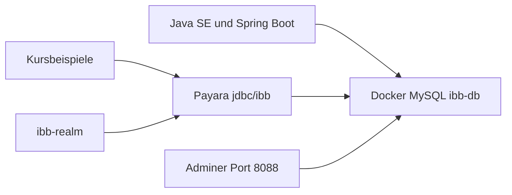

# Eine Datenbank, ein Payara-Pool

Payara unter `C:\payara6` hat heute kein JDBC-Connection-Pool. Das Realm `jwebak04Realm` zeigt auf `jdbc/jwebak04DS`, die es nicht gibt. In [web.xml](Java%20Web%20Aufbau/03-security/codebeispiel/src/main/webapp/WEB-INF/web.xml) heißt das Realm außerdem `jwebak_tag04_securityRealm`. Der MySQL-Treiber `mysql-connector-j-8.4.0.jar` liegt schon in `C:\payara6\glassfish\lib` und bleibt.

`domain1` bleibt (Ports 8080/4848, Admin `admin` / `adminadmin`, NetBeans-Registrierung). Zurückgesetzt werden deployte Anwendungen, das alte Realm und eventuell vorhandene JDBC-Ressourcen. Danach gibt es nur noch den Pool `ibb-pool`, die Ressource `jdbc/ibb` und das Realm `ibb-realm`.

H2-Übungen, `Spring Boot AK/06-actuator`, die Microservice-Compose-Datei, `Rheinwerk` und `Teilnehmerprojekte` bleiben unverändert. XAMPP wird nicht deinstalliert; der MySQL-Dienst muss gestoppt sein, damit Docker Port 3306 belegen kann.

## Docker

Neue Datei [docker/mysql/docker-compose.yml](docker/mysql/docker-compose.yml):

- Image `mysql:8.4`, Port `3306`, Datenbank `ibb-db`, User `ibb-user`, Passwort `ibb-pw`, Root-Passwort `ibb-root` (nur für die Container-Administration).
- Adminer auf Port **8088** (8080 ist Payara, 8081 nutzen Spring-Boot-Labs). Login: Server `mysql`, User `ibb-user`, Passwort `ibb-pw`, Datenbank `ibb-db`.
- Named Volume, Init-Skripte unter `docker/mysql/init/` legen nur die Tabellen an, die vor dem ersten Start da sein müssen:
  - `jwebak03_users` und `jwebak03_user_roles` mit den bestehenden SHA-256-Hashes (`admin123`, `manager123`, `user123`) aus [security-schema.sql](Java%20Web%20Aufbau/03-security/codebeispiel/src/main/webapp/WEB-INF/sql/security-schema.sql)
  - `jwebak02_customer` mit `test@example.com` / `test123` aus [schema.sql](Java%20Web%20Aufbau/02-auth/codebeispiel/src/main/webapp/WEB-INF/sql/schema.sql)
- JPA- und JDBC-Beispiele legen ihre eigenen Tabellen beim Start an. `drop-and-create` betrifft nur die Tabellen der jeweiligen Persistence Unit.

## Gemeinsame Zugangsdaten

Überall, wo ein IBB-Beispiel bisher eine eigene MySQL-/MariaDB-Datenbank nutzt:

- URL `jdbc:mysql://localhost:3306/ibb-db?useSSL=false&allowPublicKeyRetrieval=true&serverTimezone=UTC`
- User `ibb-user`, Passwort `ibb-pw`
- JNDI in allen Payara-Modulen: `jdbc/ibb` (`web.xml`, `@Resource`, JNDI-Lookup, `jta-data-source`)
- Realm-Name in `web.xml` und den Dashboard-Kommentaren: `ibb-realm`
- Die drei Spring-Boot-MySQL-Profile ([01-jpa](Spring%20Boot%20AK/01-jpa/codebeispiel/pom.xml), [02-jpa-relationen](Spring%20Boot%20AK/02-jpa-relationen/codebeispiel/pom.xml), [03-security](Spring%20Boot%20AK/03-security/codebeispiel/pom.xml)) tauschen `mariadb-java-client` gegen `mysql-connector-j` 8.4.0 und den Treiber `com.mysql.cj.jdbc.Driver`.

## Tabellenpräfixe

Präfix ist die Modulnummer. Bereits eindeutige `jwebak07_*`-Tabellen bleiben.

- `06-jdbc`: `jae06_personen`, `jae06_users`
- `07-jdbc-pool`: `jae07_personen`, `jae07_konten`
- `08-jpa`: `jae08_personen`
- `09-jpa-abfragen`: `jae09_personen`, `jae09_adressen`, `jae09_bestellungen`
- `10-integration`: `jae10_personen`
- `Java Web Basic/08-pools`: `jwebb08_products`
- `Java Web Basic/09-jdbc`: `jwebb09_products`
- `02-auth`: `jwebak02_customer`
- `03-security`: `jwebak03_users`, `jwebak03_user_roles`
- `05-jpa-jdbc`: `jwebak05_products`
- `06-many-to-one`: `jwebak06_authors`, `jwebak06_books`
- `08-jsf`: `jwebak08_products`
- `Spring Boot AK/01-jpa`: `jsprbak01_persons`
- `02-jpa-relationen`: `jsprbak02_persons`, `jsprbak02_addresses`, `jsprbak02_orders`
- `03-security`: `jsprbak03_users`, `jsprbak03_persons`, `jsprbak03_user_authorities`

Mitgezogen werden `codebeispiel`, `uebung-stufe-*`, `loesung` und die SQL-Dateien. `CREATE DATABASE` / `USE` entfallen. Tests, die den alten JNDI-Namen oder das alte `INSERT` prüfen, bekommen dieselben neuen Namen.

## Payara

Neues Skript [docker/payara/configure-ibb.ps1](docker/payara/configure-ibb.ps1), ausgeführt gegen die laufende Domain:

- Alle Anwendungen undeployen.
- Realm `jwebak04Realm` löschen, vorhandene JDBC-Ressourcen und Pools löschen.
- Pool `ibb-pool` mit `com.mysql.cj.jdbc.MysqlDataSource` auf `localhost:3306` / `ibb-db` / `ibb-user` / `ibb-pw`.
- Ressource `jdbc/ibb`.
- Realm `ibb-realm` (`JDBCRealm`, `jaas-context=jdbcRealm`, Digest `SHA-256`, Encoding `Hex`, Tabellen `jwebak03_users` / `jwebak03_user_roles`).
- Domain neu starten und `ping-connection-pool ibb-pool` ausführen.

## Doku

Kurzer Abschnitt in [docs/ide-maven.md](docs/ide-maven.md) und ein Satz in [README.md](README.md): `docker compose up -d` in `docker/mysql`, Adminer unter `http://localhost:8088`, Zugangsdaten, Pool `jdbc/ibb`, Realm `ibb-realm`. Modul-READMEs, die noch `jae_tag*`, `jwebb_tag*`, `jwebak_tag*` oder `jsprbak_tag*` nennen, zeigen danach `ibb-db` und das jeweilige Tabellenpräfix.

## Prüfung

- XAMPP-MySQL gestoppt, Container laufen, Login in Adminer auf `ibb-db`.
- `asadmin list-jdbc-connection-pools` zeigt `ibb-pool`, `list-auth-realms` zeigt `ibb-realm` und nicht mehr `jwebak04Realm`, Ping ist erfolgreich.
- Realm-Tabellen und der Demo-Kunde `test@example.com` sind in Adminer sichtbar.
