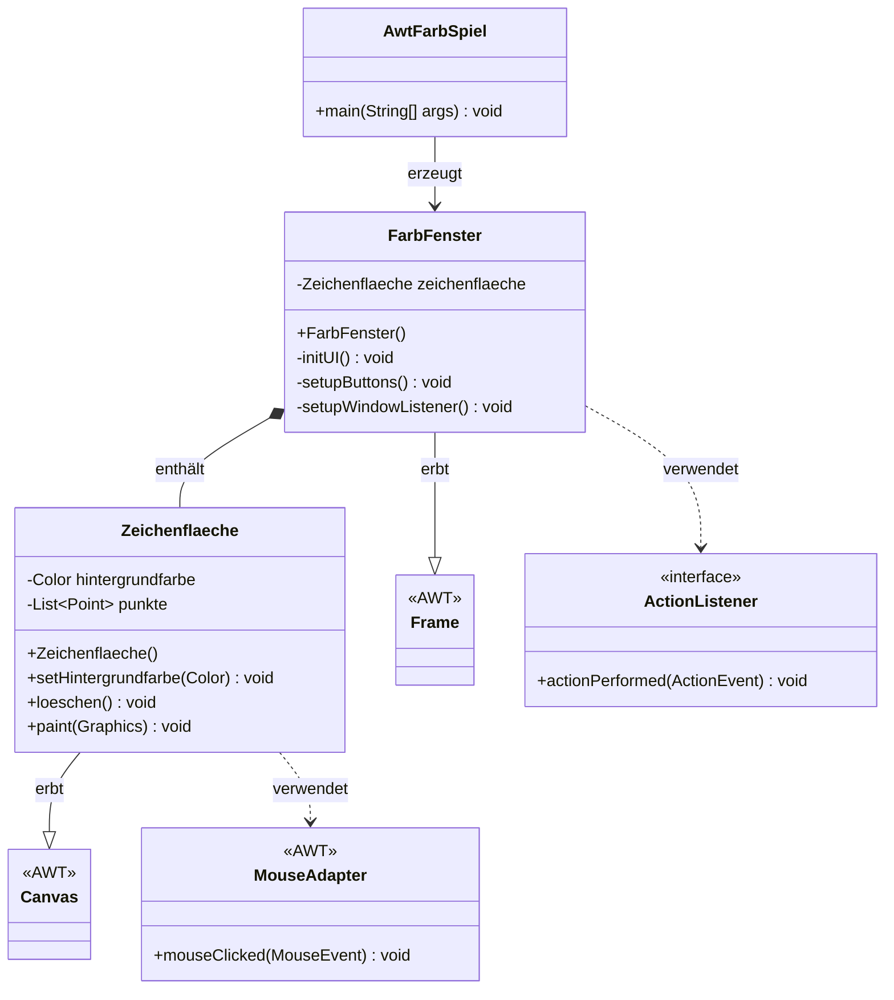
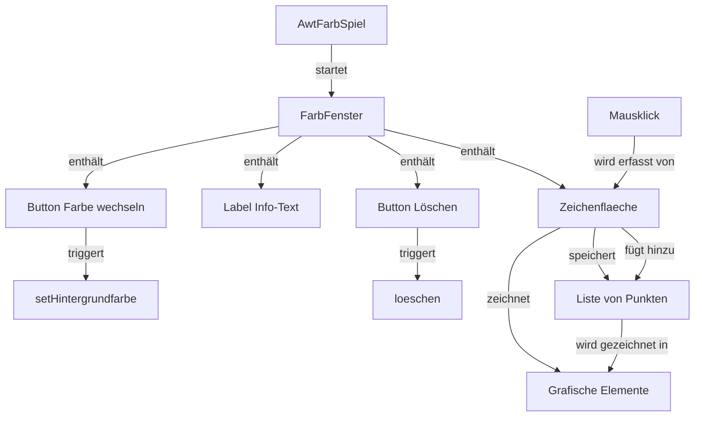
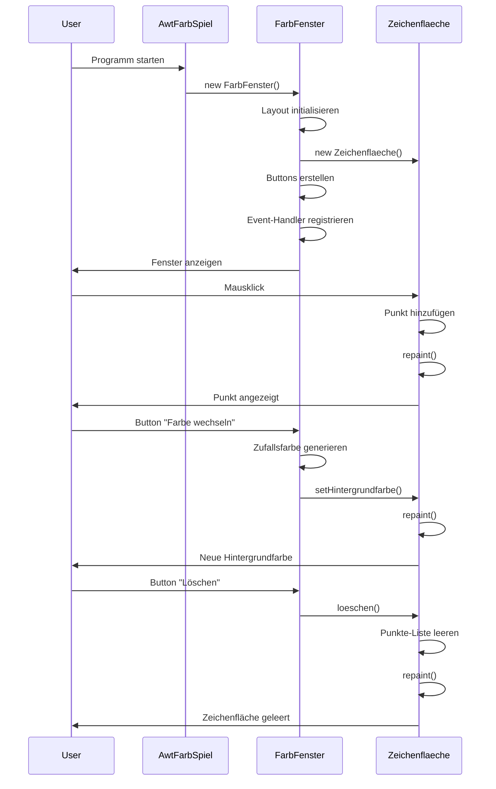

# AWT Farbspiel

Ein interaktives Java-AWT-Anwendungsbeispiel, das die Grundlagen der grafischen Benutzeroberfläche demonstriert. Das Programm bietet eine Zeichenfläche, auf der Benutzer durch Mausklicks Punkte setzen können. Zusätzlich können die Hintergrundfarbe zufällig geändert und alle Punkte gelöscht werden.

## Projektübersicht

Das Projekt besteht aus drei Hauptklassen, die zusammen eine einfache interaktive Zeichenanwendung bilden:

- **AwtFarbSpiel**: Einstiegspunkt der Anwendung
- **FarbFenster**: Hauptfenster mit Benutzeroberfläche
- **Zeichenflaeche**: Interaktive Zeichenfläche für Mausinteraktionen

## Klassenstruktur

### Klassendiagramm



### Komponentenbeziehungen



## Funktionsweise

### Programmablauf



### Hauptfunktionen

1. **Punkte setzen**: Durch Klicken auf die Zeichenfläche werden die Koordinaten gespeichert und als kleine Kreise dargestellt.

2. **Hintergrundfarbe ändern**: Der Button "Farbe wechseln" generiert eine zufällige RGB-Farbe und setzt diese als Hintergrund der Zeichenfläche.

3. **Punkte löschen**: Der Button "Löschen" entfernt alle gespeicherten Punkte und aktualisiert die Anzeige.

4. **Vordefinierte Formen**: Die Zeichenfläche zeigt zusätzlich zu den interaktiven Punkten einige vordefinierte grafische Elemente (Rechteck, Oval, Linie, Text).

## Projektstruktur

```
01-AwTFarbSpiel/
├── src/
│   └── awtfarbspiel/
│       ├── AwtFarbSpiel.java      # Einstiegspunkt
│       ├── FarbFenster.java       # Hauptfenster
│       └── Zeichenflaeche.java    # Zeichenfläche
├── test/                          # Test-Verzeichnis
├── build.xml                      # Ant-Build-Datei
└── README.md                      # Diese Datei
```

## Technische Details

### Verwendete AWT-Komponenten

- **Frame**: Hauptfenster der Anwendung
- **Canvas**: Zeichenfläche für grafische Operationen
- **BorderLayout**: Layout-Manager für die Anordnung der Komponenten
- **Button**: Schaltflächen für Benutzerinteraktionen
- **Label**: Textanzeige für Informationen
- **Panel**: Container für Button-Gruppierung

### Event-Handling

- **ActionListener**: Reagiert auf Button-Klicks
- **MouseAdapter**: Erfasst Mausklicks auf der Zeichenfläche
- **WindowAdapter**: Behandelt Fenster-Schließ-Ereignisse

### Grafik-Operationen

Die `paint()`-Methode der `Zeichenflaeche` zeichnet:
- Hintergrundfläche mit aktueller Hintergrundfarbe
- Vordefinierte Formen (Rechteck, Oval, Linie, Text)
- Alle gespeicherten Klick-Punkte als kleine Kreise

## Kompilierung und Ausführung

### Voraussetzungen

- Java Development Kit (JDK) 8 oder höher

### Kompilierung

```bash
javac -d build src/awtfarbspiel/*.java
```

### Ausführung

```bash
java -cp build awtfarbspiel.AwtFarbSpiel
```

### Alternative: NetBeans

Das Projekt ist als NetBeans-Projekt konfiguriert. Öffnen Sie das Projekt in NetBeans und führen Sie es über die IDE aus.

## Verwendung

1. **Programm starten**: Führen Sie die Anwendung aus, um das Fenster zu öffnen.

2. **Punkte setzen**: Klicken Sie mit der Maus auf die Zeichenfläche, um Punkte zu platzieren.

3. **Farbe ändern**: Klicken Sie auf "Farbe wechseln", um eine zufällige Hintergrundfarbe zu setzen.

4. **Löschen**: Klicken Sie auf "Löschen", um alle gesetzten Punkte zu entfernen.

5. **Fenster schließen**: Schließen Sie das Fenster über das X-Symbol oder die Fenstersteuerung.

## Lernziele

Dieses Projekt demonstriert:

- Grundlagen der AWT-Programmierung
- Erstellung von grafischen Benutzeroberflächen
- Event-Handling in Java
- Grafische Operationen mit der Graphics-API
- Layout-Management
- Objektorientierte Programmierung mit Komposition
