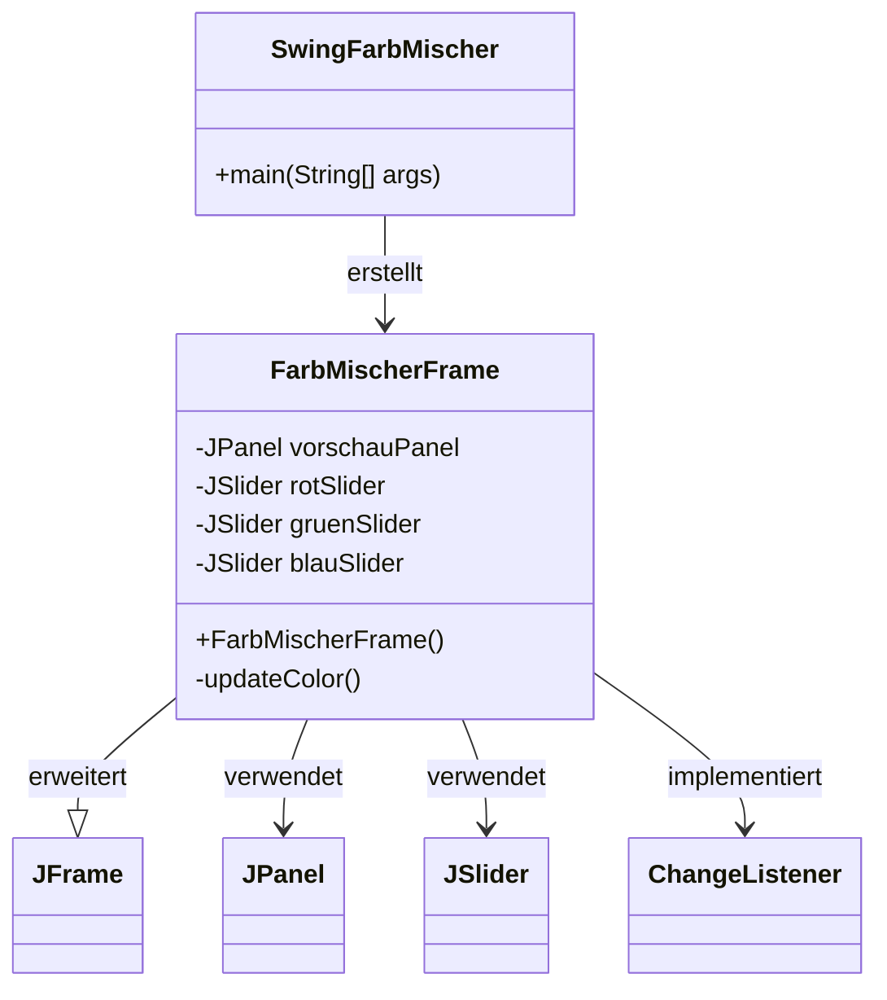
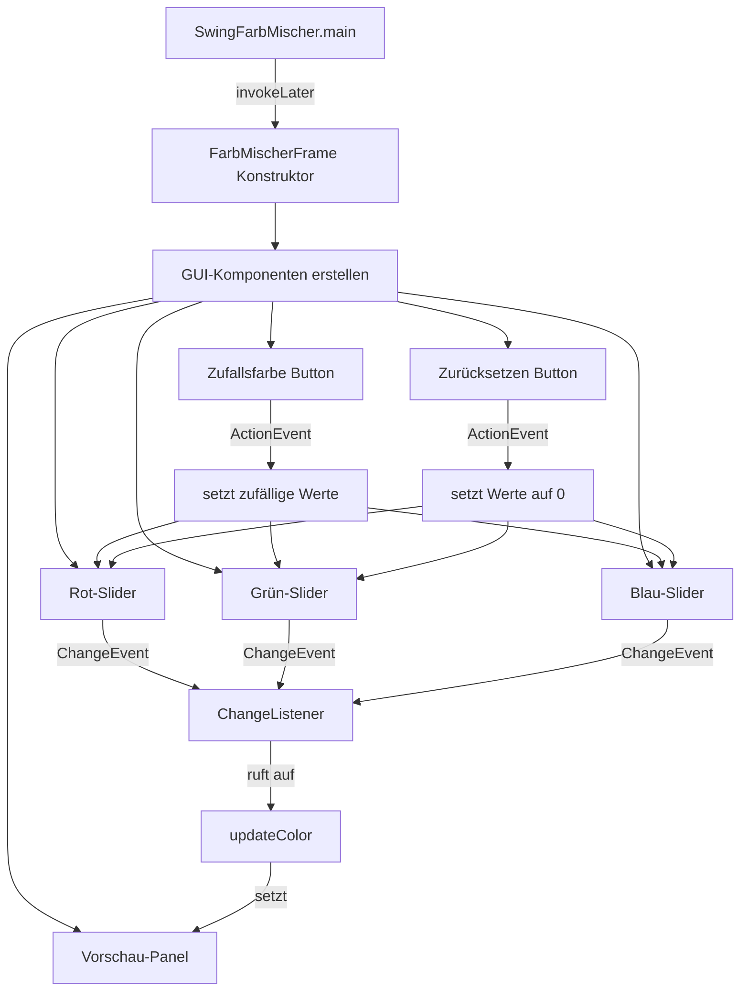
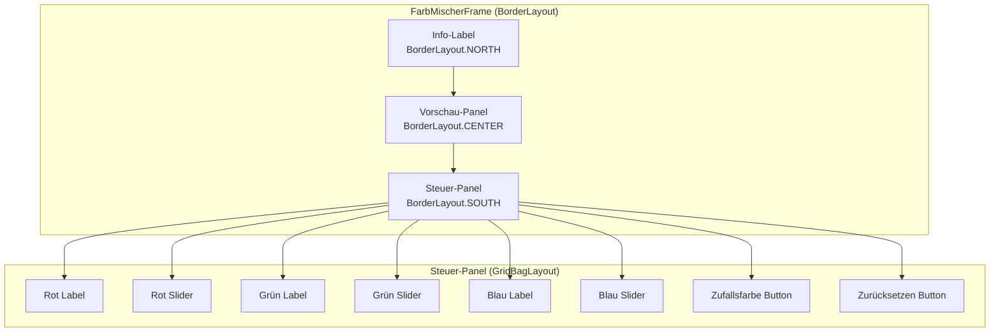

# Swing Farbmischer

Ein Java Swing-Anwendung zum interaktiven Mischen von RGB-Farben. Die Anwendung bietet eine intuitive grafische Benutzeroberfläche mit Reglern (Sliders) zur Einstellung der Rot-, Grün- und Blau-Werte sowie Funktionen zum Erzeugen von Zufallsfarben und zum Zurücksetzen.

## Übersicht

Der Swing Farbmischer ist eine einfache Desktop-Anwendung, die es Benutzern ermöglicht, durch Anpassung von RGB-Werten (0-255) Farben zu mischen und in Echtzeit zu visualisieren. Die Anwendung demonstriert die Verwendung von Java Swing-Komponenten, Event-Handling und das RGB-Farbmodell.

## Funktionalität

- **RGB-Farbmischung**: Drei separate Slider für Rot-, Grün- und Blau-Werte (0-255)
- **Echtzeit-Vorschau**: Sofortige Anzeige der gemischten Farbe in einem Vorschau-Panel
- **Zufallsfarbe**: Button zum Generieren einer zufälligen RGB-Farbe
- **Zurücksetzen**: Button zum Zurücksetzen aller Werte auf 0 (Schwarz)

## Projektstruktur

```
01-SwingFarbMischer/
├── src/
│   └── swingfarbmischer/
│       ├── SwingFarbMischer.java    # Hauptklasse (Entry Point)
│       └── FarbMischerFrame.java    # GUI-Klasse (JFrame)
├── build/
│   └── classes/                     # Kompilierte Klassen
├── nbproject/                       # NetBeans Projekt-Konfiguration
├── build.xml                        # Ant Build-Script
└── manifest.mf                     # Manifest-Datei
```

## Architektur

### Klassen-Diagramm



### Komponenten-Interaktion



### GUI-Layout



## Verwendung

### Kompilierung und Ausführung

1. **Mit NetBeans IDE:**
   - Projekt in NetBeans öffnen
   - `Run` → `Run Project` (F6)

2. **Mit Ant (Kommandozeile):**
   ```bash
   ant compile
   ant run
   ```

3. **Manuell:**
   ```bash
   javac -d build/classes src/swingfarbmischer/*.java
   java -cp build/classes swingfarbmischer.SwingFarbMischer
   ```

### Bedienung

1. **Farben mischen:**
   - Bewegen Sie die Slider für Rot, Grün und Blau
   - Die Vorschau aktualisiert sich automatisch in Echtzeit

2. **Zufallsfarbe:**
   - Klicken Sie auf den "Zufallsfarbe"-Button
   - Alle drei Slider werden auf zufällige Werte gesetzt

3. **Zurücksetzen:**
   - Klicken Sie auf den "Zurücksetzen"-Button
   - Alle Werte werden auf 0 gesetzt (Schwarz)

## Technische Details

### Event-Handling

Die Anwendung nutzt das Observer-Pattern für Event-Handling:

- **ChangeListener**: Wird von allen drei Slidern verwendet, um Änderungen zu erkennen
- **ActionListener**: Wird von den Buttons verwendet (Lambda-Ausdrücke)

### Thread-Sicherheit

Die GUI wird korrekt im Event-Dispatch-Thread (EDT) erstellt:

```java
SwingUtilities.invokeLater(new Runnable() {
    @Override
    public void run() {
        new FarbMischerFrame();
    }
});
```

### RGB-Farbmodell

Die Anwendung verwendet das RGB-Farbmodell:
- **R (Rot)**: 0-255
- **G (Grün)**: 0-255
- **B (Blau)**: 0-255

Die finale Farbe wird durch die Kombination dieser drei Werte erzeugt:
```java
Color c = new Color(r, g, b);
```

## Abhängigkeiten

- **Java**: JDK 8 oder höher
- **Java Swing**: Teil der Standard-Java-Bibliothek (keine externen Abhängigkeiten)

## Entwickelt mit

- Java Swing (GUI-Framework)
- NetBeans IDE (Entwicklungsumgebung)
- Apache Ant (Build-Tool)

## Lizenz

Dieses Projekt ist Teil eines Java-Entwicklungskurses.
