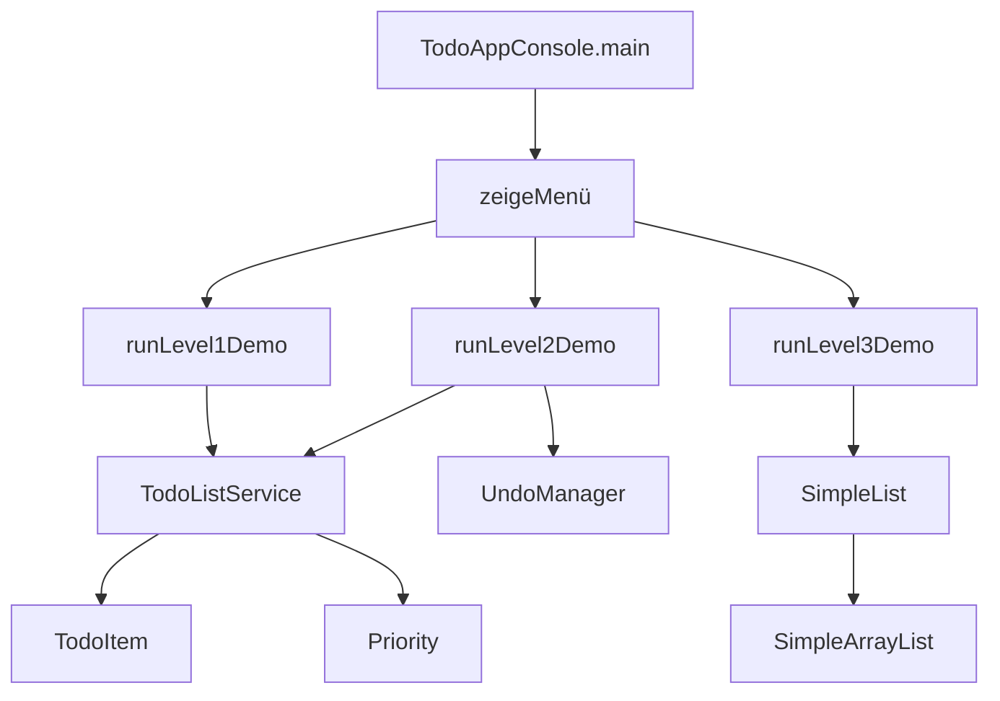

## Ziel

**Alle drei Challenge-Stufen (Level 1–3) der ToDo-/Listen-Mini-Challenge aus `Tag 1: Listen – Dein Upgrade von Arrays` als Java-11-Konsolenprogramm in deinem bestehenden Projekt nachbauen.**

Die drei Level:

- **Level 1**: Einfache ToDo-Liste mit `ArrayList`, Hinzufügen/Anzeigen/Entfernen, erledigte Tasks in zweiter Liste.
- **Level 2**: Erweiterung mit **Priorität** (HIGH/MEDIUM/LOW), **Sortierung nach Priorität**, **Undo-Funktion** mit zweiter Liste.
- **Level 3**: Eigene `SimpleList`-Klasse (ohne `ArrayList` intern zu verwenden), Methoden `add`, `get`, `remove`, `size`, `contains` + Unit-Tests, optional `Iterable`.

---

## Grobe Architektur

- **Paketstruktur**
  - `de.ibb.collections.todo` (oder ähnlich) für alle Klassen der Challenge.
  - Unterteilung nach Verantwortlichkeiten:
    - `model` (z.B. `TodoItem`, `Priority`)
    - `logic` (z.B. `TodoListService`, `UndoManager`)
    - `simplelist` (z.B. `SimpleList`, `SimpleArrayList`, Tests)
    - `ui` (z.B. `TodoAppConsole` mit `main`-Methode oder separater `Main` in vorhandener Struktur).

- **Konsolen-UI**
  - Ein zentrales `main`-Programm (z.B. `[src/...]/TodoAppConsole.java`), das per Textmenü **Level 1–3** auswählbar macht:
    - "1: Level 1 Demo / 2: Level 2 Demo / 3: Level 3 Demo / 0: Beenden".
  - Für jedes Level eine eigene Ablaufmethode (z.B. `runLevel1Demo()`, `runLevel2Demo()`, `runLevel3Demo()`), die die jeweiligen Features kurz demonstriert (statt eines aufwändigen interaktiven Menüs).

---

## Level 1 – Einsteiger-ToDo-Liste

- **Datenmodell**
  - `TodoItem` mit Feldern: `String description`, `boolean done` (optional in Level 1) oder nur Beschreibung.
  - Zwei Listen im Service:
    - `List<TodoItem> openTasks = new ArrayList<>();`
    - `List<TodoItem> completedTasks = new ArrayList<>();`

- **Logikklasse `TodoListService` (Basis)**
  - Methoden z.B.:
    - `void addTask(String description)` – erstellt `TodoItem`, fügt zu `openTasks` hinzu.
    - `List<TodoItem> getOpenTasks()` – unveränderliche Ansicht oder Kopie.
    - `List<TodoItem> getCompletedTasks()`.
    - `boolean completeTask(int index)` – verschiebt von `openTasks` nach `completedTasks`.
    - `boolean removeOpenTask(int index)` – entfernt offen Task komplett.

- **Konsolendemonstration für Level 1**
  - In `runLevel1Demo()` exemplarisch einige Tasks hinzufügen, anzeigen, einen erledigen und verschieben.
  - Ausgabe klar kommentieren, damit der Zusammenhang zur Challenge erkennbar ist.

---

## Level 2 – Fortgeschritten (Prioritäten & Undo)

- **Erweiterung des Modells**
  - Enum `Priority { HIGH, MEDIUM, LOW }`.
  - `TodoItem` um Feld `Priority priority` erweitern + sinnvolle `toString()`-Darstellung.

- **Logikerweiterung `TodoListService`**
  - Überladene Methode `addTask(String description, Priority priority)`.
  - Sortierfunktion, z.B. `void sortByPriority()` oder `List<TodoItem> getOpenTasksSortedByPriority()` mit `Comparator`:
    - Reihenfolge: HIGH vor MEDIUM vor LOW.
  - Anpassung, dass bestehende Methoden mit Prioritäten weiter funktionieren (Default z.B. `MEDIUM`).

- **Undo-Funktion (z.B. `UndoManager`)**
  - Einfache Implementierung mit zweiter Liste oder Stack-artiger Struktur:
    - `List<UndoAction> undoStack = new ArrayList<>();`
    - `UndoAction` als kleines Interface/Klasse mit Information, wie eine Aktion rückgängig gemacht werden kann (z.B. Typ ENUM + Referenzen).
  - Unterstützte Undo-Typen (mindestens):
    - Hinzufügen eines Tasks: Undo = Task wieder entfernen.
    - Entfernen/Abschließen eines Tasks: Undo = Task zurück an ursprüngliche Position.
  - Methode `boolean undoLastAction()` im Service oder separaten `UndoManager`, der mit `TodoListService` kooperiert.

- **Konsolendemonstration für Level 2**
  - In `runLevel2Demo()` zeigen:
    - Hinzufügen von Tasks mit unterschiedlichen Prioritäten.
    - Anzeige sortiert nach Priorität.
    - Durchführung von 1–2 Aktionen und anschließendes `undoLastAction()` mit Ausgabe vorher/nachher.

---

## Level 3 – Eigene `SimpleList` + Tests

- **Interface `SimpleList<E>`**
  - Im Paket `simplelist` definieren, **ohne** direkte Abhängigkeit von `java.util.List` in der öffentlichen API:
    - `void add(E element);`
    - `E get(int index);`
    - `E remove(int index);`
    - `int size();`
    - `boolean contains(E element);`
  - Optional: `extends Iterable<E>` für den Bonus.

- **Implementierung `SimpleArrayList<E>`** (Name frei wählbar, intern mit einfachem Array)
  - Internes Feld `Object[] elements` + `int size`.
  - Dynamische Vergrößerung ähnlich `ArrayList` (z.B. Verdopplung der Kapazität bei Bedarf):
    - neue Kapazität berechnen, `System.arraycopy` verwenden.
  - Methoden-Implementierung mit Indexprüfungen (eigene `IndexOutOfBoundsException` oder Standard).
  - `contains` mittels Schleife über vorhandene Elemente (`equals`-Vergleich, mit `null`-Handling).
  - Optional `Iterator`-Implementierung, falls `Iterable` umgesetzt wird.

- **Nutzung von `SimpleList` in einer kleinen Demo**
  - In `runLevel3Demo()` z.B. eine `SimpleList<String>` anlegen, einige Elemente hinzufügen, ausgeben, Elemente entfernen, `contains` demonstrieren.
  - Hinweis im Kommentar, dass hier bewusst **kein** `ArrayList` für die interne Struktur verwendet wird.

- **Unit-Tests**
  - Falls im Projekt bereits eine Test-Struktur (`test`-Quellordner, JUnit) vorhanden ist, Tests dort ergänzen (z.B. `[test/...]/SimpleArrayListTest.java`).
  - Mindestens folgende Testfälle:
    - `add` und `size` (inkl. Kapazitätserweiterung – z.B. > 10 Elemente).
    - `get` mit gültigen und ungültigen Indizes.
    - `remove` (am Anfang, in der Mitte, am Ende) + Größenanpassung.
    - `contains` mit vorhandenen/nicht vorhandenen und `null`-Werten (falls erlaubt).
  - Falls keine Testumgebung vorhanden, alternativ eine einfache manuelle Testklasse `SimpleListTestMain` mit Assertions/`System.out.println`.

---

## Integration in dein bestehendes NetBeans-Projekt

- **Dateianlage**
  - Neue Klassen im `src`-Ordner des vorhandenen Projekts anlegen, z.B.:
    - `[src/...]/de/javakurs/collections/todo/TodoItem.java`
    - `[src/...]/de/javakurs/collections/todo/Priority.java`
    - `[src/...]/de/javakurs/collections/todo/TodoListService.java`
    - `[src/...]/de/javakurs/collections/todo/UndoManager.java` (optional, falls nicht direkt im Service)
    - `[src/...]/de/javakurs/collections/todo/ui/TodoAppConsole.java `(mit `main` und Menü).
    - `[src/...]/de/javakurs/collections/todo/simplelist/SimpleList.java`
    - `[src/...]/de/javakurs/collections/todo/simplelist/SimpleArrayList.java`
    - `[test/...]/de/javakurs/collections/todo/simplelist/SimpleArrayListTest.java` (falls Teststruktur existiert).

- **Kompabilität mit Java 11+**
  - Verwendung moderner Features ist erlaubt, aber moderat halten:
    - `var` für lokale Variablen, wo es die Lesbarkeit erhöht.
    - `List.of(...)` in Demos/Tests, nicht im Kern der Challenge-Logik (da der Artikel es eher als Feature vorstellt).

- **Dokumentation im Code**
  - Kurze Javadoc-/Kommentarblöcke an den zentralen Stellen, die explizit Bezug auf die Challenge herstellen, z.B. `// Entspricht Level 2 – Undo-Funktion der Mini-Challenge`.

---

## Wie es nach Plan weitergeht

1. **Projektstruktur prüfen**: Paketnamen und evtl. schon vorhandene Klassen im NetBeans-Projekt ansehen, um die neuen Klassen sauber einzuordnen.
2. **Level 1 implementieren**: `TodoItem`, `TodoListService` (Basis) und `TodoAppConsole.runLevel1Demo()` umsetzen und kurz manuell laufen lassen.
3. **Level 2 erweitern**: `Priority`, Sortierung, Undo-Funktion ergänzen und in `runLevel2Demo()` demonstrieren.
4. **Level 3 umsetzen**: `SimpleList`-Interface, `SimpleArrayList`-Implementierung, Konsolen-Demo und Tests erstellen.
5. **Feinschliff**: Konsolenausgaben aufräumen, deutsche Labels/Texte an den Artikel anlehnen, optional kurze README-Notiz im Projekt (oder Kommentar in `TodoAppConsole`), was zu welcher Challenge-Stufe gehört.