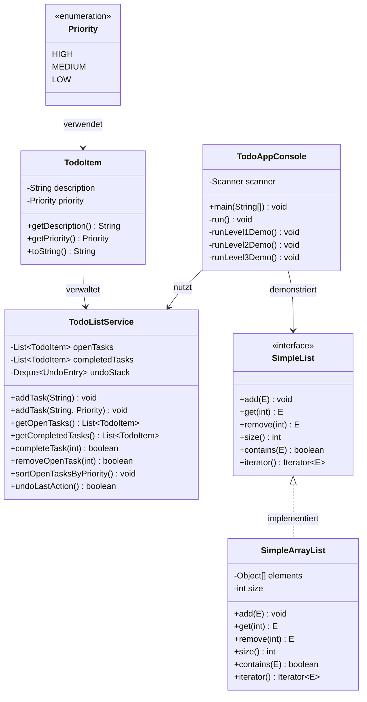
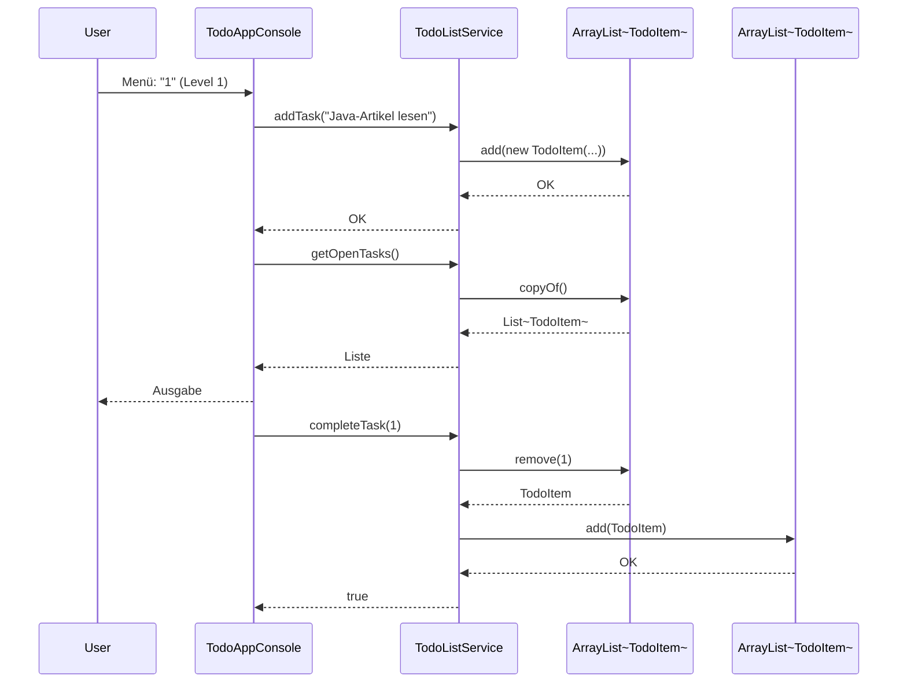
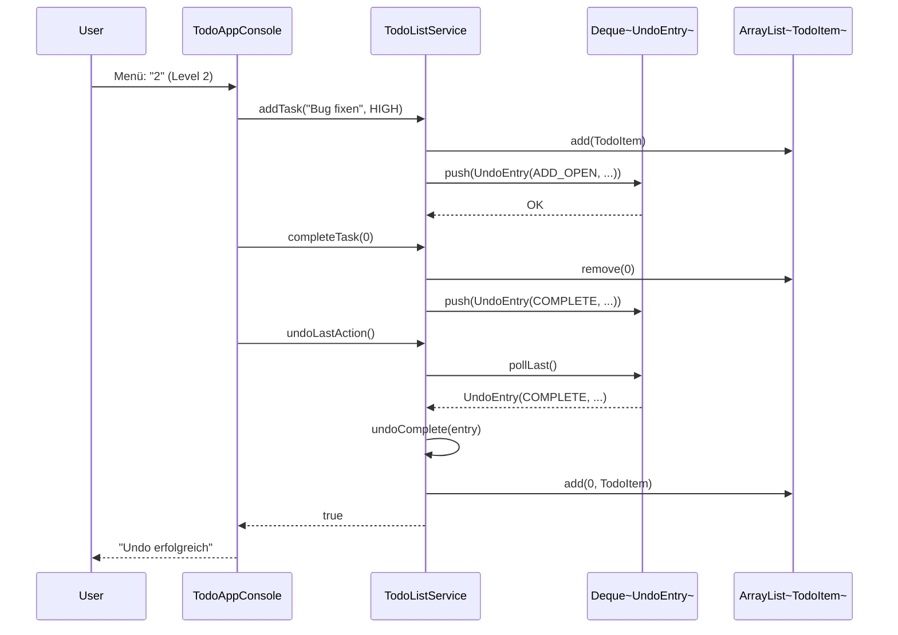

# Tag 1: Listen – Mini-Challenge

Dieses Projekt implementiert die **Mini-Challenge aus "Tag 1: Listen – Dein Upgrade von Arrays"** als vollständige Java-Anwendung mit drei aufsteigenden Schwierigkeitsgraden.

## 📋 Inhaltsverzeichnis

- [Überblick](#überblick)
- [Projektstruktur](#projektstruktur)
- [Die drei Challenge-Level](#die-drei-challenge-level)
- [Installation & Build](#installation--build)
- [Nutzung](#nutzung)
- [Architektur](#architektur)

---

## Überblick

Die Mini-Challenge demonstriert den Übergang von statischen Arrays zu dynamischen Collections am Beispiel einer **ToDo-Listen-Anwendung**. Das Projekt ist in drei aufeinander aufbauende Level unterteilt:

- **🟢 Level 1**: Einfache ToDo-Liste mit zwei `ArrayList`s (offen/erledigt)
- **🟡 Level 2**: Erweiterung um Prioritäten, Sortierung und Undo-Funktion
- **🔵 Level 3**: Eigene `SimpleList`-Implementierung ohne Verwendung von `ArrayList`

### Technische Details

- **Java-Version**: 11+
- **Build-Tool**: Apache Ant
- **IDE**: NetBeans-kompatibel
- **Paketstruktur**: `de.ibb.collections.todo.*`

---

## Projektstruktur

```
01-collections-lists/
├── src/
│   └── de/javakurs/collections/todo/
│       ├── model/
│       │   ├── Priority.java          # Enum: HIGH, MEDIUM, LOW
│       │   └── TodoItem.java          # Datenmodell für Aufgaben
│       ├── logic/
│       │   └── TodoListService.java   # Zentrale Geschäftslogik
│       ├── ui/
│       │   └── TodoAppConsole.java    # Konsolen-UI mit main()
│       └── simplelist/
│           ├── SimpleList.java        # Interface (Level 3)
│           ├── SimpleArrayList.java   # Implementierung (Level 3)
│           └── SimpleListTestMain.java # Tests für SimpleList
├── build.xml                          # Ant-Build-Konfiguration
├── nbproject/                         # NetBeans-Projektdateien
└── README.md                          # Diese Datei
```

---

## Die drei Challenge-Level

### 🟢 Level 1: Einsteiger – Basis ToDo-Liste

**Ziel**: Implementierung einer einfachen ToDo-Liste mit zwei `ArrayList`s zur Verwaltung offener und erledigter Aufgaben.

**Features**:
- Aufgaben hinzufügen (`addTask(String description)`)
- Offene Aufgaben anzeigen (`getOpenTasks()`)
- Erledigte Aufgaben anzeigen (`getCompletedTasks()`)
- Aufgabe als erledigt markieren (`completeTask(int index)`)
- Aufgabe entfernen (`removeOpenTask(int index)`)

**Implementierung**:
- `TodoItem`: Datenmodell mit Beschreibung
- `TodoListService`: Verwaltet zwei separate `ArrayList<TodoItem>`
  - `openTasks`: Liste der offenen Aufgaben
  - `completedTasks`: Liste der erledigten Aufgaben

**Demo**: `TodoAppConsole.runLevel1Demo()`

---

### 🟡 Level 2: Fortgeschritten – Prioritäten & Undo

**Ziel**: Erweiterung der ToDo-Liste um Prioritäten, Sortierung und eine Undo-Funktion.

**Features**:
- Aufgaben mit Priorität hinzufügen (`addTask(String, Priority)`)
- Sortierung nach Priorität (HIGH > MEDIUM > LOW)
- Undo-Funktion für die letzten Aktionen (`undoLastAction()`)

**Implementierung**:
- `Priority`: Enum mit Werten `HIGH`, `MEDIUM`, `LOW`
- `TodoItem`: Erweitert um `Priority`-Feld
- `TodoListService`: 
  - Sortierung via `Comparator.comparing(TodoItem::getPriority)`
  - Undo-Stack (`Deque<UndoEntry>`) für Rückgängigmachen von:
    - Hinzufügen einer Aufgabe
    - Als erledigt markieren
    - Entfernen einer Aufgabe

**Demo**: `TodoAppConsole.runLevel2Demo()`

---

### 🔵 Level 3: Profi – Eigene SimpleList-Implementierung

**Ziel**: Implementierung einer eigenen Listen-Struktur **ohne** Verwendung von `java.util.ArrayList` intern.

**Features**:
- Interface `SimpleList<E>` mit Methoden:
  - `void add(E element)`
  - `E get(int index)`
  - `E remove(int index)`
  - `int size()`
  - `boolean contains(E element)`
  - `Iterator<E> iterator()` (via `Iterable<E>`)

**Implementierung**:
- `SimpleArrayList<E>`: 
  - Internes `Object[]` Array als Backing-Storage
  - Dynamische Vergrößerung (Verdopplung bei Bedarf)
  - Index-basierte Zugriffe mit Bounds-Checking
  - `Iterator`-Implementierung für `Iterable`

**Tests**: `SimpleListTestMain` mit manuellen Testfällen

**Demo**: `TodoAppConsole.runLevel3Demo()` (verweist auf `SimpleListTestMain`)

---

## Installation & Build

### Voraussetzungen

- **JDK 11 oder höher**
- **Apache NetBeans** (optional, aber empfohlen)
- **Apache Ant** (in NetBeans enthalten)

### Projekt öffnen

1. **NetBeans**:
   - `Datei` → `Projekt öffnen...`
   - Ordner `01-collections-lists` auswählen
   - Projekt wird automatisch erkannt

2. **Manuell (Ant)**:
   ```bash
   cd "01-collections-lists"
   ant compile    # Kompilieren
   ant run        # Ausführen
   ant jar        # JAR erstellen
   ant clean      # Aufräumen
   ```

### Build-Ziele

| Ziel | Beschreibung |
|------|--------------|
| `compile` | Kompiliert alle Java-Quellen nach `build/classes/` |
| `run` | Führt `TodoAppConsole` aus |
| `jar` | Erstellt ausführbares JAR in `dist/` |
| `clean` | Löscht `build/` und `dist/` |
| `rebuild` | `clean` + `compile` |

---

## Nutzung

### Konsolen-Anwendung starten

**NetBeans**:
1. Rechtsklick auf `TodoAppConsole.java`
2. `Datei ausführen` wählen
3. Oder: `Ausführen` → `Projekt ausführen` (F6)

**Kommandozeile**:
```bash
ant run
```

### Menü-Navigation

Nach dem Start erscheint ein Textmenü:

```
========================================
 Tag 1: Listen – Mini-Challenge (Konsole)
========================================
1 - Level 1: Einsteiger (ToDo-Liste)
2 - Level 2: Fortgeschritten (Prioritäten & Undo)
3 - Level 3: Profi (SimpleList-Implementierung)
0 - Beenden
Auswahl: 
```

**Eingabe**:
- `1`: Führt Level-1-Demo aus (Basis ToDo-Liste)
- `2`: Führt Level-2-Demo aus (Prioritäten & Undo)
- `3`: Zeigt Hinweis zu Level-3-Implementierung
- `0`: Beendet die Anwendung

Nach jeder Demo: Enter drücken, um zum Hauptmenü zurückzukehren.

### SimpleList-Tests ausführen

**NetBeans**:
- Rechtsklick auf `SimpleListTestMain.java` → `Datei ausführen`

**Kommandozeile**:
```bash
ant compile
java -cp build/classes de.ibb.collections.todo.simplelist.SimpleListTestMain
```

---

## Architektur

### Klassendiagramm



### Datenfluss Level 1



### Datenfluss Level 2 (Undo)



### SimpleList-Interna (Level 3)

```mermaid
graph TD
    A[SimpleList.add element] --> B{Array voll?}
    B -->|Ja| C[Neues Array erstellen<br/>Kapazität verdoppeln]
    B -->|Nein| D[Element an Index size<br/>hinzufügen]
    C --> E[System.arraycopy<br/>alte Elemente kopieren]
    E --> D
    D --> F[size++]
    
    G[SimpleList.get index] --> H{Index gültig?}
    H -->|Nein| I[IndexOutOfBoundsException]
    H -->|Ja| J[return elements[index]]
    
    K[SimpleList.remove index] --> L{Index gültig?}
    L -->|Nein| M[IndexOutOfBoundsException]
    L -->|Ja| N[Element speichern]
    N --> O[Elemente nach links<br/>verschieben]
    O --> P[size--]
    P --> Q[return gespeichertes Element]
```

---

## Code-Beispiele

### Level 1: Einfache ToDo-Liste

```java
TodoListService service = new TodoListService();

// Aufgaben hinzufügen
service.addTask("Java-Artikel lesen");
service.addTask("Mini-Challenge nachbauen");

// Aufgaben anzeigen
List<TodoItem> open = service.getOpenTasks();
List<TodoItem> done = service.getCompletedTasks();

// Aufgabe als erledigt markieren
service.completeTask(0); // Verschiebt von openTasks nach completedTasks
```

### Level 2: Prioritäten & Undo

```java
TodoListService service = new TodoListService();

// Aufgaben mit Priorität hinzufügen
service.addTask("Bug fixen", Priority.HIGH);
service.addTask("Dokumentation", Priority.LOW);

// Nach Priorität sortiert anzeigen
List<TodoItem> sorted = service.getOpenTasksSortedByPriority();

// Undo: Letzte Aktion rückgängig machen
service.completeTask(0);
service.undoLastAction(); // Aufgabe ist wieder offen
```

### Level 3: SimpleList

```java
SimpleList<String> list = new SimpleArrayList<>();

// Elemente hinzufügen
list.add("Erstes Element");
list.add("Zweites Element");

// Zugriff per Index
String first = list.get(0);

// Größe abfragen
int size = list.size();

// Element entfernen
String removed = list.remove(0);

// Prüfen ob enthalten
boolean contains = list.contains("Zweites Element");

// Iteration
for (String item : list) {
    System.out.println(item);
}
```

---

## Lernziele

Nach Abschluss dieser Mini-Challenge solltest du:

- ✅ `ArrayList` vs. Arrays verstehen und anwenden können
- ✅ Zwei separate Listen zur Datenorganisation nutzen können
- ✅ `Priority`-Enums und `Comparator` für Sortierung einsetzen können
- ✅ Eine einfache Undo-Funktion mit Stack-Struktur implementieren können
- ✅ Eine eigene Listen-Implementierung mit dynamischem Array erstellen können
- ✅ `Iterable` und `Iterator` verstehen und implementieren können

---

## Quellen & Referenzen

- **Original-Artikel**: [Tag 1: Listen – Dein Upgrade von Arrays](https://www.java-developer.online/tag-1-listen-dein-upgrade-von-arrays/)
- **Java Collections Framework**: [Oracle Java Tutorials](https://docs.oracle.com/javase/tutorial/collections/)
- **ArrayList API**: [Java 11 ArrayList](https://docs.oracle.com/en/java/javase/11/docs/api/java.base/java/util/ArrayList.html)

---

## Lizenz & Hinweise

Dieses Projekt ist Teil des Kurses **"Java Erweiterte Techniken"** und dient ausschließlich zu Lernzwecken.

**Autor**: Implementierung basierend auf der Mini-Challenge von Java Fleet Systems Consulting.

---

## Troubleshooting

### "Switch-Regeln werden in -source 11 nicht unterstützt"

**Lösung**: Der Code verwendet bereits klassische `switch`-Syntax (ohne `->`). Falls Fehler auftreten, stelle sicher, dass `javac.source=11` in `nbproject/project.properties` gesetzt ist.

### "Main-Klasse nicht gefunden"

**Lösung**: 
- NetBeans: Rechtsklick auf `TodoAppConsole.java` → `Als Hauptprojekt festlegen`
- Oder: `build.xml` prüfen, ob `main.class` korrekt gesetzt ist

### Build-Fehler

**Lösung**:
```bash
ant clean
ant compile
```

---

**Viel Erfolg beim Lernen! 🚀**
