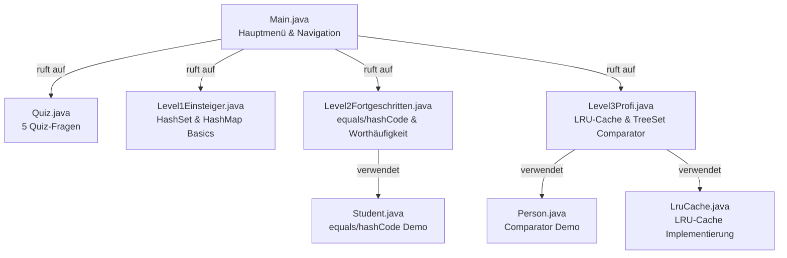
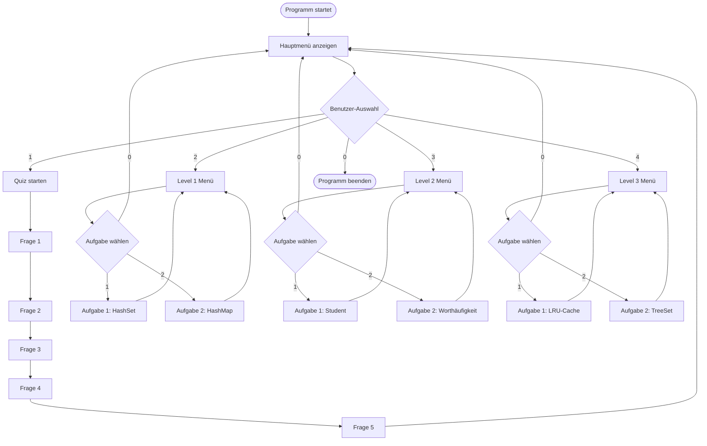
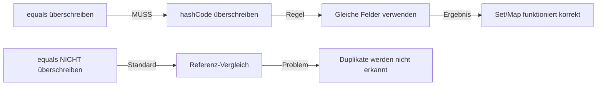
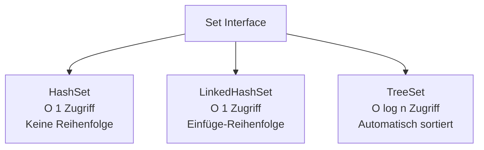
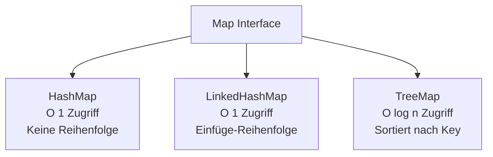

# Mini-Challenge: Sets & Maps – Keine Duplikate

Ein interaktives Java-Konsolenprogramm, das die Konzepte von **Sets** und **Maps** in Java praktisch demonstriert. Basierend auf dem Artikel ["Tag 2: Sets & Maps – Keine Duplikate"](https://www.java-developer.online/tag-2-sets-maps-keine-duplikate/) von java-developer.online.

## 📋 Projektübersicht

Dieses Projekt bietet eine vollständige Mini-Challenge mit:
- **5 Quiz-Fragen** zu Sets, Maps, equals/hashCode und Performance
- **3 Schwierigkeitslevel** mit je 2 praktischen Aufgaben
- **Interaktive Konsolenanwendung** mit Menü-Navigation
- **Vollständige Code-Beispiele** für alle wichtigen Set- und Map-Konzepte

## 🎯 Lernziele

Nach dem Durcharbeiten dieser Challenge verstehst du:
- ✅ Wann du **Set** statt **List** verwendest
- ✅ Unterschiede zwischen **HashSet**, **LinkedHashSet** und **TreeSet**
- ✅ Verwendung von **HashMap**, **LinkedHashMap** und **TreeMap**
- ✅ Den **equals/hashCode-Vertrag** und warum er essentiell ist
- ✅ **Comparable** und **Comparator** für sortierte Collections
- ✅ Praktische Patterns wie **LRU-Cache** und **Worthäufigkeit zählen**

## 🏗️ Projektstruktur



## 📁 Dateistruktur

```
02-collections-sets-maps/
├── src/
│   └── setsmapschallenge/
│       ├── Main.java                    # Hauptklasse mit Menü
│       ├── Quiz.java                    # Quiz-Fragen 1-5
│       ├── Level1Einsteiger.java       # Einsteiger-Aufgaben
│       ├── Level2Fortgeschritten.java  # Fortgeschrittene Aufgaben
│       ├── Level3Profi.java            # Profi-Aufgaben
│       ├── Student.java                # equals/hashCode Beispiel
│       ├── Person.java                 # Comparator Beispiel
│       └── LruCache.java               # LRU-Cache Implementierung
├── build.xml                           # Ant Build-Datei
├── nbproject/                          # NetBeans Projektkonfiguration
└── README.md                           # Diese Datei
```

## 🚀 Schnellstart

### Voraussetzungen
- **Java 17** oder höher
- **NetBeans IDE** (empfohlen) oder ein anderes Java-IDE
- **Ant** (wird normalerweise mit NetBeans mitgeliefert)

### Projekt öffnen

1. **NetBeans öffnen**
2. **Datei → Öffnen Projekt…**
3. Ordner auswählen: `02-collections-sets-maps`
4. Projekt wird automatisch erkannt

### Programm starten

1. Rechtsklick auf das Projekt → **Eigenschaften → Run**
2. **Main Class** auf `setsmapschallenge.Main` setzen (falls nicht gesetzt)
3. **F6** drücken oder Toolbar-Button "Run Project"

### Alternative: Von der Kommandozeile

```bash
cd "02-collections-sets-maps"
ant clean jar
java -jar dist/02-collections-sets-maps.jar
```

## 📚 Challenge-Inhalt

### Quiz (5 Fragen)

Das Quiz behandelt folgende Themen:

1. **Set<Person> ohne equals/hashCode** – Warum werden Duplikate nicht erkannt?
2. **Set-Sortierung** – Welches Set behält die Sortierung?
3. **Mutable Keys in HashMap** – Was passiert, wenn der Key verändert wird?
4. **Zeitkomplexität** – O(1) vs. O(log n) bei HashMap und TreeMap
5. **equals/hashCode-Vertrag** – Die goldene Regel für Collections

### Level 1 – Einsteiger 🟢

**Aufgabe 1: HashSet mit Städten**
- Erstellt ein `HashSet<String>` mit Städtenamen
- Demonstriert `contains()`-Prüfung
- Zeigt, dass Duplikate automatisch verhindert werden

**Aufgabe 2: HashMap Länder → Hauptstädte**
- Erstellt eine `HashMap<String, String>`
- Iteriert über `entrySet()` für effiziente Ausgabe
- Zeigt Key-Value-Mapping

### Level 2 – Fortgeschritten 🟡

**Aufgabe 1: Student mit equals/hashCode**
- Implementiert `Student`-Klasse mit korrektem `equals()` und `hashCode()`
- Demonstriert, wie ein `Set<Student>` Duplikate verhindert
- Zeigt den Unterschied mit/ohne equals/hashCode

**Aufgabe 2: Worthäufigkeit zählen**
- Verwendet `HashMap<String, Integer>` mit `merge()`
- Zählt Vorkommen jedes Wortes in einem Text
- Sortierte Ausgabe nach Häufigkeit

### Level 3 – Profi 🔵

**Aufgabe 1: LRU-Cache mit LinkedHashMap**
- Implementiert einen Least-Recently-Used Cache
- Erweitert `LinkedHashMap` und überschreibt `removeEldestEntry()`
- Demonstriert automatische Entfernung alter Einträge

**Aufgabe 2: TreeSet mit Comparator**
- Erstellt `TreeSet<Person>` mit Custom Comparator
- Sortierung: erst nach Alter, dann nach Nachname, dann nach Vorname
- Zeigt `Comparator.comparing()` und `thenComparing()`

## 🔄 Programmablauf



## 💡 Wichtige Konzepte

### equals/hashCode-Vertrag



**Die goldene Regel:**
> Wenn du `equals()` überschreibst, **MUSS** du auch `hashCode()` überschreiben!

### Set-Implementierungen im Vergleich



### Map-Implementierungen im Vergleich



## 🛠️ Technische Details

### Verwendete Java-Features

- **Collections Framework**: `Set`, `Map`, `HashSet`, `HashMap`, `TreeSet`, `TreeMap`, `LinkedHashMap`
- **equals/hashCode**: Korrekte Implementierung mit `Objects.equals()` und `Objects.hash()`
- **Comparator API**: `Comparator.comparing()`, `thenComparing()`, `reversed()`
- **Map-Methoden**: `merge()`, `computeIfAbsent()`, `entrySet()`
- **LinkedHashMap**: `removeEldestEntry()` für LRU-Cache

### Code-Beispiele

#### equals/hashCode Pattern (aus Student.java)

```java
@Override
public boolean equals(Object o) {
    if (this == o) return true;
    if (o == null || getClass() != o.getClass()) return false;
    Student student = (Student) o;
    return Objects.equals(matrikelnummer, student.matrikelnummer)
            && Objects.equals(name, student.name);
}

@Override
public int hashCode() {
    return Objects.hash(matrikelnummer, name);
}
```

#### LRU-Cache Pattern (aus LruCache.java)

```java
public class LruCache<K, V> extends LinkedHashMap<K, V> {
    private final int maxCapacity;
    
    @Override
    protected boolean removeEldestEntry(Map.Entry<K, V> eldest) {
        return size() > maxCapacity;
    }
}
```

#### Comparator Pattern (aus Level3Profi.java)

```java
Comparator<Person> comparator = Comparator
    .comparing(Person::getAlter)
    .thenComparing(Person::getNachname)
    .thenComparing(Person::getVorname);
```

## 📖 Weiterführende Ressourcen

- [Original-Artikel: Tag 2: Sets & Maps](https://www.java-developer.online/tag-2-sets-maps-keine-duplikate/)
- [Oracle Java Tutorials: Collections](https://docs.oracle.com/javase/tutorial/collections/)
- [Baeldung: equals() and hashCode()](https://www.baeldung.com/java-equals-hashcode-contracts)

## 📝 Lizenz

Dieses Projekt ist Teil eines Lernkurses und dient ausschließlich Bildungszwecken.

## 👤 Autor

Basierend auf dem Kurs "Java Erweiterte Techniken – Tag 2" von [java-developer.online](https://www.java-developer.online/).

---

**Viel Erfolg beim Lernen! 🚀**
