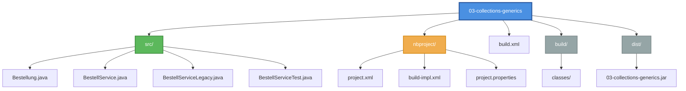
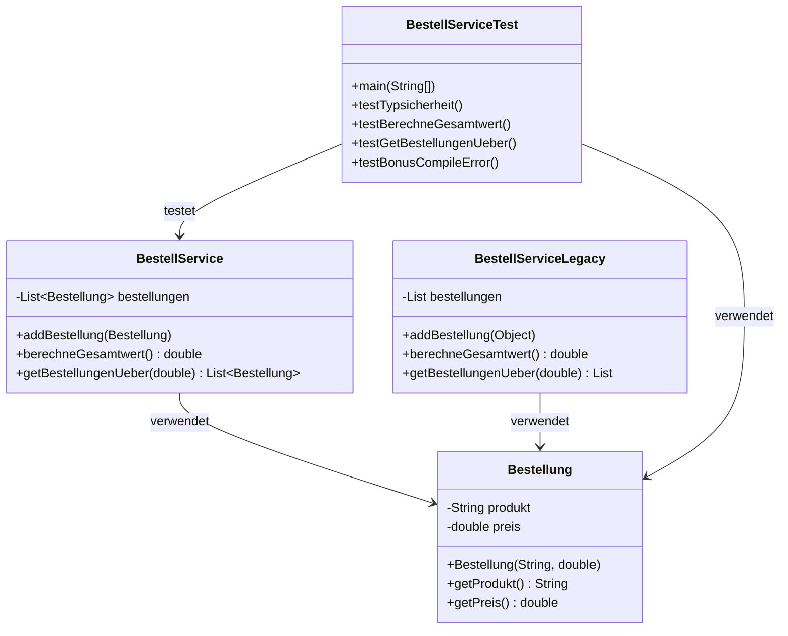
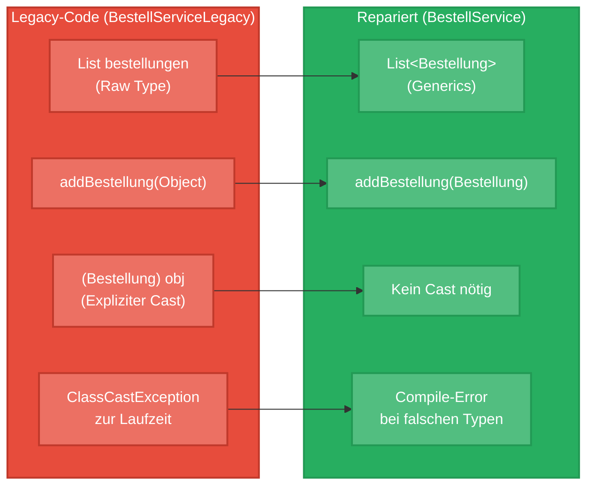
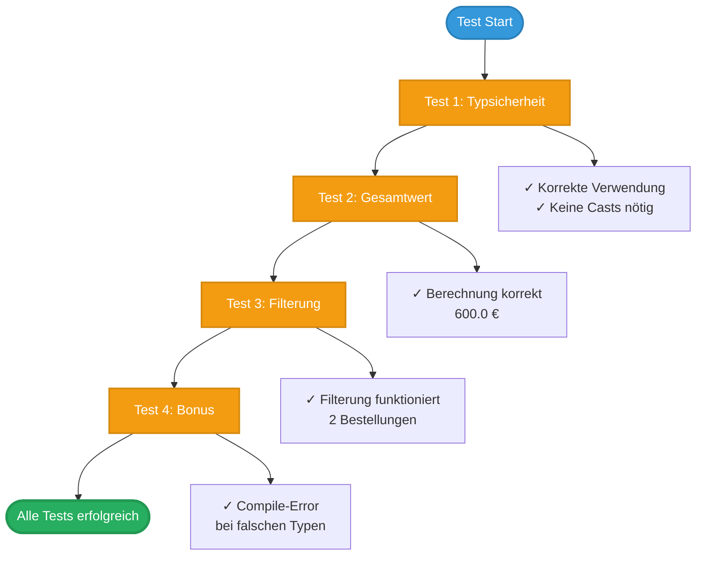
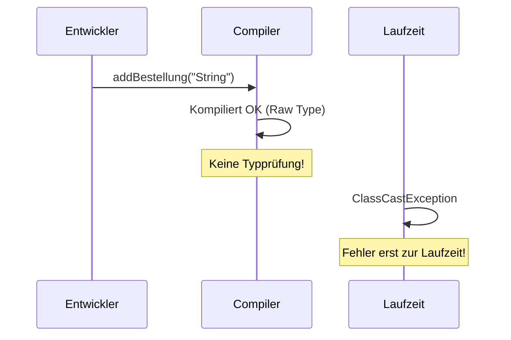
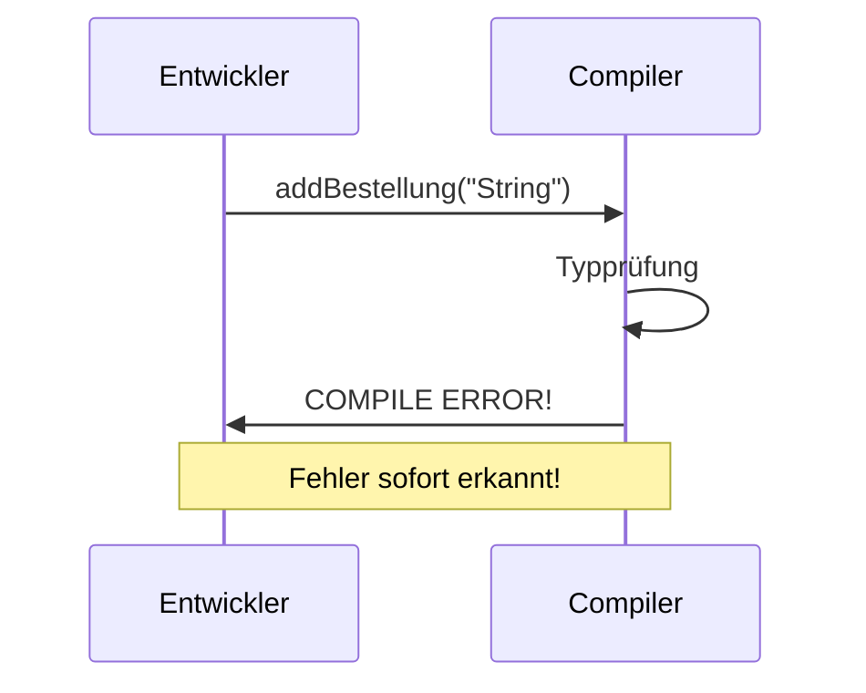

# Java Generics Challenge: Legacy-Code Reparatur

Dieses Projekt demonstriert die Verbesserung von Legacy-Code durch die Verwendung von Java Generics. Es zeigt den Unterschied zwischen unsicherem Code mit Raw Types und typsicherem Code mit Generics.

## 📋 Projektübersicht

Das Projekt enthält eine **Mini-Challenge** aus dem Kurs "Java Erweiterte Techniken - Tag 3: Java Generics Typsicherheit". Die Aufgabe besteht darin, einen `BestellService` mit Raw Types zu reparieren und typsicher zu machen.

### Hauptziele

- ✅ Identifikation von Raw Types in Legacy-Code
- ✅ Umwandlung zu typsicherem Code mit Generics
- ✅ Entfernung aller expliziten Casts
- ✅ Demonstration der Typsicherheit zur Compile-Zeit

## 🏗️ Projektstruktur



## 📦 Klassenübersicht



## 🔄 Legacy vs. Repariert: Vergleich



## 🎯 Die Challenge

### Problem: Legacy-Code mit Raw Types

Der ursprüngliche `BestellServiceLegacy` verwendet:
- **Raw Types**: `List` statt `List<Bestellung>`
- **Unsichere Parameter**: `Object` statt `Bestellung`
- **Explizite Casts**: `(Bestellung) obj` - gefährlich!
- **Laufzeit-Fehler**: `ClassCastException` wenn falsche Typen hinzugefügt werden

### Lösung: Typsicherer Code mit Generics

Der reparierte `BestellService` verwendet:
- **Generics**: `List<Bestellung>` für Typsicherheit
- **Typsichere Parameter**: `Bestellung` statt `Object`
- **Keine Casts**: Der Compiler garantiert den Typ
- **Compile-Zeit-Prüfung**: Fehler werden sofort erkannt

## 📊 Test-Ablauf



## 🚀 Verwendung

### Voraussetzungen

- Java JDK 17 oder höher
- Apache Ant (für Build-Prozess)
- NetBeans IDE (optional, für IDE-Integration)

### Build und Test

```bash
# Projekt kompilieren
ant clean compile

# JAR-Datei erstellen
ant jar

# Tests ausführen
java -cp build/classes BestellServiceTest

# Oder mit Ant (wenn Test-Framework konfiguriert)
ant test
```

### Verfügbare Ant-Targets

| Target | Beschreibung |
|--------|--------------|
| `clean` | Löscht Build-Verzeichnisse |
| `compile` | Kompiliert alle Java-Dateien |
| `jar` | Erstellt JAR-Datei |
| `test` | Führt Tests aus |
| `javadoc` | Generiert Javadoc |
| `run` | Führt Main-Klasse aus |

## 🔍 Code-Beispiele

### Legacy-Code (Problem)

```java
// Raw Type - keine Typsicherheit!
private List bestellungen = new ArrayList();

// Unsicherer Parameter
public void addBestellung(Object bestellung) {
    bestellungen.add(bestellung);
}

// Gefährlicher Cast - kann zur Laufzeit fehlschlagen
for (Object obj : bestellungen) {
    Bestellung b = (Bestellung) obj;  // ClassCastException möglich!
    summe += b.getPreis();
}
```

### Reparierter Code (Lösung)

```java
// Generics - typsicher!
private List<Bestellung> bestellungen = new ArrayList<>();

// Typsicherer Parameter
public void addBestellung(Bestellung bestellung) {
    bestellungen.add(bestellung);
}

// Kein Cast nötig - Compiler garantiert den Typ
for (Bestellung b : bestellungen) {
    summe += b.getPreis();  // Kein Cast, keine Gefahr!
}
```

## ⚠️ Wichtige Erkenntnisse

### Vorher (Legacy)



### Nachher (Repariert)



## 📈 Vorteile der Reparatur

| Aspekt | Legacy | Repariert |
|--------|-------|-----------|
| **Typsicherheit** | ❌ Zur Laufzeit | ✅ Zur Compile-Zeit |
| **Casts erforderlich** | ✅ Ja | ❌ Nein |
| **Fehlererkennung** | ❌ Spät (Laufzeit) | ✅ Früh (Compile-Zeit) |
| **IDE-Support** | ⚠️ Eingeschränkt | ✅ Vollständig |
| **Code-Lesbarkeit** | ⚠️ Unklar | ✅ Explizit |

## 🎓 Lernziele

Nach Abschluss dieser Challenge verstehen Sie:

1. **Raw Types** und warum sie problematisch sind
2. **Generics** zur Typsicherheit zur Compile-Zeit
3. **Diamond Operator** (`<>`) für weniger Boilerplate
4. **Type Erasure** und seine Auswirkungen
5. **Best Practices** für typsicheren Code

## 📚 Weitere Informationen

Dieses Projekt basiert auf der **Mini-Challenge "Level 1: Legacy-Code fixen"** aus:
- Kurs: Java Erweiterte Techniken
- Tag 3: Java Generics Typsicherheit
- Quelle: [java-developer.online](https://www.java-developer.online/tag-3-java-generics-typsicherheit/)

## 🛠️ Technische Details

- **Java Version**: 17+
- **Build Tool**: Apache Ant
- **Projekttyp**: NetBeans Ant-Projekt
- **Encoding**: UTF-8

## 📝 Dateien

- `Bestellung.java` - Datenklasse für Bestellungen
- `BestellService.java` - Reparierte Version mit Generics
- `BestellServiceLegacy.java` - Original-Version mit Raw Types
- `BestellServiceTest.java` - Test-Suite zur Demonstration

## ✅ Test-Ergebnisse

Alle Tests wurden erfolgreich durchgeführt:

```
=== BestellService Typsicherheits-Tests ===

Test 1: Typsicherheit ✓
Test 2: Berechne Gesamtwert ✓
Test 3: Get Bestellungen über Mindestwert ✓
Test 4: Bonus - Compile-Error bei falschen Typen ✓

=== Alle Tests erfolgreich! ===
```

## 🎯 Bonus-Frage

**Was passiert, wenn jemand `addBestellung("Keine echte Bestellung")` aufruft?**

- **VORHER (Legacy)**: Der Code kompiliert, führt aber zur Laufzeit zu einer `ClassCastException`
- **NACHHER (Repariert)**: Der Code kompiliert **NICHT** - Compile-Error!

**Fazit**: Fehler werden beim Schreiben erkannt, nicht erst beim Kunden! 🎉

---

**Viel Erfolg beim Lernen von Java Generics!** 🚀
