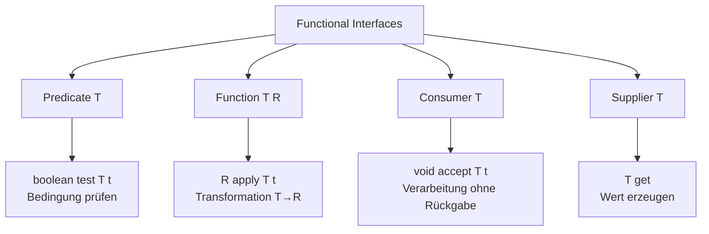
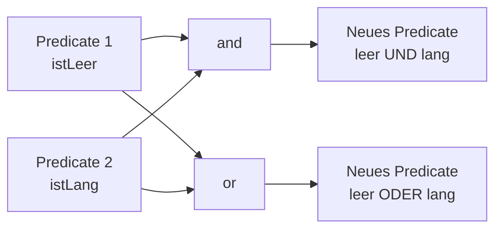
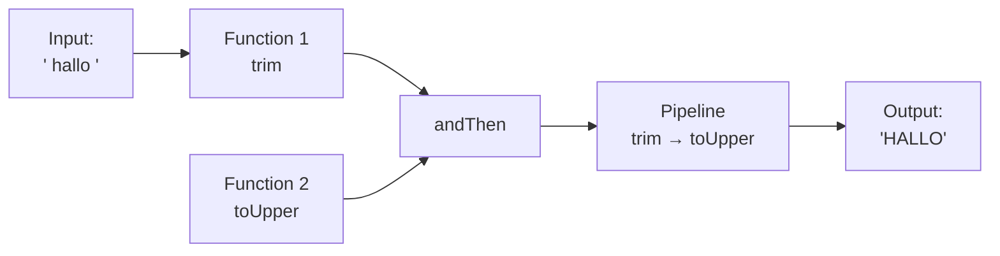

# Functional Interfaces Mini-Challenge

Ein Java-Projekt zur Demonstration von Functional Interfaces in Java 8+. Dieses Projekt implementiert die **Mini-Challenge Level 1** aus dem Java Developer Online Kurs "Tag 5: Functional Interfaces".

## 📋 Projektübersicht

Dieses Projekt demonstriert die Verwendung der vier wichtigsten Functional Interfaces aus dem `java.util.function` Package:
- **Predicate** - Bedingungen prüfen
- **Function** - Transformationen durchführen
- **Consumer** - Verarbeitung ohne Rückgabe
- **Supplier** - Werte erzeugen

Zusätzlich werden erweiterte Konzepte gezeigt:
- Kombination von Predicates mit `and()` und `or()`
- Verkettung von Functions mit `andThen()`

## 🏗️ Projektstruktur

```
05-functional-interfaces/
├── build.xml                 # Ant Build-Konfiguration
├── nbproject/                # NetBeans Projekt-Konfiguration
│   ├── project.xml
│   └── project.properties
├── src/                      # Quellcode
│   └── MiniChallenge.java    # Hauptklasse
└── build/                    # Build-Ausgabe (generiert)
    └── classes/
```

## 🎯 Functional Interfaces im Überblick

### Die Basis-Vier



### Verwendung im Projekt

```java
// Predicate: Prüft Bedingungen
Predicate<String> istLeer = s -> s.isEmpty();

// Function: Transformiert Werte
Function<String, Integer> laenge = s -> s.length();

// Consumer: Verarbeitet ohne Rückgabe
Consumer<String> drucker = s -> System.out.println(s);

// Supplier: Erzeugt Werte
Supplier<String> hello = () -> "Hello World";
```

## 🔗 Komposition und Verkettung

### Predicate-Kombination



### Function-Verkettung



## 🚀 Build und Ausführung

### Voraussetzungen

- Java JDK 8 oder höher
- Apache Ant 1.8.0 oder höher
- NetBeans IDE (optional, für IDE-Support)

### Build-Befehle

```bash
# Projekt kompilieren
ant compile

# Projekt ausführen
ant run

# Alles auf einmal (clean, compile, run)
ant clean compile run

# JAR-Datei erstellen
ant jar
```

### In NetBeans

1. Projekt öffnen: `File` → `Open Project`
2. Projekt bauen: Rechtsklick auf Projekt → `Build`
3. Programm ausführen: Rechtsklick auf `MiniChallenge.java` → `Run File`

## 📚 Implementierte Features

### 1. Grundlegende Functional Interfaces

Die Klasse `MiniChallenge` demonstriert alle vier Basis-Interfaces:

- **Predicate<String>**: Prüft ob Strings leer sind oder eine bestimmte Länge haben
- **Function<String, Integer>**: Transformiert Strings zu ihrer Länge
- **Function<String, String>**: Transformiert Strings (z.B. toUpperCase)
- **Consumer<String>**: Gibt Strings aus
- **Supplier<String>**: Erzeugt String-Werte

### 2. Predicate-Kombination

```java
Predicate<String> istLeer = s -> s.isEmpty();
Predicate<String> istLang = s -> s.length() > 10;

// Kombination mit and()
Predicate<String> leerUndLang = istLeer.and(istLang);

// Kombination mit or()
Predicate<String> leerOderLang = istLeer.or(istLang);
```

### 3. Function-Verkettung

```java
Function<String, String> trim = s -> s.trim();
Function<String, String> toUpper = s -> s.toUpperCase();

// Verkettung mit andThen()
Function<String, String> pipeline = trim.andThen(toUpper);

// Ergebnis: " hallo " → "HALLO"
```

## 📊 Ausgabe-Beispiel

```
=== Functional Interfaces Mini-Challenge (Level 1) ===

1. Grundlegende Functional Interfaces für Strings:

   Predicate<String> istLeer:
   - "" ist leer: true
   - "Hallo" ist leer: false

   Function<String, Integer> laenge:
   - Länge von "Hallo": 5

   Consumer<String> drucker:
   [Consumer] Ausgabe: Hallo Welt

   Supplier<String> helloSupplier:
   - Wert: Hello World

2. Kombination von Predicates mit and() und or():
   ...

3. Verkettung von Functions mit andThen():
   ...

=== Challenge abgeschlossen! ===
```

## 🎓 Lernziele

Nach dem Durcharbeiten dieses Projekts verstehen Sie:

- ✅ Was Functional Interfaces sind und warum sie wichtig sind
- ✅ Die vier Standard-Interfaces: Function, Predicate, Consumer, Supplier
- ✅ Wie man Predicates mit `and()` und `or()` kombiniert
- ✅ Wie man Functions mit `andThen()` verkettet
- ✅ Praktische Anwendungsfälle für Functional Interfaces

## 📖 Weiterführende Ressourcen

- [Java Developer Online - Tag 5: Functional Interfaces](https://www.java-developer.online/tag-5-functional-interfaces/)
- [Oracle Java Documentation - java.util.function](https://docs.oracle.com/en/java/javase/21/docs/api/java.base/java/util/function/package-summary.html)

## 🛠️ Technische Details

- **Java Version**: 8+ (für Functional Interfaces)
- **Build Tool**: Apache Ant
- **IDE**: NetBeans-kompatibel
- **Package**: Default-Package (kein Package)

## 📝 Lizenz

Dieses Projekt ist Teil des Java Developer Online Kurses und dient zu Lernzwecken.

---

**Erstellt für**: Java Erweiterte Techniken - Tag 5  
**Schwierigkeit**: 🟡 Mittel  
**Geschätzte Zeit**: 15-30 Minuten
