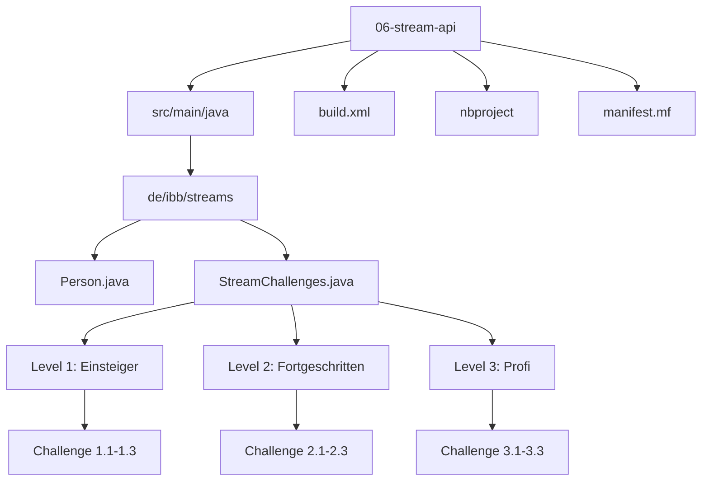
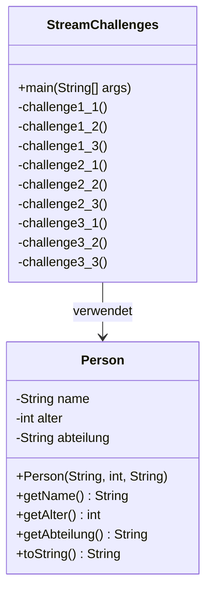
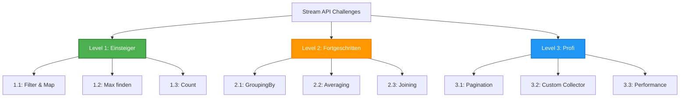
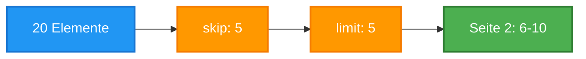
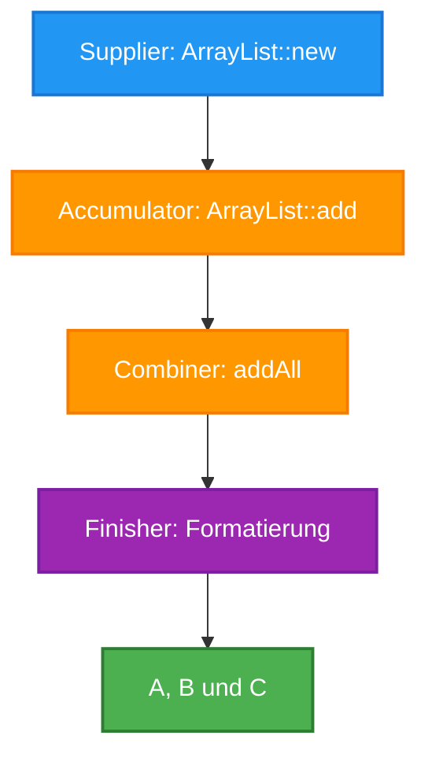
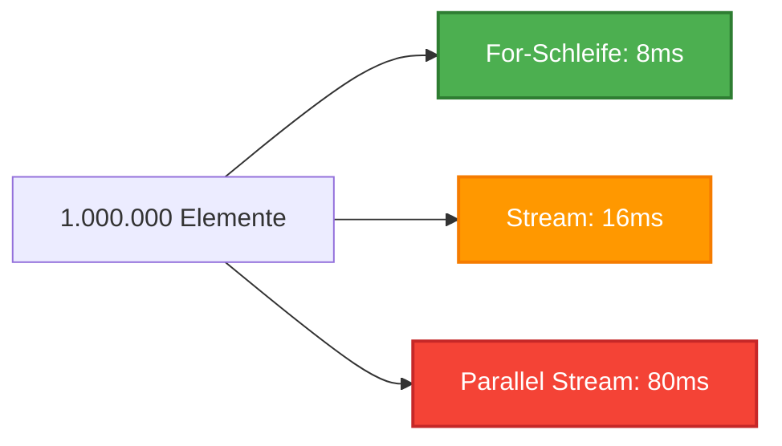

# Stream API Challenge Projekt

Ein umfassendes Java-Lernprojekt zur Stream-API mit 9 praktischen Challenges in drei Schwierigkeitsstufen.

## 📋 Projektübersicht

Dieses Projekt demonstriert die Verwendung der Java Stream-API anhand von praktischen Beispielen. Es ist Teil des Kurses "Java Erweiterte Techniken - Tag 6" und zeigt, wie Daten mit Streams elegant verarbeitet werden können.

### Projektstruktur



## 🏗️ Architektur

### Klassendiagramm



### Stream-Pipeline Konzept

```mermaid
flowchart LR
    A[Quelle<br/>Collection/Array] --> B[Stream erstellen<br/>.stream()]
    B --> C[Intermediate Operations<br/>filter, map, sorted]
    C --> D[Intermediate Operations<br/>distinct, limit, skip]
    D --> E[Terminal Operation<br/>collect, forEach, count]
    E --> F[Ergebnis<br/>Collection/Wert]
    
    style A fill:#2196F3,stroke:#1976D2,stroke-width:2px,color:#fff
    style C fill:#FF9800,stroke:#F57C00,stroke-width:2px,color:#fff
    style D fill:#FF9800,stroke:#F57C00,stroke-width:2px,color:#fff
    style E fill:#9C27B0,stroke:#7B1FA2,stroke-width:2px,color:#fff
    style F fill:#4CAF50,stroke:#2E7D32,stroke-width:2px,color:#fff
```

## 🎯 Challenges im Detail

### Challenge-Übersicht



---

## 🟢 Level 1 - Einsteiger

### Challenge 1.1: Filtere alle Zahlen > 5 und verdopple sie

**Ziel:** Grundlegende Verwendung von `filter()` und `map()`.

**Stream-Pipeline:**


**Code:**
```java
List<Integer> ergebnis = zahlen.stream()
    .filter(n -> n > 5)      // Nur Zahlen > 5
    .map(n -> n * 2)         // Verdoppeln
    .toList();                // Sammeln
```

### Challenge 1.2: Finde den längsten Namen

**Ziel:** Verwendung von `max()` mit Comparator.

**Code:**
```java
Optional<String> laengsterName = namen.stream()
    .max(Comparator.comparing(String::length));
```

### Challenge 1.3: Zähle Strings mit 'A'

**Ziel:** Kombination von `filter()` und `count()`.

**Code:**
```java
long anzahl = namen.stream()
    .filter(s -> s.startsWith("A"))
    .count();
```

---

## 🟡 Level 2 - Fortgeschritten

### Challenge 2.1: Gruppiere Personen nach Alter

**Ziel:** Verwendung des `groupingBy` Collectors.

**Stream-Pipeline:**


**Code:**
```java
Map<Integer, List<Person>> nachAlter = personen.stream()
    .collect(Collectors.groupingBy(Person::getAlter));
```

**Ergebnis:**
```
Alter 25: [Max, Tom]
Alter 28: [Lisa]
Alter 30: [Anna, Peter]
```

### Challenge 2.2: Durchschnittsalter pro Abteilung

**Ziel:** Verschachtelte Collectors mit `groupingBy` und `averagingInt`.

**Code:**
```java
Map<String, Double> durchschnitt = personen.stream()
    .collect(Collectors.groupingBy(
        Person::getAbteilung,
        Collectors.averagingInt(Person::getAlter)
    ));
```

### Challenge 2.3: CSV-String erstellen

**Ziel:** Transformation und `joining` Collector.

**Code:**
```java
String csv = personen.stream()
    .map(p -> p.getName() + "," + p.getAlter() + "," + p.getAbteilung())
    .collect(Collectors.joining("\n"));
```

---

## 🔵 Level 3 - Profi

### Challenge 3.1: Pagination mit skip/limit

**Ziel:** Implementierung von Seitennummerierung für große Datenmengen.

**Stream-Pipeline:**


**Code:**
```java
int seite = 2;
int seitenGroesse = 5;

List<Integer> seite2 = zahlen.stream()
    .skip((seite - 1) * seitenGroesse)  // Überspringe erste 5
    .limit(seitenGroesse)                 // Nimm nächste 5
    .toList();
```

### Challenge 3.2: Custom Collector (Oxford Comma)

**Ziel:** Erstellung eines eigenen Collectors für spezielle Formatierung.

**Funktionsweise:**


**Code:**
```java
Collector<String, ArrayList<String>, String> oxfordComma = Collector.of(
    ArrayList<String>::new,           // Supplier
    ArrayList<String>::add,          // Accumulator
    (left, right) -> {                // Combiner
        left.addAll(right);
        return left;
    },
    list -> {                         // Finisher
        if (list.isEmpty()) return "";
        if (list.size() == 1) return list.get(0);
        return String.join(", ", list.subList(0, list.size() - 1))
            + " und " + list.get(list.size() - 1);
    }
);
```

**Ergebnis:** `"Max, Anna und Tom"` statt `"Max, Anna, Tom"`

### Challenge 3.3: Performance-Vergleich

**Ziel:** Vergleich von for-Schleife, Stream und Parallel Stream.

**Ergebnis-Analyse:**


**Erkenntnisse:**
- ✅ **For-Schleife:** Schnellste bei kleinen/medium Datenmengen
- ⚠️ **Stream:** Etwas langsamer, aber lesbarer
- ❌ **Parallel Stream:** Overhead bei kleinen Datenmengen größer als Gewinn

**Fazit:** Parallel Streams lohnen sich erst ab ~10.000+ Elementen bei CPU-intensiven Operationen.

---

## 🚀 Ausführung

### Voraussetzungen

- **Java:** Version 8 oder höher
- **Ant:** Version 1.8.0 oder höher (für Build-Skript)
- **NetBeans:** Optional, für IDE-Unterstützung

### In NetBeans ausführen

1. Projekt in NetBeans öffnen (File → Open Project)
2. Rechtsklick auf Projekt → **"Run"** oder **F6** drücken
3. Ausgabe erscheint im Output-Fenster

### Mit Ant (Kommandozeile)

```bash
# Kompilieren und ausführen
ant run

# Nur kompilieren
ant compile

# JAR erstellen
ant jar

# Alles aufräumen
ant clean
```

### Direkt mit Java

```bash
# Kompilieren
ant compile

# Ausführen
java -cp build/classes de.ibb.streams.StreamChallenges

# Oder mit JAR
ant jar
java -jar dist/lib/06-stream-api.jar
```

---

## 📁 Projektstruktur

```
06-stream-api/
├── src/
│   └── main/
│       └── java/
│           └── de/
│               └── ibb/
│                   └── streams/
│                       ├── Person.java              # Datenmodell
│                       └── StreamChallenges.java     # Alle Challenges
├── build.xml                                         # Ant Build-File
├── manifest.mf                                       # JAR Manifest
├── nbproject/                                        # NetBeans Konfiguration
│   ├── project.xml
│   └── project.properties
├── build/                                            # Generiert (Build-Output)
│   └── classes/
├── dist/                                             # Generiert (JAR-Dateien)
│   └── lib/
└── README.md                                         # Diese Datei
```

---

## 🎓 Lernziele

Nach Abschluss dieses Projekts verstehen Sie:

- ✅ **Stream-Erstellung:** Aus Collections, Arrays, Generatoren
- ✅ **Intermediate Operations:** `filter`, `map`, `sorted`, `distinct`, `limit`, `skip`
- ✅ **Terminal Operations:** `collect`, `forEach`, `count`, `findFirst`, `reduce`
- ✅ **Collectors:** `toList`, `toSet`, `toMap`, `groupingBy`, `joining`, `averagingInt`
- ✅ **Custom Collectors:** Erstellung eigener Collector-Implementierungen
- ✅ **Performance:** Wann Streams vs. for-Schleifen vs. Parallel Streams verwenden

---

## 🔍 Code-Beispiele

### Beispiel 1: Einfache Filterung und Transformation

```java
List<Integer> gerade = zahlen.stream()
    .filter(n -> n % 2 == 0)      // Nur gerade Zahlen
    .map(n -> n * 2)              // Verdoppeln
    .sorted()                      // Sortieren
    .toList();                     // Sammeln
```

### Beispiel 2: Gruppierung mit Aggregation

```java
Map<String, Double> durchschnitt = personen.stream()
    .collect(Collectors.groupingBy(
        Person::getAbteilung,
        Collectors.averagingInt(Person::getAlter)
    ));
```

### Beispiel 3: Verschachtelte Streams mit flatMap

```java
List<List<Integer>> verschachtelt = List.of(
    List.of(1, 2, 3),
    List.of(4, 5),
    List.of(6, 7, 8)
);

List<Integer> flach = verschachtelt.stream()
    .flatMap(List::stream)        // Alle Listen zusammenführen
    .toList();                     // [1, 2, 3, 4, 5, 6, 7, 8]
```

---

## 📊 Stream-API Übersicht

### Intermediate Operations (Lazy)

| Operation | Beschreibung | Beispiel |
|----------|-------------|----------|
| `filter()` | Elemente filtern | `.filter(n -> n > 5)` |
| `map()` | Transformieren | `.map(String::toUpperCase)` |
| `flatMap()` | Verschachtelte Strukturen flatten | `.flatMap(List::stream)` |
| `sorted()` | Sortieren | `.sorted(Comparator.comparing(...))` |
| `distinct()` | Duplikate entfernen | `.distinct()` |
| `limit()` | Erste n Elemente | `.limit(10)` |
| `skip()` | Erste n überspringen | `.skip(5)` |
| `peek()` | Debugging | `.peek(System.out::println)` |

### Terminal Operations (Eager)

| Operation | Rückgabetyp | Beispiel |
|----------|-----------|----------|
| `collect()` | Collection | `.collect(Collectors.toList())` |
| `toList()` | List | `.toList()` |
| `forEach()` | void | `.forEach(System.out::println)` |
| `count()` | long | `.count()` |
| `findFirst()` | Optional | `.findFirst()` |
| `reduce()` | Optional/T | `.reduce(0, Integer::sum)` |
| `anyMatch()` | boolean | `.anyMatch(s -> s.startsWith("A"))` |
| `allMatch()` | boolean | `.allMatch(s -> s.length() > 3)` |
| `noneMatch()` | boolean | `.noneMatch(String::isEmpty)` |

---

## 🛠️ Build-Konfiguration

### Ant Targets

| Target | Beschreibung |
|--------|-------------|
| `compile` | Kompiliert Java-Quellcode |
| `run` | Führt die Hauptklasse aus |
| `jar` | Erstellt ausführbare JAR-Datei |
| `clean` | Löscht Build-Verzeichnisse |
| `default` | Führt clean, compile, jar, run aus |

### NetBeans Integration

Das Projekt ist vollständig NetBeans-kompatibel:
- Automatische Code-Vervollständigung
- Debugging-Unterstützung
- Integrierte Ant-Integration
- Projekt-Explorer-Navigation

---

## 📚 Weiterführende Ressourcen

- [Oracle Stream Tutorial](https://docs.oracle.com/javase/tutorial/collections/streams/)
- [Java Stream API Dokumentation](https://docs.oracle.com/en/java/javase/21/docs/api/java.base/java/util/stream/Stream.html)
- [Collectors Dokumentation](https://docs.oracle.com/en/java/javase/21/docs/api/java.base/java/util/stream/Collectors.html)

---

## 📝 Lizenz

Dieses Projekt ist Teil des Kurses "Java Erweiterte Techniken" von Java Fleet Systems Consulting.

---

## 👥 Autor

**Elyndra Valen** - Senior Entwicklerin bei Java Fleet Systems Consulting

Mit Einblicken von:
- Nova Trent (Junior Dev)
- Jamal Hassan (Backend Developer)

---

**Viel Erfolg beim Lernen der Stream-API! 🚀**
