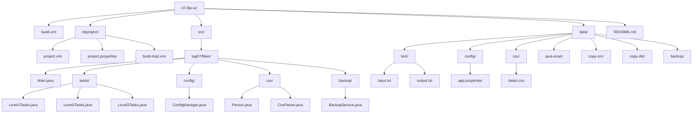
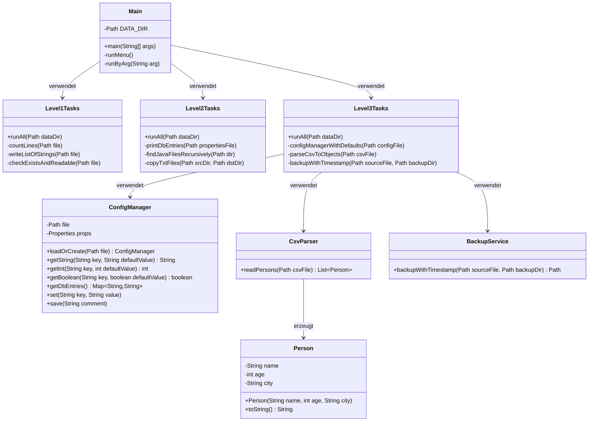
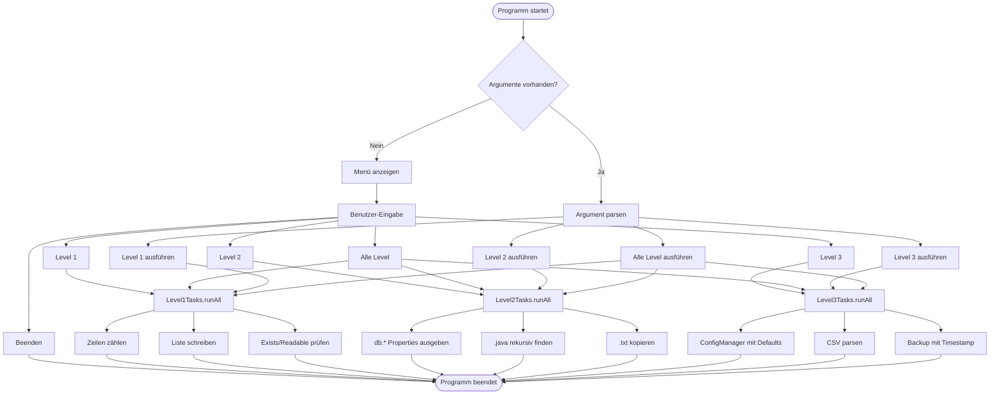

# Tag 7 – Dateien lesen, schreiben und verwalten (Mini‑Challenge)

Dieses Projekt ist ein **NetBeans-kompatibles Ant‑Projekt** zur vollständigen Umsetzung der Mini‑Challenge aus  
**„TAG 7: Dateien lesen, schreiben und verwalten“** auf [java-developer.online](https://www.java-developer.online/tag-7-dateien-lesen-schreiben/).

## 📋 Projektübersicht

Das Projekt demonstriert die moderne **Java NIO.2 API** (`java.nio.file`) für Dateioperationen und setzt alle drei Schwierigkeitsgrade der Challenge um:

- **🟢 Level 1 (Einsteiger)**: Grundlegende Dateioperationen (Lesen, Schreiben, Prüfen)
- **🟡 Level 2 (Fortgeschritten)**: Properties, rekursive Verzeichnissuche, Dateikopien
- **🔵 Level 3 (Profi)**: Config-Manager mit Defaults, CSV-Parsing, Backup-Service

### Technologie-Stack

- **Java 21** (LTS)
- **NIO.2 API** (`Path`, `Files`, `Stream`)
- **Try-with-Resources** für sichere Ressourcenverwaltung
- **NetBeans Ant Build** (kompatibel mit NetBeans IDE)
- **UTF-8 Encoding** für plattformunabhängige Textverarbeitung

---

## 🏗️ Projektstruktur



---

## 🎯 Architektur

### Klassendiagramm



### Ablaufdiagramm



---

## 📚 Detaillierte Aufgaben-Übersicht

### 🟢 Level 1 – Einsteiger

**Aufgabe 1: Textdatei lesen und Zeilen zählen**

```java
try (var stream = Files.lines(file, StandardCharsets.UTF_8)) {
    long lines = stream.count();
}
```

- Verwendet `Files.lines()` für Stream-basiertes Lesen
- Try-with-Resources stellt automatisches Schließen sicher
- UTF-8 Encoding für korrekte Umlaute

**Aufgabe 2: Liste von Strings in Datei schreiben**

```java
List<String> lines = List.of("Zeile 1", "Zeile 2", "Zeile 3");
Files.write(file, lines, StandardCharsets.UTF_8, 
    StandardOpenOption.CREATE, StandardOpenOption.TRUNCATE_EXISTING);
```

- `Files.write()` für atomares Schreiben
- `TRUNCATE_EXISTING` überschreibt vorhandene Datei

**Aufgabe 3: Datei existiert und lesbar prüfen**

```java
boolean exists = Files.exists(file);
boolean readable = Files.isReadable(file);
```

- Plattformunabhängige Prüfungen mit NIO.2

---

### 🟡 Level 2 – Fortgeschritten

**Aufgabe 1: Properties laden und `db.*` Einträge ausgeben**

```java
Properties props = new Properties();
try (InputStream in = Files.newInputStream(propertiesFile)) {
    props.load(in);
}
props.stringPropertyNames().stream()
    .filter(k -> k.startsWith("db."))
    .forEach(k -> System.out.println(k + "=" + props.getProperty(k)));
```

- Stream-API für elegante Filterung
- Try-with-Resources für InputStream

**Aufgabe 2: `.java` Dateien rekursiv finden**

```java
try (Stream<Path> walk = Files.walk(dir)) {
    walk
        .filter(Files::isRegularFile)
        .filter(p -> p.getFileName().toString().endsWith(".java"))
        .forEach(System.out::println);
}
```

- `Files.walk()` für rekursive Verzeichnisdurchquerung
- Methodenreferenzen (`Files::isRegularFile`) für sauberen Code

**Aufgabe 3: `.txt` Dateien von A nach B kopieren**

```java
try (Stream<Path> list = Files.list(srcDir)) {
    list
        .filter(Files::isRegularFile)
        .filter(p -> p.getFileName().toString().endsWith(".txt"))
        .forEach(p -> Files.copy(p, dstDir.resolve(p.getFileName()), 
            StandardCopyOption.REPLACE_EXISTING));
}
```

- `Files.list()` für flache Verzeichnisauflistung
- `Files.copy()` mit `REPLACE_EXISTING` Option

---

### 🔵 Level 3 – Profi

**Aufgabe 1: Config-Manager mit Default-Werten**

Die `ConfigManager`-Klasse implementiert:

- **Lazy Loading**: Erstellt Default-Properties, falls Datei nicht existiert
- **Type-Safe Access**: `getString()`, `getInt()`, `getBoolean()` mit Defaults
- **Non-Destructive**: Fehlende Werte werden mit Defaults ergänzt, vorhandene bleiben unverändert
- **Filterung**: `getDbEntries()` liefert alle `db.*` Einträge als `Map`

```java
ConfigManager cfg = ConfigManager.loadOrCreate(configFile);
String host = cfg.getString("db.host", "localhost");
int port = cfg.getInt("db.port", 5432);
Map<String, String> dbEntries = cfg.getDbEntries();
```

**Aufgabe 2: CSV in Objekte parsen**

Die `CsvParser`-Klasse:

- Liest CSV mit Semikolon-Trenner (`;`)
- Überspringt Header-Zeile
- Mappt jede Zeile zu einem `Person`-Objekt
- Verwendet Stream-API für funktionale Transformation

```java
List<Person> persons = CsvParser.readPersons(csvFile);
// Person: name, age, city
```

**Aufgabe 3: Backup mit Timestamp**

Die `BackupService`-Klasse:

- Erstellt Kopie mit Format: `<originalname>_<yyyyMMdd_HHmmss>.<ext>`
- Verwendet `LocalDateTime` für plattformunabhängige Zeitstempel
- Erstellt Backup-Verzeichnis automatisch, falls nicht vorhanden

```java
Path backup = BackupService.backupWithTimestamp(sourceFile, backupDir);
// Ergebnis: input_20250120_143052.txt
```

---

## 🗂️ Datenbasis (`data/`-Ordner)

Das Projekt verwendet ausschließlich **relative Pfade** mit `java.nio.file.Path`/`Files`.  
Alle Ein- und Ausgaben liegen unter dem Ordner `data/`:

```
data/
├── text/
│   ├── input.txt          # Beispiel-Textdatei (Level 1)
│   └── output.txt         # Ausgabe der String-Liste (Level 1)
├── config/
│   └── app.properties     # Beispiel-Konfiguration (db.*, app.*)
├── csv/
│   └── daten.csv          # Beispiel-CSV (Name;Alter;Stadt)
├── java-scan/             # Dummy-.java-Dateien zum rekursiven Finden
│   ├── Root.java
│   ├── a/
│   │   ├── A1.java
│   │   └── note.txt
│   └── b/
│       ├── B1.java
│       └── inner/
│           └── B2.java
├── copy-src/              # Quelle für .txt-Kopien
│   ├── eins.txt
│   ├── zwei.txt
│   └── ignore.md
├── copy-dst/              # Ziel für .txt-Kopien (wird befüllt)
└── backup/                # Hier landen Timestamp-Backups
```

**Wichtig**: Fehlende Dateien/Ordner werden beim ersten Lauf – soweit notwendig – automatisch angelegt (idempotente Initialisierung).

---

## 🚀 Projekt öffnen und ausführen

### NetBeans IDE

1. **NetBeans starten**
2. **File → Open Project…**
3. Ordner `07-file-io` auswählen (dort, wo diese `README.md` liegt)
4. Projekt sollte als **Java Application (Ant)** erkannt werden  
   (`build.xml` und `nbproject/` vorhanden)
5. Projekt markieren → Rechtsklick → **Run**  
   → Es startet ein Konsolen‑Menü mit den Optionen für Level 1–3 bzw. „alle“.

### Kommandozeile

Im Projektverzeichnis `07-file-io`:

```bash
# Build und Run
ant run

# Oder direkt mit Java (nach Build)
java -cp dist/tag07-file-io.jar de.ibb.fileio.Main level1
java -cp dist/tag07-file-io.jar de.ibb.fileio.Main level2
java -cp dist/tag07-file-io.jar de.ibb.fileio.Main level3
java -cp dist/tag07-file-io.jar de.ibb.fileio.Main all
```

### Menü-Optionen

Bei interaktivem Start (ohne Argumente) erscheint ein Menü:

```
=== Tag 7: File I/O Mini-Challenge (Level 1–3) ===
Arbeitsverzeichnis: C:\Users\...\07-file-io
Datenbasis:         C:\Users\...\07-file-io\data

1) Level 1 (Einsteiger) ausführen
2) Level 2 (Fortgeschritten) ausführen
3) Level 3 (Profi) ausführen
4) Alle Level ausführen
0) Beenden
>
```

---

## 🔧 Technische Details

### NIO.2 API – Warum modern?

**Vorteile gegenüber `java.io.File`:**

- ✅ **Plattformunabhängig**: `Path.of("ordner", "datei.txt")` funktioniert auf Windows, macOS, Linux
- ✅ **Stream-Support**: `Files.lines()`, `Files.walk()` für funktionale Programmierung
- ✅ **Bessere API**: Weniger Boilerplate, mehr Ausdruckskraft
- ✅ **Try-with-Resources**: Automatisches Ressourcen-Management

**Wichtige Klassen:**

- `Path`: Repräsentiert Dateipfade (ersetzt `File`)
- `Files`: Statische Utility-Methoden für alle Dateioperationen
- `StandardOpenOption`: Optionen für Datei-Öffnungen (`CREATE`, `APPEND`, `TRUNCATE_EXISTING`)
- `StandardCopyOption`: Optionen für Kopieroperationen (`REPLACE_EXISTING`, `ATOMIC_MOVE`)

### Ressourcen-Management

**Kritisch**: Alle Streams, Reader und Writer müssen geschlossen werden!

```java
// ✅ RICHTIG: Try-with-Resources
try (Stream<String> lines = Files.lines(path)) {
    lines.forEach(System.out::println);
} // Stream wird automatisch geschlossen

// ❌ FALSCH: Resource Leak!
Stream<String> lines = Files.lines(path);
lines.forEach(System.out::println);
// Stream bleibt offen → Datei blockiert!
```

### Encoding

Das Projekt verwendet durchgängig **UTF-8**:

```java
Files.readAllLines(path, StandardCharsets.UTF_8);
Files.writeString(path, text, StandardCharsets.UTF_8);
```

Dies stellt sicher, dass Umlaute (äöü) und Sonderzeichen korrekt verarbeitet werden.

---

## 📖 Weiterführende Ressourcen

- **Original-Artikel**: [TAG 7: Dateien lesen, schreiben und verwalten](https://www.java-developer.online/tag-7-dateien-lesen-schreiben/)
- **Oracle Tutorial**: [File I/O (NIO.2)](https://docs.oracle.com/javase/tutorial/essential/io/file.html)
- **Baeldung**: [Java NIO2 File API](https://www.baeldung.com/java-nio-2-file-api)

---

## ✅ Akzeptanzkriterien

- ✅ Projekt lässt sich in NetBeans **als Ant-Projekt öffnen** und mit **Run** starten
- ✅ Alle Challenge-Aufgaben (Level 1–3) sind vollständig implementiert
- ✅ Jede Aufgabe ist ausführbar und schreibt/liest erwartbar unter `data/`
- ✅ Keine hardcodierten absoluten Pfade; nur `Path`/`Files` (NIO.2)
- ✅ Try-with-Resources für alle Streams/Reader/Writer
- ✅ UTF-8 Encoding für plattformunabhängige Textverarbeitung

---

**Viel Erfolg beim Lernen der Java NIO.2 API! 🚀**
