# Java Erweiterte Techniken - Tag 8: Annotations & Multithreading

Dieses Projekt demonstriert die Verwendung von **Java-Annotationen** und **Multithreading-Konzepten** in drei aufsteigenden Schwierigkeitsgraden.

## 📋 Projektübersicht

Das Projekt ist in drei Level unterteilt, die verschiedene Aspekte von Annotationen und Multithreading behandeln:

- **Level 1**: Einfache Annotationen und Basis-Threading
- **Level 2**: Validierungs-Annotationen und Thread-Pools
- **Level 3**: Logging-Annotationen, Producer-Consumer-Pattern und Performance-Vergleiche

## 🚀 Ausführung

Die Anwendung kann über die Hauptklasse `App` gestartet werden:

```bash
java de.ibb.tag08.App
```

Die Demo führt automatisch alle drei Level nacheinander aus und zeigt die verschiedenen Konzepte in Aktion.

### Programmablauf

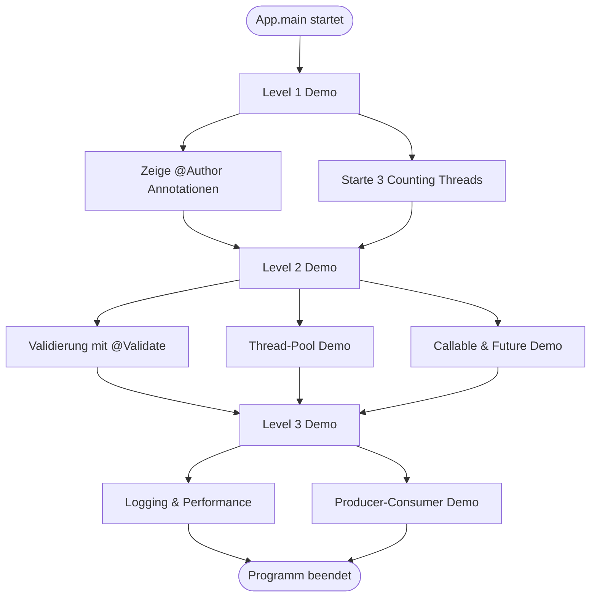

## 📁 Projektstruktur

```
src/de/javadeveloper/tag08/
├── App.java                    # Hauptklasse - Einstiegspunkt
├── level1/                     # Level 1: @Author & Threads
│   ├── Author.java            # Custom Annotation für Autoren-Informationen
│   ├── SimpleExample.java     # Beispielklasse mit @Author-Annotationen
│   ├── CountingTask.java      # Runnable-Implementierung für Threads
│   └── Level1Demo.java        # Demo für Level 1
├── level2/                     # Level 2: @Validate & Thread-Pool
│   ├── Validate.java          # Custom Annotation für Feld-Validierung
│   ├── Person.java            # Beispiel-Domainklasse mit @Validate
│   ├── Validator.java         # Reflection-basierter Validator
│   └── Level2Demo.java        # Demo für Level 2
└── level3/                     # Level 3: Logging, Producer-Consumer, Performance
    ├── LogExecutionTime.java  # Custom Annotation für Ausführungszeit-Logging
    ├── LoggingProcessor.java  # Processor für @LogExecutionTime
    ├── PerformanceComparisonDemo.java  # Performance-Vergleich sequentiell vs. parallel
    ├── ProducerConsumerDemo.java       # Producer-Consumer-Pattern Demo
    └── Level3Demo.java         # Demo für Level 3
```

### Abhängigkeitsdiagramm

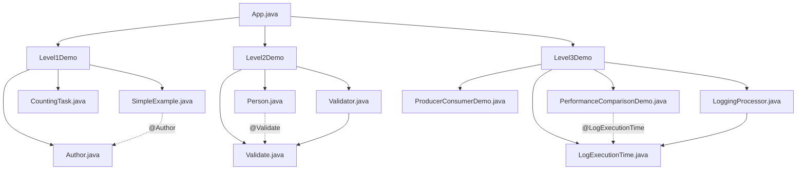

## 📚 Level 1: @Author & Threads

### Konzepte
- **Custom Annotationen**: Erstellen und Verwenden der `@Author`-Annotation
- **Reflection**: Auslesen von Annotationen zur Laufzeit
- **Basis-Threading**: Erstellen und Starten von Threads mit `Runnable`

### Komponenten

#### `@Author` Annotation
```java
@Retention(RetentionPolicy.RUNTIME)
@Target({ElementType.TYPE, ElementType.METHOD})
public @interface Author {
    String name();
    String date();
}
```

- Kann auf Klassen und Methoden angewendet werden
- Speichert Autoren-Name und Datum
- Wird zur Laufzeit ausgelesen

#### `CountingTask`
- Implementiert `Runnable`
- Zählt von 1 bis 10 mit Pausen zwischen den Zählvorgängen
- Demonstriert parallele Ausführung mehrerer Threads

### Annotation-Processing (Level 1)

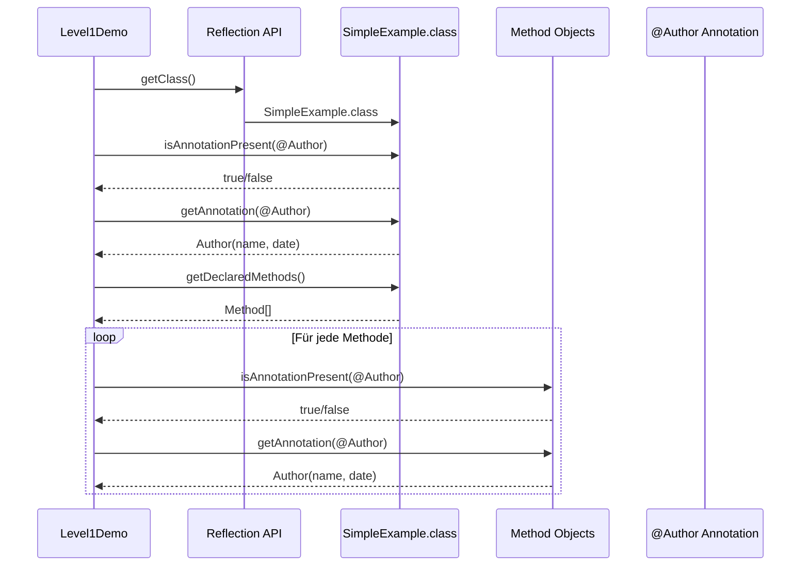

### Thread-Ausführung (Level 1)

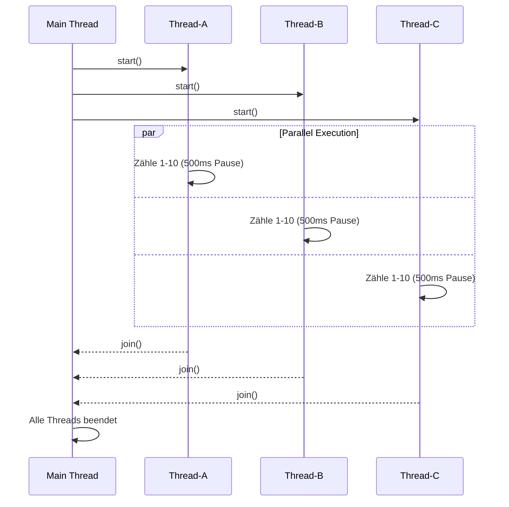

### Demo-Ausgabe
- Zeigt alle `@Author`-Annotationen einer Beispielklasse
- Startet drei parallele Zähl-Threads

## 📚 Level 2: @Validate & Thread-Pool

### Konzepte
- **Validierungs-Annotationen**: Feld-Validierung mit `@Validate`
- **Reflection-basierte Validierung**: Automatische Prüfung annotierter Felder
- **ExecutorService**: Thread-Pool-Verwaltung
- **Callable & Future**: Rückgabewerte von Thread-Aufgaben

### Komponenten

#### `@Validate` Annotation
```java
@Retention(RetentionPolicy.RUNTIME)
@Target(ElementType.FIELD)
public @interface Validate {
    boolean notEmpty() default false;
    int min() default Integer.MIN_VALUE;
    int max() default Integer.MAX_VALUE;
    String message() default "Ungültiger Wert";
}
```

- Wird auf Felder angewendet
- Unterstützt `notEmpty`-Prüfung für Strings
- Unterstützt `min`/`max`-Prüfung für Zahlen

#### `Validator`
- Verwendet Reflection, um alle `@Validate`-annotierten Felder zu finden
- Führt Validierungsprüfungen durch
- Gibt Liste von Fehlermeldungen zurück

#### Validierungsprozess

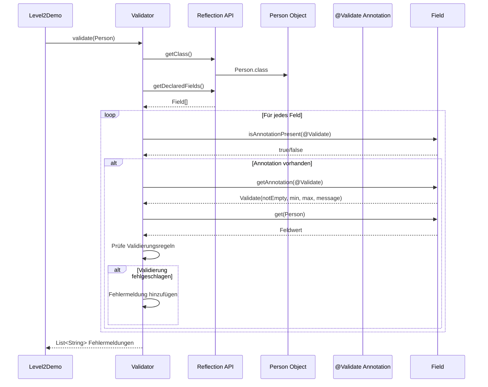

#### Thread-Pool-Demos
1. **ExecutorService mit Runnable**: 10 Aufgaben werden in einem Pool von 4 Threads ausgeführt
2. **Callable & Future**: 5 Aufgaben mit Rückgabewerten werden parallel ausgeführt und Ergebnisse gesammelt

### Thread-Pool Architektur (Level 2)

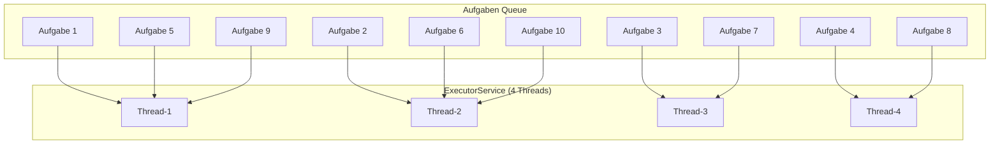

### Callable & Future Pattern

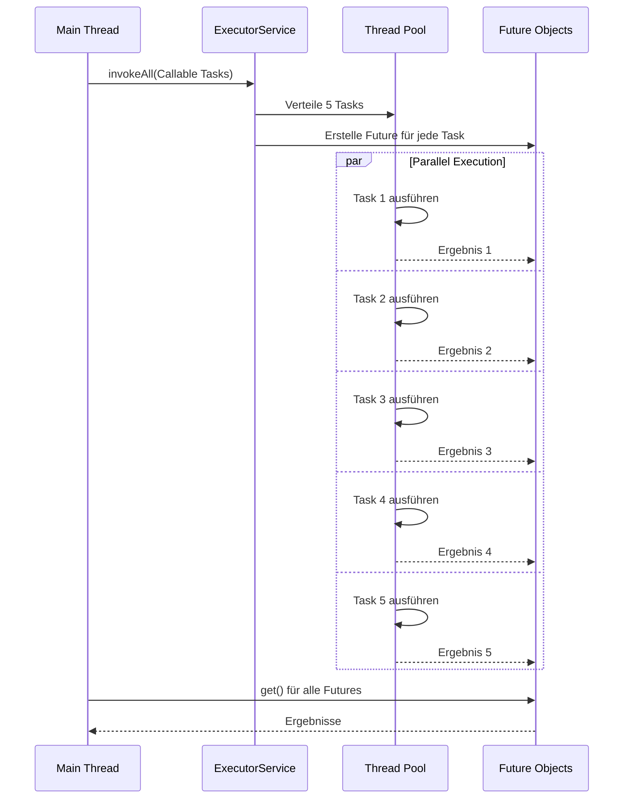

### Demo-Ausgabe
- Validierung von `Person`-Objekten mit gültigen und ungültigen Werten
- Parallele Ausführung von 10 Aufgaben in einem Thread-Pool
- Sammlung und Ausgabe von Future-Ergebnissen

## 📚 Level 3: Logging, Producer-Consumer, Performance

### Konzepte
- **Logging-Annotationen**: Automatisches Messen der Ausführungszeit
- **Annotation Processing**: Runtime-Processing von Annotationen
- **Producer-Consumer-Pattern**: Koordination zwischen produzierenden und konsumierenden Threads
- **Performance-Vergleich**: Sequentiell vs. parallel

### Komponenten

#### `@LogExecutionTime` Annotation
```java
@Retention(RetentionPolicy.RUNTIME)
@Target(ElementType.METHOD)
public @interface LogExecutionTime {
    String value() default "";
    boolean enabled() default true;
}
```

- Wird auf Methoden angewendet
- Misst automatisch die Ausführungszeit
- Kann mit einem Label versehen werden

#### `LoggingProcessor`
- Findet alle Methoden mit `@LogExecutionTime`
- Führt Methoden aus und misst die Dauer
- Gibt die Ausführungszeit aus

#### `PerformanceComparisonDemo`
- **`runSequential()`**: Führt 8 Aufgaben nacheinander aus
- **`runParallel()`**: Führt 8 Aufgaben parallel in einem Thread-Pool aus
- Beide Methoden sind mit `@LogExecutionTime` annotiert
- Zeigt den Performance-Unterschied zwischen sequentieller und paralleler Ausführung

#### Logging-Processor Pipeline

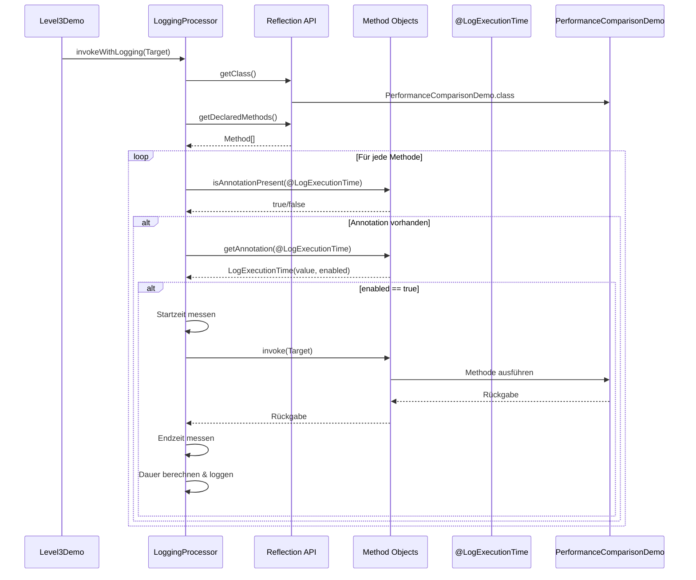

#### Performance-Vergleich: Sequentiell vs. Parallel

```mermaid
gantt
    title Performance-Vergleich: 8 Aufgaben
    dateFormat X
    axisFormat %s
    
    section Sequentiell
    Aufgabe 1 (100ms)    :0, 100
    Aufgabe 2 (100ms)    :100, 100
    Aufgabe 3 (100ms)    :200, 100
    Aufgabe 4 (100ms)    :300, 100
    Aufgabe 5 (100ms)    :400, 100
    Aufgabe 6 (100ms)    :500, 100
    Aufgabe 7 (100ms)    :600, 100
    Aufgabe 8 (100ms)    :700, 100
    
    section Parallel (4 Threads)
    Aufgabe 1 (100ms)    :0, 100
    Aufgabe 2 (100ms)    :0, 100
    Aufgabe 3 (100ms)    :0, 100
    Aufgabe 4 (100ms)    :0, 100
    Aufgabe 5 (100ms)    :100, 100
    Aufgabe 6 (100ms)    :100, 100
    Aufgabe 7 (100ms)    :100, 100
    Aufgabe 8 (100ms)    :100, 100
```

#### `ProducerConsumerDemo`
- Verwendet `BlockingQueue` für Thread-sichere Kommunikation
- **Producer**: Erstellt 10 Items und legt sie in die Queue
- **Consumer**: Zwei Consumer-Threads verarbeiten Items aus der Queue
- Demonstriert koordinierte Arbeitsteilung zwischen Threads

### Producer-Consumer Pattern

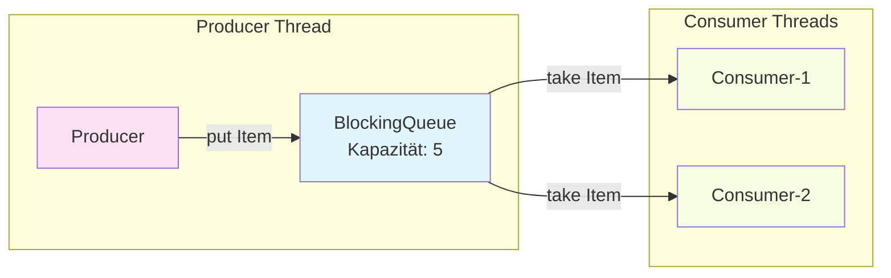

### Producer-Consumer Sequenzdiagramm

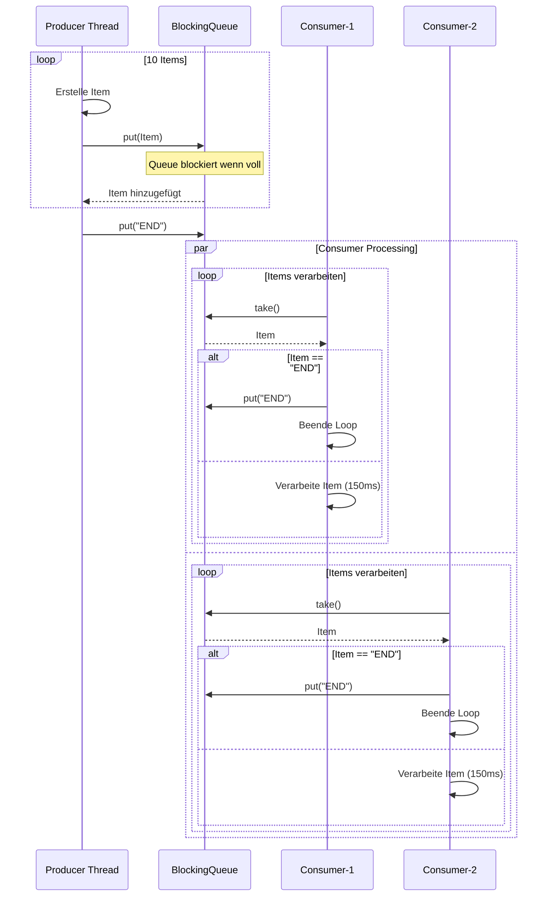

### Demo-Ausgabe
- Ausführungszeiten für sequentielle und parallele Verarbeitung
- Producer-Consumer-Interaktion mit Queue-basierter Kommunikation

## 🔑 Wichtige Java-Konzepte

### Annotationen

```mermaid
mindmap
  root((Annotationen))
    Retention
      SOURCE
      CLASS
      RUNTIME
    Target
      TYPE
      METHOD
      FIELD
      PARAMETER
    Reflection API
      getAnnotation()
      isAnnotationPresent()
      getDeclaredMethods()
      getDeclaredFields()
```

- **@Retention**: Bestimmt, wann Annotationen verfügbar sind (`RUNTIME` für Reflection)
- **@Target**: Bestimmt, wo Annotationen angewendet werden können
- **Reflection**: `Class.getAnnotation()`, `Method.getAnnotation()`, `Field.getAnnotation()`

### Multithreading

```mermaid
mindmap
  root((Multithreading))
    Thread Erstellung
      Thread Klasse
      Runnable Interface
      Callable Interface
    Thread Management
      ExecutorService
      Thread Pool
      Future
    Synchronisation
      BlockingQueue
      join()
      synchronized
```

- **Thread**: Basis-Klasse für Thread-Erstellung
- **Runnable**: Interface für ausführbare Aufgaben
- **Callable**: Interface für Aufgaben mit Rückgabewert
- **ExecutorService**: Verwaltung von Thread-Pools
- **Future**: Repräsentiert das Ergebnis einer asynchronen Berechnung
- **BlockingQueue**: Thread-sichere Queue für Producer-Consumer-Pattern

## 🛠️ Technische Details

- **Java Version**: Kompatibel mit Java SE 8+
- **Build-System**: Apache Ant (NetBeans-Projekt)
- **Package-Struktur**: `de.ibb.tag08`

## 📝 Lernziele

Nach dem Durcharbeiten dieses Projekts sollten Sie verstehen:

1. ✅ Wie man eigene Annotationen erstellt und verwendet
2. ✅ Wie man Annotationen zur Laufzeit mit Reflection ausliest
3. ✅ Grundlagen des Multithreading in Java
4. ✅ Verwendung von `ExecutorService` und Thread-Pools
5. ✅ Arbeiten mit `Callable` und `Future`
6. ✅ Implementierung des Producer-Consumer-Patterns
7. ✅ Performance-Vorteile paralleler Ausführung

## 📖 Weitere Informationen

Dieses Projekt ist Teil einer Java-Schulungsreihe und demonstriert praktische Anwendungen erweiterter Java-Techniken. Die drei Level bauen aufeinander auf und zeigen zunehmend komplexere Konzepte.
