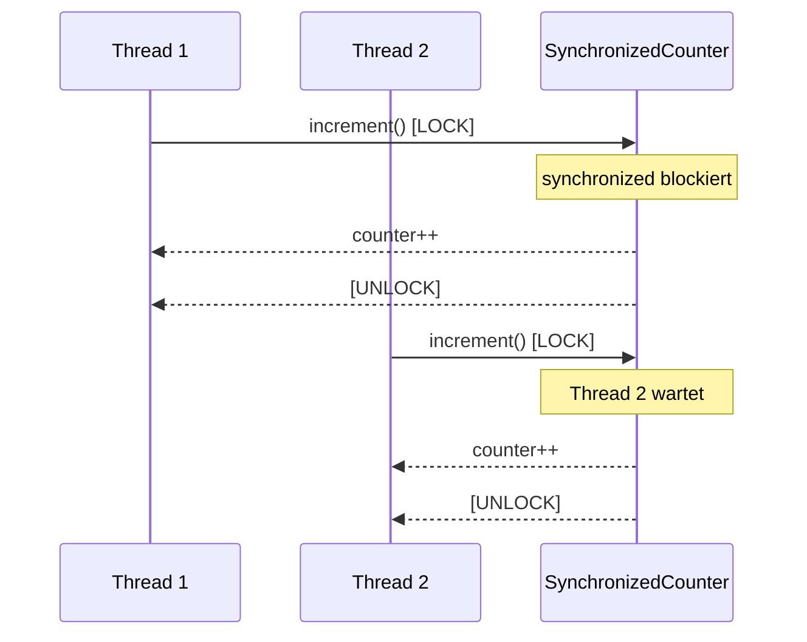
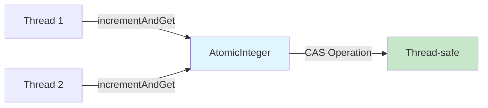
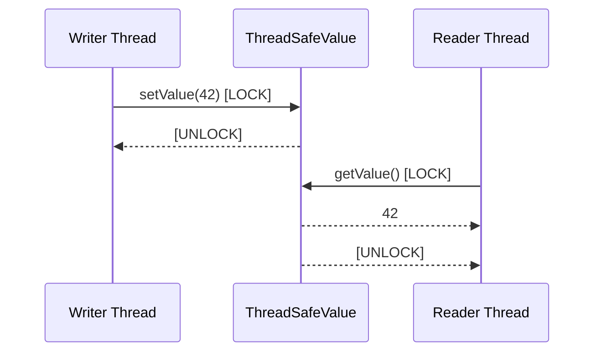
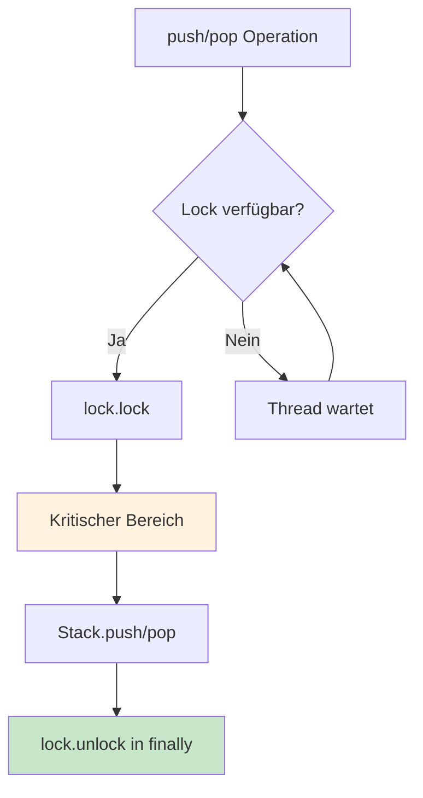
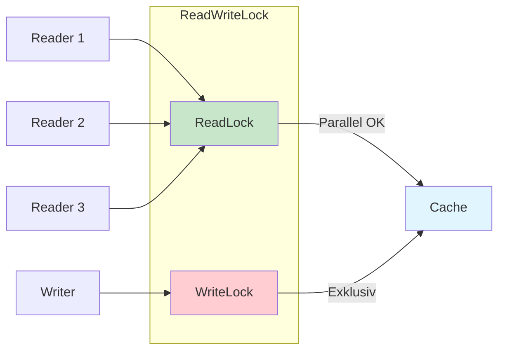
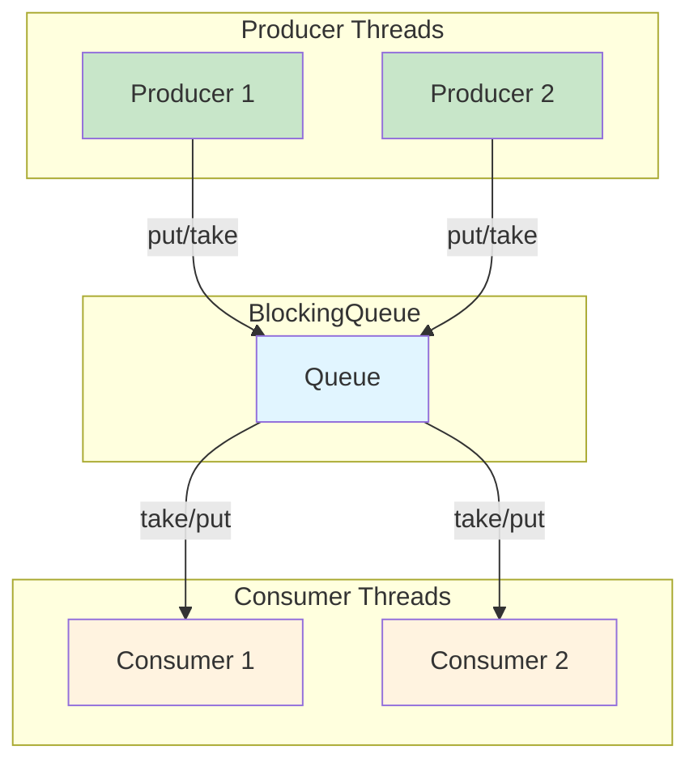
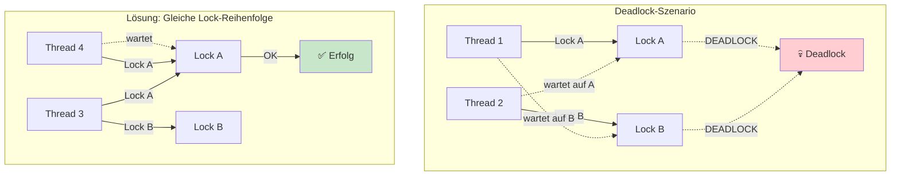
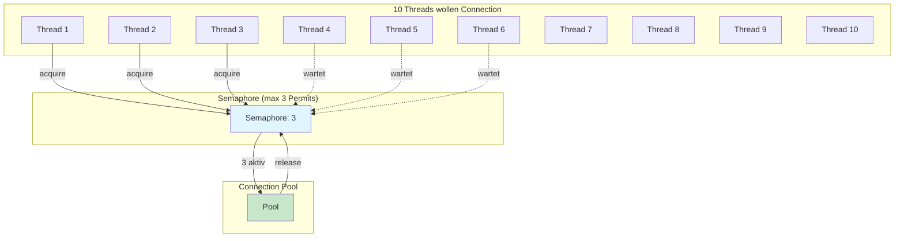
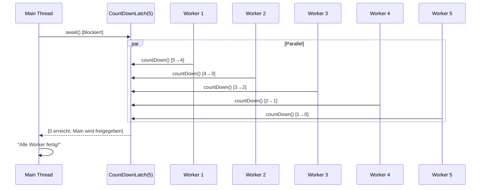

# Tag 9: Multithreading – Synchronisation

## 📋 Projektübersicht

Dieses Projekt implementiert die **Mini-Challenge** aus **Tag 9: Multithreading – Synchronisation** des Kurses "Java Erweiterte Techniken". Es demonstriert verschiedene Synchronisationsmechanismen in Java, von einfachen `synchronized`-Blöcken bis hin zu fortgeschrittenen `java.util.concurrent`-Klassen.

Das Projekt ist als **Ant-basiertes NetBeans-Projekt** aufgebaut und enthält alle drei Challenge-Level (Einsteiger, Fortgeschritten, Profi) mit vollständigen, lauffähigen Beispielen.

## 🎯 Lernziele

- ✅ Race Conditions verstehen und vermeiden
- ✅ `synchronized`-Blöcke und Methoden anwenden
- ✅ `volatile` für Sichtbarkeit verstehen
- ✅ `java.util.concurrent.locks` (ReentrantLock, ReadWriteLock) nutzen
- ✅ Atomic-Klassen für lockfreie Operationen verwenden
- ✅ Thread-sichere Collections einsetzen
- ✅ Deadlocks erkennen und vermeiden
- ✅ Semaphore und CountDownLatch praktisch anwenden

## 📁 Projektstruktur

```
09-multithreading-synchronisation/
├── build.xml                    # Ant-Build-Skript
├── nbproject/                   # NetBeans-Projektkonfiguration
│   ├── project.xml
│   ├── project.properties
│   └── build-impl.xml
├── src/
│   └── de/javadeveloper/tag09/
│       ├── Tag09MiniChallengeApp.java    # Main-Klasse
│       │
│       ├── Level1SynchronizedCounter.java      # Level 1: synchronized
│       ├── Level1AtomicCounter.java            # Level 1: AtomicInteger
│       ├── Level1ThreadSafeValue.java          # Level 1: Thread-safe Getter/Setter
│       │
│       ├── Level2LockStack.java                # Level 2: Stack mit ReentrantLock
│       ├── Level2ReadWriteCache.java            # Level 2: Cache mit ReadWriteLock
│       ├── Level2BlockingQueueDemo.java        # Level 2: Producer-Consumer
│       │
│       ├── Level3DeadlockDemo.java             # Level 3: Deadlock + Lösung
│       ├── Level3ConnectionPool.java           # Level 3: Semaphore
│       └── Level3InitWithCountDownLatch.java   # Level 3: CountDownLatch
└── README.md
```

## 🚀 Ausführung

### In NetBeans

1. **Projekt öffnen**: `File → Open Project...` → Ordner `09-multithreading-synchronisation` wählen
2. **Projekt ausführen**: Rechtsklick auf Projekt → `Run Project` (oder `Shift+F6`)
3. Die Konsole zeigt nacheinander alle Demos der drei Challenge-Level

### Mit Ant (Kommandozeile)

```bash
# Kompilieren und ausführen
ant run

# Oder nur kompilieren
ant compile

# Clean Build + JAR erstellen
ant clean jar
```

## 📚 Challenge-Levels im Detail

### 🟢 Level 1: Einsteiger

#### 1. Synchronized Counter

Demonstriert Thread-Sicherheit mit dem `synchronized`-Keyword.

**Klasse**: `Level1SynchronizedCounter`



**Kernkonzept**: Nur ein Thread kann gleichzeitig eine `synchronized`-Methode ausführen. Andere Threads warten automatisch.

#### 2. AtomicInteger Counter

Lockfreie Thread-Sicherheit mit Atomic-Operationen.

**Klasse**: `Level1AtomicCounter`



**Vorteil**: Keine Blockierung, sehr performant für einfache Zähler-Operationen.

#### 3. Thread-sichere Getter/Setter

Synchronisierte Zugriffe auf gemeinsame Daten.

**Klasse**: `Level1ThreadSafeValue`



---

### 🟡 Level 2: Fortgeschritten

#### 1. Thread-sicherer Stack mit ReentrantLock

Feingranulare Kontrolle über Locking mit `ReentrantLock`.

**Klasse**: `Level2LockStack<T>`



**Vorteile gegenüber `synchronized`**:
- `tryLock()` mit Timeout möglich
- `lockInterruptibly()` für unterbrechbare Locks
- Fairness-Option

#### 2. Cache mit ReadWriteLock

Paralleles Lesen, exklusives Schreiben.

**Klasse**: `Level2ReadWriteCache`



**Anwendungsfall**: Viele Lesezugriffe, wenige Schreibzugriffe (z.B. Konfigurations-Cache).

#### 3. Producer-Consumer mit BlockingQueue

Thread-sichere Kommunikation zwischen Produzenten und Konsumenten.

**Klasse**: `Level2BlockingQueueDemo`



**Besonderheit**: `put()` blockiert, wenn Queue voll; `take()` blockiert, wenn Queue leer.

---

### 🔴 Level 3: Profi

#### 1. Deadlock-Demo und Lösung

Demonstriert, wie Deadlocks entstehen und wie man sie vermeidet.

**Klasse**: `Level3DeadlockDemo`



**Lösungsansätze**:
1. **Gleiche Lock-Reihenfolge**: Immer zuerst Lock A, dann Lock B
2. **tryLock mit Timeout**: Verhindert endloses Warten

#### 2. ConnectionPool mit Semaphore

Begrenzt gleichzeitige Zugriffe auf eine Ressource.

**Klasse**: `Level3ConnectionPool`



**Anwendungsfall**: Datenbankverbindungen, Netzwerkverbindungen, Datei-Handles begrenzen.

#### 3. Parallele Initialisierung mit CountDownLatch

Wartet auf mehrere Threads, bevor der Hauptthread fortfährt.

**Klasse**: `Level3InitWithCountDownLatch`



**Anwendungsfall**: Parallele Initialisierung mehrerer Komponenten, bevor die Anwendung startet.

---

## 🔍 Wichtige Konzepte im Überblick

### Synchronisation-Mechanismen

| Mechanismus | Verwendung | Thread-Safety | Performance |
|------------|------------|---------------|-------------|
| `synchronized` | Einfache Fälle | ✅ | Mittel |
| `ReentrantLock` | Komplexe Anforderungen | ✅ | Mittel |
| `AtomicInteger/Long` | Zähler, Flags | ✅ | Sehr hoch |
| `ReadWriteLock` | Viele Leser, wenige Schreiber | ✅ | Hoch (Lesen) |
| `BlockingQueue` | Producer-Consumer | ✅ | Hoch |
| `Semaphore` | Ressourcen-Begrenzung | ✅ | Mittel |
| `CountDownLatch` | Warten auf Threads | ✅ | Hoch |

### Thread-sichere Collections

| Standard | Thread-safe Alternative | Wann verwenden? |
|----------|------------------------|-----------------|
| `ArrayList` | `CopyOnWriteArrayList` | Viele Leser, wenige Schreiber |
| `HashMap` | `ConcurrentHashMap` | Map mit vielen Zugriffen |
| `HashSet` | `ConcurrentHashMap.newKeySet()` | Thread-sicheres Set |
| `Queue` | `BlockingQueue` | Producer-Consumer-Pattern |

---

## ⚠️ Häufige Fallen

### 1. Race Condition bei `counter++`

```java
// ❌ FALSCH: Nicht thread-safe
private int counter = 0;
public void increment() {
    counter++; // 3 Operationen: Lesen, Erhöhen, Schreiben
}

// ✅ RICHTIG: synchronized
public synchronized void increment() {
    counter++;
}

// ✅ BESSER: AtomicInteger
private AtomicInteger counter = new AtomicInteger(0);
public void increment() {
    counter.incrementAndGet();
}
```

### 2. Deadlock durch unterschiedliche Lock-Reihenfolge

```java
// ❌ FALSCH: Deadlock-Gefahr
Thread 1: lockA → lockB
Thread 2: lockB → lockA

// ✅ RICHTIG: Gleiche Reihenfolge
Thread 1: lockA → lockB
Thread 2: lockA → lockB
```

### 3. `volatile` macht nicht atomar

```java
// ❌ FALSCH: volatile garantiert nur Sichtbarkeit, nicht Atomarität
private volatile int count = 0;
count++; // IMMER NOCH NICHT THREAD-SAFE!

// ✅ RICHTIG: AtomicInteger
private AtomicInteger count = new AtomicInteger(0);
count.incrementAndGet(); // Thread-safe
```

### 4. Spurious Wakeups bei `wait()`

```java
// ❌ FALSCH: if-Schleife
if (queue.isEmpty()) {
    wait(); // Kann ohne notify() aufwachen!
}

// ✅ RICHTIG: while-Schleife
while (queue.isEmpty()) {
    wait(); // Prüft erneut nach Aufwachen
}
```

---

## 🛠️ Technische Details

### Java-Version
- **Minimum**: Java 17
- **Empfohlen**: Java 17 oder höher

### Build-System
- **Ant** (Apache Ant)
- NetBeans-integriert

### Projekt-Konfiguration
- **Main-Klasse**: `de.ibb.tag09.Tag09MiniChallengeApp`
- **Source-Verzeichnis**: `src/`
- **Build-Verzeichnis**: `build/classes/`
- **Dist-Verzeichnis**: `dist/`

---

## 📖 Weiterführende Ressourcen

- [Oracle: Java Concurrency Tutorial](https://docs.oracle.com/javase/tutorial/essential/concurrency/)
- [Baeldung: java.util.concurrent](https://www.baeldung.com/java-util-concurrent)
- [Java Concurrency in Practice (Buch)](https://jcip.net/)

---

## 📝 Lizenz

Dieses Projekt ist Teil des Kurses "Java Erweiterte Techniken" und dient ausschließlich zu Lernzwecken.

---

## 👤 Autor

Erstellt im Rahmen von **Tag 9: Multithreading – Synchronisation** des Java-Erweiterte-Techniken-Kurses.

**Quelle**: [java-developer.online - Tag 9](https://www.java-developer.online/tag-9-multithreading-synchronisation/)
