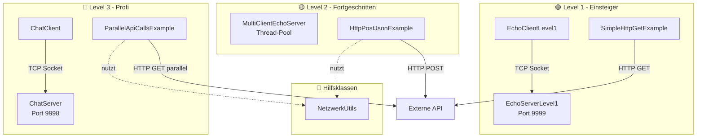
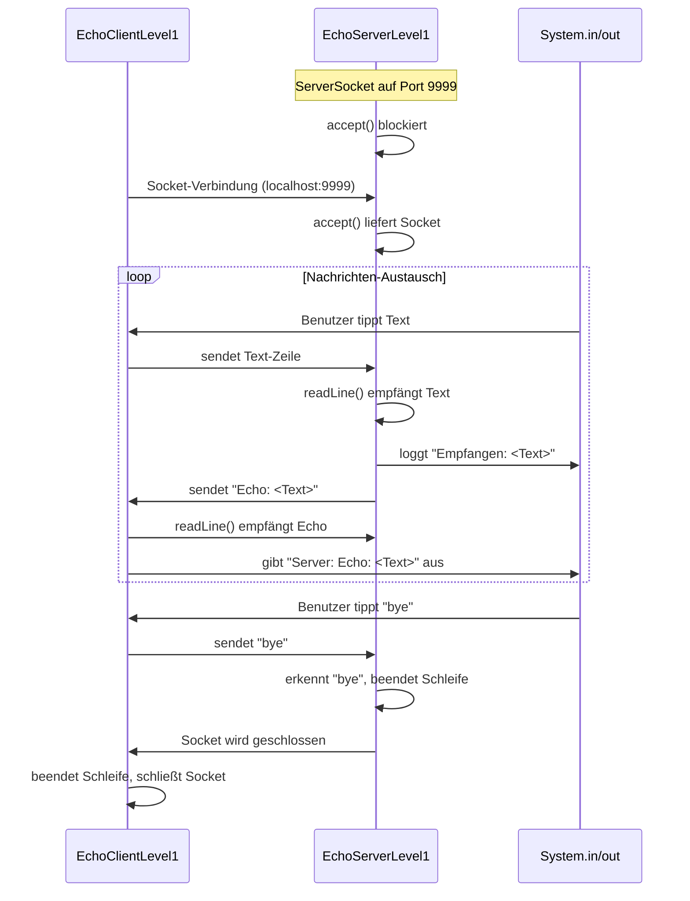
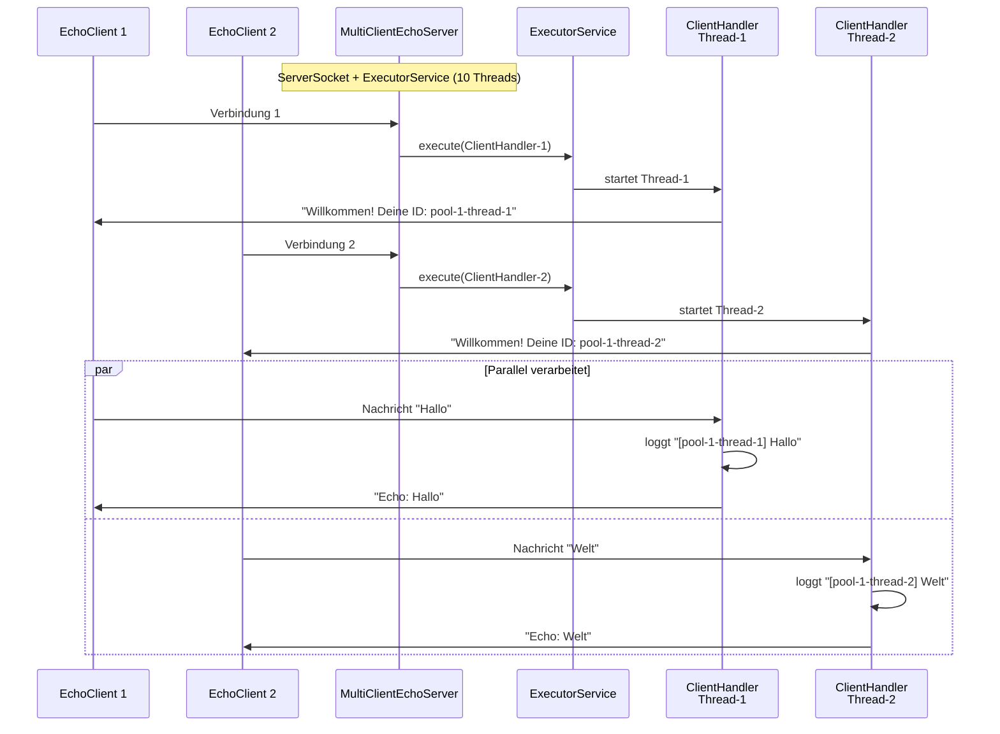
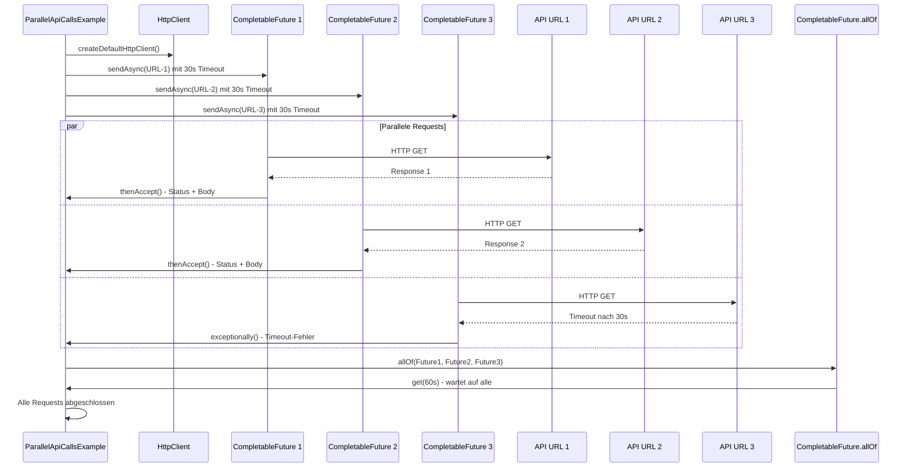
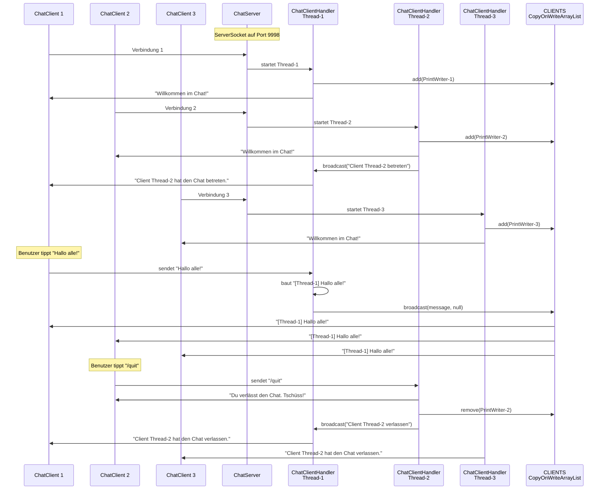

## Tag 10 – Netzwerkprogrammierung (Sockets & HttpClient)

Dieses Projekt enthält die Umsetzung der Mini-Challenge aus  
`Tag 10: Netzwerkprogrammierung – Sockets, HTTP und REST-Clients` (Java Fleet).

Alle Beispiele liegen im Paket `de.ibb.netzwerk.tag10` unter `src/de/trainer/netzwerk/tag10`.

---

## Übersicht der Klassen

- **Level 1 – Einsteiger**
  - `EchoServerLevel1` – Einfacher, blockierender TCP-Echo-Server (ein Client).
  - `EchoClientLevel1` – Konsolen-Client zum Testen des Echo-Servers.
  - `SimpleHttpGetExample` – Einfacher GET-Request mit `HttpClient`.

- **Level 2 – Fortgeschritten**
  - `MultiClientEchoServer` – Echo-Server mit mehreren Clients (Thread-Pool).
  - `HttpPostJsonExample` – POST-Request mit JSON-Body und einfacher JSON-Auswertung.

- **Level 3 – Profi**
  - `ChatServer` – Chat-Server mit Broadcast an alle Clients.
  - `ChatClient` – Konsolen-Chat-Client mit Lese- und Schreib-Thread.
  - `ParallelApiCallsExample` – Parallele API-Calls mit `CompletableFuture` und Timeout.

- **Hilfsklasse**
  - `NetzwerkUtils` – Hilfsmethoden für `HttpClient`, Requests und Ausgaben.

---

## Architektur-Übersicht



---

## Laufzeit-Ablauf – Schritt für Schritt

### 1. EchoServerLevel1 & EchoClientLevel1

**EchoServerLevel1**

1. `main` startet und legt `ServerSocket` auf Port `9999` an.
2. Der Server schreibt auf die Konsole:  
   „Server läuft auf Port 9999. Warte auf Client-Verbindung …".
3. In einer Endlosschleife:
   - `accept()` blockiert, bis sich ein Client verbindet.
   - Bei Verbindung wird ein `Socket` an `handleClient(socket)` übergeben.
4. `handleClient`:
   - Richtet `BufferedReader` (lesen) und `PrintWriter` (schreiben, autoFlush) ein.
   - Liest Zeilen mit `readLine()` vom Client.
   - Für jede Zeile:
     - Loggt: `Empfangen: <Text>`.
     - Sendet zurück: `Echo: <Text>`.
     - Bei `"bye"` (Case-insensitive) wird die Schleife beendet und der Socket geschlossen.

**EchoClientLevel1**

1. `main` verbindet sich mit `localhost:9999`.
2. Es werden drei Streams aufgebaut:
   - Vom Server lesen (`BufferedReader`).
   - Zum Server schreiben (`PrintWriter`).
   - Von der Konsole lesen (`BufferedReader` auf `System.in`).
3. Der Client schreibt: „Verbunden mit Server. Tippe Nachrichten ("bye" zum Beenden):“.
4. In einer Schleife:
   - Liest eine Zeile von der Konsole.
   - Sendet die Zeile zum Server.
   - Liest die Antwort vom Server.
   - Gibt auf der Konsole aus: `Server: <Antwort>`.
   - Bei `"bye"` beendet der Client die Schleife und schließt den Socket.

**Lernpunkte**

- Blockierendes `readLine()` auf Server- und Client-Seite.
- Unterschied zwischen sauberem Beenden (`"bye"`) und Verbindungstrennung (wenn `readLine()` `null` liefert).

**Sequenzdiagramm – Echo-Server/Client**



---

### 2. MultiClientEchoServer

**Ziel:** Mehrere Clients parallel bedienen.

**Ablauf**

1. `main` erstellt einen `ServerSocket` auf Port `9999` und einen `ExecutorService` mit fester Thread-Anzahl (z.B. 10 Threads).
2. In einer Endlosschleife:
   - `accept()` wartet auf neue Client-Verbindungen.
   - Für jeden Client wird ein `ClientHandler` erzeugt und per `EXECUTOR.execute(handler)` gestartet.
3. `ClientHandler.run()`:
   - Ermittelt den aktuellen Thread-Namen (z.B. `pool-1-thread-1`).
   - Sendet eine Begrüßung: „Willkommen! Deine ID: pool-1-thread-1“.
   - Liest Zeilen vom Client (`readLine()`).
   - Loggt sie auf der Konsole mit Prefix `[ThreadName]`.
   - Sendet `Echo: <Text>` zurück.
   - Bei `"bye"` beendet der Handler die Schleife und schließt den Socket.

**Lernpunkte**

- Parallele Bearbeitung mit Thread-Pool statt einem Thread pro Verbindung.
- Thread-Name als einfache „Client-ID“.

**Sequenzdiagramm – MultiClient-Echo-Server**



---

### 3. SimpleHttpGetExample

**Ziel:** Moderner `HttpClient` (Java 11+) für einen GET-Request.

**Ablauf**

1. `main` definiert eine URL, z.B. `https://jsonplaceholder.typicode.com/posts/1`.
2. `HttpClient client = HttpClient.newHttpClient();` erstellt einen Standard-Client.
3. `HttpRequest` wird gebaut mit:
   - `.uri(URI.create(url))`
   - `.GET()`
4. `client.send(request, BodyHandlers.ofString())` führt den Request **synchron** aus:
   - Der Aufruf blockiert, bis der Server geantwortet hat oder ein Fehler auftritt.
5. Danach:
   - Ausgabe des Statuscodes (z.B. `200`).
   - Ausgabe des Response-Bodys (JSON) als String.

**Lernpunkte**

- Einstieg in den modernen `HttpClient`.
- Unterschied zwischen Request-Building (Builder) und Senden (Client).

---

### 4. HttpPostJsonExample

**Ziel:** POST mit JSON-Body und einfacher JSON-Auswertung.

**Ablauf**

1. `main` wählt als Ziel z.B. `https://jsonplaceholder.typicode.com/posts`.
2. `HttpClient` wird über `NetzwerkUtils.createDefaultHttpClient()` erstellt:
   - HTTP/2, Redirects erlaubt, Connect-Timeout 10s.
3. JSON-Body wird als Textblock definiert:
   ```json
   {
     "title": "Mein Post",
     "body": "Inhalt hier",
     "userId": 1
   }
   ```
4. `HttpRequest`:
   - `NetzwerkUtils.defaultRequestBuilder(url)` setzt URI + Request-Timeout.
   - Header `Content-Type: application/json`.
   - Body über `BodyPublishers.ofString(jsonBody)`.
5. `client.send(request, BodyHandlers.ofString())`:
   - Gibt Statuscode und JSON-Antwort aus.
6. Ein Regex (`"\"id\"\\s*:\\s*(\\d+)"`) extrahiert die `id` aus der JSON-Antwort und gibt sie separat aus.

**Lernpunkte**

- Senden eines JSON-Request-Bodys mit POST.
- Einfache JSON-Auswertung per RegEx (für echte Projekte: Jackson/Gson nutzen).

---

### 5. ParallelApiCallsExample

**Ziel:** Mehrere HTTP-Requests parallel mit `CompletableFuture` und Timeout.

**Ablauf**

1. `HttpClient client = NetzwerkUtils.createDefaultHttpClient();`
2. Eine `List<String>` mit mehreren URLs wird definiert (z.B. drei `jsonplaceholder`-Posts).
3. Für jede URL wird `sendAsyncWithLogging(client, url)` aufgerufen:
   - Erzeugt einen `HttpRequest` mit `NetzwerkUtils.defaultRequestBuilder(url).GET().build()`.
   - `client.sendAsync(request, BodyHandlers.ofString())` startet den Request asynchron.
   - `.orTimeout(30, TimeUnit.SECONDS)` setzt ein per-Request-Timeout.
   - `.thenAccept(response -> { ... })`:
     - Gibt Status und einen gekürzten Body (z.B. erste 50 Zeichen) aus.
   - `.exceptionally(ex -> { ... })`:
     - Handhabt `TimeoutException`, `IOException` und andere Fehler mit klaren Meldungen.
4. `CompletableFuture.allOf(...)` wird verwendet, um auf **alle** Requests zu warten:
   - `all.get(60, TimeUnit.SECONDS)` setzt ein Gesamt-Timeout für die gesamte Operation.

**Lernpunkte**

- Unterschied zwischen synchronen (`send`) und asynchronen (`sendAsync`) Requests.
- Verwenden von `CompletableFuture` für parallele Aufrufe.
- Zeitlimits auf Request- und Gesamtebene.

**Sequenzdiagramm – Parallele API-Calls**



---

### 6. ChatServer & ChatClient – Laufzeit im Detail

#### ChatServer

**Ziel:** Einfacher Chat-Server, der Nachrichten eines Clients an alle anderen Clients (Broadcast) weiterleitet.

**Ablauf**

1. `main`:
   - Startet einen `ServerSocket` auf Port `9998`.
   - Erstellt einen `ExecutorService` mit z.B. 20 Threads.
   - Erstellt eine threadsichere Liste `CLIENTS` (`CopyOnWriteArrayList<PrintWriter>`).
2. Endlosschleife im Server:
   - `accept()` wartet auf neue Clients.
   - Bei Verbindung:
     - Loggt „Neuer Client verbunden: …“.
     - Startet einen neuen `ChatClientHandler` im Threadpool.

3. `ChatClientHandler.run()`:
   - Baut `BufferedReader` (lesen vom Client) und `PrintWriter` (schreiben zum Client) auf.
   - Fügt den `PrintWriter` in die Liste `CLIENTS` ein.
   - Ruft `broadcast("Client <ThreadName> hat den Chat betreten.", out)` auf:
     - Sendet die Nachricht an alle anderen Clients.
   - Sendet an den neuen Client:
     - „Willkommen im Chat! Tippe Nachrichten, '/quit' zum Verlassen.“
   - Hauptschleife:
     - Liest Zeilen vom Client mit `readLine()`.
     - Wenn Zeile `"/quit"`:
       - Antwort an Client: „Du verlässt den Chat. Tschüss!“
       - Schleife wird beendet → Handler endet → Socket schließt.
     - Sonst:
       - Baut eine Chat-Nachricht im Format `[ThreadName] Nachricht`.
       - Loggt sie auf der Server-Konsole.
       - Ruft `broadcast(message, null)` auf:
         - Sendet die Nachricht an alle Clients in `CLIENTS`.
   - Beim Verlassen von `run()` (z.B. durch `/quit` oder Verbindungstrennung):
     - Loggt „Client <ThreadName> hat die Verbindung getrennt.“

4. `broadcast(String message, PrintWriter exclude)`:
   - Iteriert über alle `PrintWriter` in `CLIENTS`.
   - Sendet `message` an jeden Client, außer an `exclude` (falls gesetzt).

**Lernpunkte**

- Zentrales Broadcast-Konzept über gemeinsame Liste von Client-Streams.
- Verwendung einer threadsicheren Sammlung (`CopyOnWriteArrayList`).
- Trennung von Verbindungsaufbau (im Server-Loop) und Nachrichtenverarbeitung (im Handler).

#### ChatClient

**Ziel:** Konsolenbasierter Chat-Client mit parallelem Lesen und Schreiben.

**Ablauf**

1. `main` verbindet sich mit `localhost:9998`.
2. Streams:
   - `serverIn` (vom Server lesen).
   - `serverOut` (zum Server schreiben).
   - `console` (Benutzereingaben von `System.in`).
3. Es wird ein separater Leser-Thread gestartet:
   - Name: `"ChatClient-Reader"`.
   - Schleife:
     - Liest `line = serverIn.readLine()`.
     - Gibt jede empfangene Zeile direkt auf der Konsole aus.
     - Beendet sich, wenn `readLine()` `null` liefert oder eine `IOException` auftritt.
   - `setDaemon(true)`:
     - Der Leser-Thread verhindert nicht, dass das Programm beendet wird, wenn `main` endet.
4. Hauptthread:
   - Gibt Hinweis aus: „Verbunden mit Chat-Server. Tippe Nachrichten ('/quit' zum Verlassen):“.
   - Liest Zeilen von der Konsole.
   - Sendet jede Zeile mit `serverOut.println(...)` an den Server.
   - Bei `"/quit"` beendet der Hauptthread die Schleife, verlässt den `try`-Block und schließt den Socket.
   - Der Server erkennt das und beendet später den passenden `ChatClientHandler`.

**Lernpunkte**

- Zwei Threads pro Client (Lesen vs. Schreiben) zur Vermeidung von Blockaden.
- Zusammenspiel von `/quit`-Befehl im Client und Broadcast-Logik im Server.
- Praktisches Beispiel für einfache, aber realistische Chat-Kommunikation.

**Sequenzdiagramm – Chat-Server mit Broadcast**



---

## Nutzung in der IDE / Konsole

### Mit Ant-Befehlen (Empfohlen)

Das Projekt verwendet Apache Ant für Build und Ausführung. Alle Beispiele können direkt über Ant-Targets gestartet werden.

#### Kompilieren

```bash
ant compile
```

#### Verfügbare Ant-Targets

| Target | Beschreibung |
|--------|--------------|
| `ant run-echo-server` | Startet `EchoServerLevel1` (Port 9999) |
| `ant run-echo-client` | Startet `EchoClientLevel1` |
| `ant run-multi-server` | Startet `MultiClientEchoServer` (Port 9999) |
| `ant run-chat-server` | Startet `ChatServer` (Port 9998) |
| `ant run-chat-client` | Startet `ChatClient` |
| `ant run-http-get` | Führt `SimpleHttpGetExample` aus |
| `ant run-http-post` | Führt `HttpPostJsonExample` aus |
| `ant run-parallel-api` | Führt `ParallelApiCallsExample` aus |
| `ant clean` | Löscht Build- und Dist-Verzeichnisse |
| `ant jar` | Erstellt JAR-Datei |

#### Demonstrations-Ablauf

**1. Echo Server/Client (Level 1 – Grundlagen)**

```bash
# Terminal 1: Server starten
ant run-echo-server

# Terminal 2: Client starten
ant run-echo-client
# Nachrichten eingeben, "bye" zum Beenden
```

**2. Multi-Client Echo Server (Level 2 – Threading)**

```bash
# Terminal 1: Multi-Client-Server starten
ant run-multi-server

# Terminal 2, 3, 4...: Mehrere Clients parallel starten
ant run-echo-client
```

**3. HTTP GET (Level 1 – Einfacher Request)**

```bash
ant run-http-get
```

**4. HTTP POST mit JSON (Level 2 – POST-Request)**

```bash
ant run-http-post
```

**5. Parallele API-Calls (Level 3 – Async/CompletableFuture)**

```bash
ant run-parallel-api
```

**6. Chat Server/Client (Level 3 – Broadcast)**

```bash
# Terminal 1: Chat-Server starten
ant run-chat-server

# Terminal 2, 3, 4...: Mehrere Chat-Clients starten
ant run-chat-client
# Nachrichten zwischen Clients testen, "/quit" zum Verlassen
```

#### Tipps für die Demonstration

- **Mehrere Terminals**: In VS Code `Ctrl+Shift+` ` (Backtick) für neues Terminal, oder Terminal-Symbol → Split Terminal
- **Port-Konflikte**: Falls Port belegt ist, mit `netstat -ano | findstr :9999` (Windows) den Prozess finden
- **Reihenfolge**: Server immer zuerst starten, dann Client(s)
- **Clean Build**: Bei Problemen `ant clean` und dann `ant compile`

### Mit direkten Java-Befehlen

Alternativ können die Programme auch direkt mit Java gestartet werden (nach dem Kompilieren):

```bash
# Kompilieren
ant compile

# Server starten
java -cp build/classes de.ibb.netzwerk.tag10.EchoServerLevel1

# Client starten (in neuem Terminal)
java -cp build/classes de.ibb.netzwerk.tag10.EchoClientLevel1
```

### In NetBeans

NetBeans bietet mehrere Möglichkeiten, die Beispiele zu starten. Die einfachste Methode ist "Run File" für einzelne Klassen.

> **Quick-Reference:** Siehe auch [NETBEANS.md](NETBEANS.md) für eine kompakte Übersicht.

#### Projekt öffnen

1. **NetBeans öffnen**
2. **File → Open Project** → Projektordner auswählen
3. Projekt erscheint im **Projects-Fenster** (Strg+1)

#### Methode 1: Run File (Empfohlen für Demonstration)

Die einfachste Methode: Rechtsklick auf die Java-Datei → **Run File** (F6)

**Vorteile:**
- Jedes Programm startet in einem eigenen Output-Fenster
- Keine Konfiguration nötig
- Ideal für parallele Server/Client-Demonstrationen

**Verfügbare Klassen zum Starten:**

| Klasse | Beschreibung | Port |
|--------|--------------|------|
| `EchoServerLevel1.java` | Echo Server (Level 1) | 9999 |
| `EchoClientLevel1.java` | Echo Client (Level 1) | - |
| `MultiClientEchoServer.java` | Multi-Client Echo Server | 9999 |
| `ChatServer.java` | Chat Server | 9998 |
| `ChatClient.java` | Chat Client | - |
| `SimpleHttpGetExample.java` | HTTP GET Beispiel | - |
| `HttpPostJsonExample.java` | HTTP POST Beispiel | - |
| `ParallelApiCallsExample.java` | Parallele API-Calls | - |

#### Demonstrations-Ablauf in NetBeans

**1. Echo Server/Client (Level 1 – Grundlagen)**

```
1. Rechtsklick auf EchoServerLevel1.java → Run File (F6)
   → Server wartet auf Port 9999

2. Rechtsklick auf EchoClientLevel1.java → Run File (F6)
   → Client verbindet sich, Nachrichten eingeben, "bye" zum Beenden
```

**2. Multi-Client Echo Server (Level 2 – Threading)**

```
1. Rechtsklick auf MultiClientEchoServer.java → Run File (F6)

2. Mehrere Clients starten:
   - Rechtsklick auf EchoClientLevel1.java → Run File (F6)
   - Wiederholen für weitere Clients
   → Jeder Client erhält eine eigene Thread-ID
```

**3. HTTP GET (Level 1 – Einfacher Request)**

```
Rechtsklick auf SimpleHttpGetExample.java → Run File (F6)
→ Zeigt Statuscode und JSON-Response
```

**4. HTTP POST mit JSON (Level 2 – POST-Request)**

```
Rechtsklick auf HttpPostJsonExample.java → Run File (F6)
→ Zeigt Statuscode, JSON-Response und extrahierte ID
```

**5. Parallele API-Calls (Level 3 – Async/CompletableFuture)**

```
Rechtsklick auf ParallelApiCallsExample.java → Run File (F6)
→ Zeigt parallele Requests mit Timeout-Handling
```

**6. Chat Server/Client (Level 3 – Broadcast)**

```
1. Rechtsklick auf ChatServer.java → Run File (F6)
   → Server wartet auf Port 9998

2. Mehrere Chat-Clients starten:
   - Rechtsklick auf ChatClient.java → Run File (F6)
   - Wiederholen für weitere Clients
   → Nachrichten zwischen Clients testen, "/quit" zum Verlassen
```

#### Methode 2: Run Project (Standard-Main-Klasse)

Die Standard-Main-Klasse ist `EchoServerLevel1` (konfiguriert in `nbproject/project.properties`).

- **Run → Run Project** (F6) startet die Standard-Main-Klasse
- Für andere Klassen: Methode 1 (Run File) verwenden

#### Methode 3: Ant-Targets in NetBeans

NetBeans kann auch Ant-Targets direkt ausführen:

1. **Rechtsklick auf Projekt** → **Run Target**
2. Verfügbare Targets:
   - `run-echo-server`
   - `run-echo-client`
   - `run-multi-server`
   - `run-chat-server`
   - `run-chat-client`
   - `run-http-get`
   - `run-http-post`
   - `run-parallel-api`

#### Output-Fenster verwalten

- **Window → Output → Output** (Strg+4) zeigt alle Output-Fenster
- Jedes "Run File" öffnet ein neues Output-Fenster
- Fenster können nebeneinander angeordnet werden
- **Window → IDE Tools → Terminal** für zusätzliche Terminals

#### Debugging in NetBeans

**Breakpoints setzen:**

1. Linksklick in den Zeilennummernbereich (roter Punkt erscheint)
2. **Debug File** (Strg+F5) statt Run File
3. Programm stoppt am Breakpoint
4. **Variables-Fenster** (Strg+3) zeigt Variablenwerte
5. **Step Over** (F8), **Step Into** (F7), **Continue** (F5)

**Empfohlene Breakpoints für Demonstration:**

- `EchoServerLevel1.java`: Zeile 43 (`readLine()`)
- `ChatServer.java`: Zeile 68 (`readLine()` im Handler)
- `ChatClient.java`: Zeile mit `readLine()` im Reader-Thread

#### Tipps für NetBeans-Demonstration

- **Mehrere Output-Fenster**: Jedes "Run File" erstellt ein eigenes Fenster
- **Fenster anordnen**: Window → Arrange Windows → Tile Horizontally
- **Projekt kompilieren**: Build → Build Project (F11)
- **Clean & Build**: Build → Clean and Build Project (Shift+F11)
- **Port-Konflikte**: Falls Port belegt, mit `netstat -ano | findstr :9999` (Windows) Prozess finden
- **Reihenfolge**: Server immer zuerst starten, dann Client(s)

#### Empfohlene Fenster-Anordnung

Für optimale Demonstration:

1. **Projects-Fenster** (Strg+1) – für schnellen Zugriff auf Klassen
2. **Output-Fenster** (Strg+4) – nebeneinander für Server/Client
3. **Navigator** (Strg+7) – optional, für Klassenstruktur
4. **Terminal** (Window → IDE Tools → Terminal) – optional, für zusätzliche Befehle

### In anderen IDEs (IntelliJ IDEA, Eclipse)

**IntelliJ IDEA:**
- Rechtsklick auf Klasse → Run 'Klassenname'
- Mehrere Run-Konfigurationen: Run → Edit Configurations
- Parallele Ausführung: Run → Run... → mehrere Konfigurationen auswählen

**Eclipse:**
- Rechtsklick auf Klasse → Run As → Java Application
- Run-Konfigurationen: Run → Run Configurations
- Mehrere Instanzen: Run → Run History → gewünschte Konfiguration

