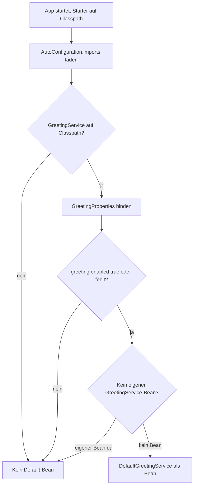

# Projekt-Erklärung: Greeting Spring Boot Starter

Schritt-für-Schritt-Erklärung des Lehrprojekts für einen eigenen Spring-Boot-3-Starter.

## Was das Projekt ist

Ein **Lehrprojekt für einen eigenen Spring-Boot-3-Starter**: Es baut eine Bibliothek, die beim App-Start automatisch einen konfigurierbaren `GreetingService` bereitstellt. Eine Demo-Webapp zeigt, dass man dafür weder `@Bean` noch `@Import` schreiben muss.

- Java 21
- Spring Boot 3.2.5
- Zwei Maven-Module

---

## Schritt 1: Projektaufbau

```text
greeting-spring-boot-starter-project (Parent POM)
├── greeting-spring-boot-starter      ← die Bibliothek (Starter)
└── greeting-spring-boot-starter-demo ← die Beispiel-App
```

| Modul | Rolle |
|-------|--------|
| **Parent** | gemeinsame Java-/Spring-Boot-Versionen |
| **Starter** | nur Auto-Config + Greeting-API (kein Web) |
| **Demo** | hängt den Starter + `spring-boot-starter-web` ein, läuft auf Port **8101** |

---

## Schritt 2: Der Vertrag – `GreetingService`

Öffentliche API des Starters:

```java
String greet(String name);  // null/leer → IllegalArgumentException
```

Apps hängen nur von diesem Interface ab, nicht von der Default-Implementierung.

---

## Schritt 3: Konfiguration – `GreetingProperties`

`@ConfigurationProperties(prefix = "greeting")` bindet Werte aus `application.properties`:

| Property | Bedeutung | Default |
|----------|-----------|---------|
| `greeting.message` | Text vor dem Namen | `Hello` |
| `greeting.uppercase` | Ausgabe in Großbuchstaben | `false` |
| `greeting.prefix` | optionaler Vorsatz | `""` |
| `greeting.enabled` | Bean an/aus | `true` |
| `greeting.format.separator` | zwischen Message und Name | `", "` |
| `greeting.format.suffix` | nach dem Namen | `"!"` |
| `greeting.format.emoji` | optional um die Begrüßung | `""` |

Hinweis: `greeting.enabled` wird von der Auto-Configuration über `@ConditionalOnProperty` ausgewertet – nicht vom Service selbst.

---

## Schritt 4: Die Logik – `DefaultGreetingService`

Baut den Begrüßungs-String in fester Reihenfolge:

1. optional Prefix + Leerzeichen
2. Message + Separator + Name + Suffix
3. optional `toUpperCase()`
4. optional Emoji drumherum (danach, damit das Emoji nicht mit großgeschrieben wird)

Beispiel mit den Demo-Properties: `greet("Petra")` → `"Hello, Petra!"`

---

## Schritt 5: Auto-Configuration – das Herzstück

`GreetingAutoConfiguration` registriert den Bean **nur unter Bedingungen**:



Wichtige Mechanismen:

- **`AutoConfiguration.imports`** (Boot 3) listet die Auto-Config-Klasse – Ersatz für `spring.factories`
- **`@ConditionalOnClass`** – nur wenn die Greeting-API auf dem Classpath ist
- **`@EnableConfigurationProperties`** – bindet `greeting.*` an `GreetingProperties`
- **`@ConditionalOnMissingBean`** – eine eigene `GreetingService`-Bean hat Vorrang
- **`matchIfMissing = true`** – ohne `greeting.enabled` ist der Service trotzdem aktiv

---

## Schritt 6: Die Demo als Verbraucher

Die Demo hängt nur den Starter ein und injiziert `GreetingService`:

1. **`DemoApplication`** – `CommandLineRunner` begrüßt Petra/Nova/Elyndra beim Start
2. **`GreetingController`** – REST:
   - `GET /greet/{name}` → Begrüßung für den Namen
   - `GET /greet` → Begrüßung für `"World"`

Kein manuelles `@Bean` für `GreetingService` – der Starter liefert ihn.

---

## Schritt 7: Ablauf beim Start (Zusammenfassung)

1. Demo startet mit `@SpringBootApplication`
2. Starter liegt auf dem Classpath
3. Spring Boot liest `AutoConfiguration.imports` → lädt `GreetingAutoConfiguration`
4. Bedingungen passen → `DefaultGreetingService`-Bean entsteht
5. Properties aus `application.properties` fließen in `GreetingProperties`
6. Controller und `CommandLineRunner` bekommen den Service per Constructor-Injection

---

## Lernziel in einem Satz

**„Classpath + AutoConfiguration.imports + Conditions + ConfigurationProperties = fertiger Bean ohne manuelle Verdrahtung.“**
