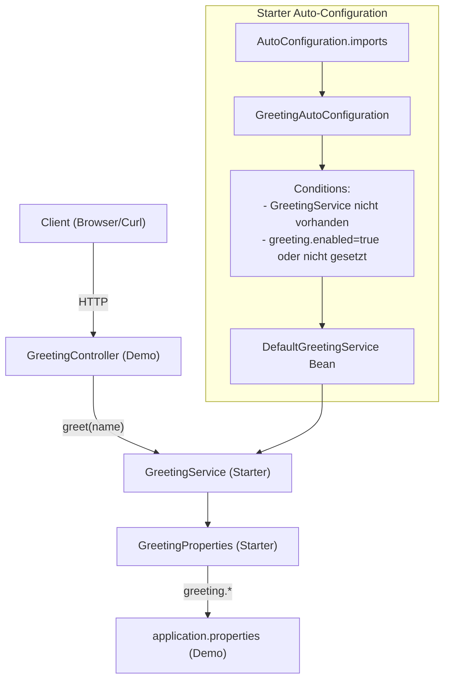
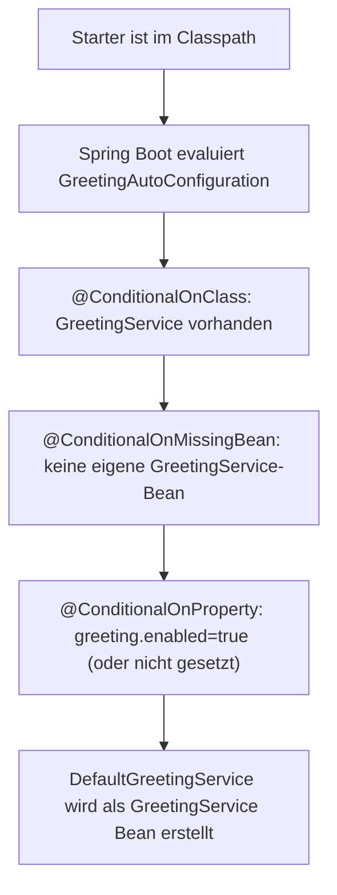
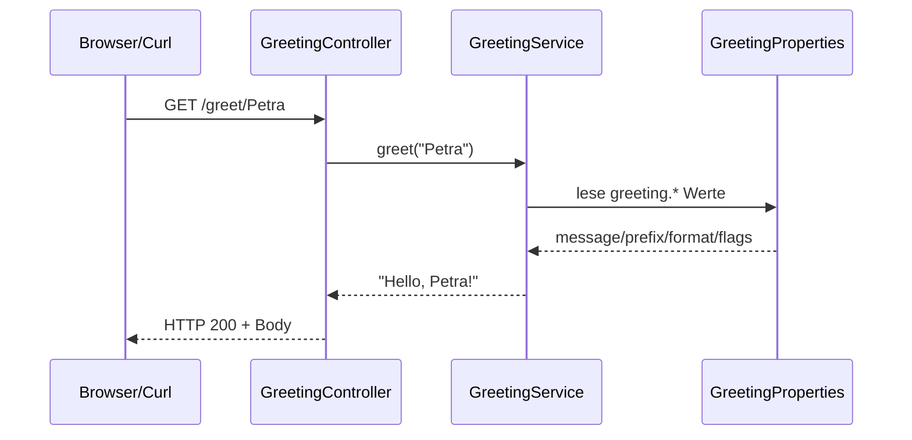

Die Aufgabe dieses Moduls steht in der [README des Elternordners](../README.md).

# Greeting Spring Boot Starter (Custom Starter + Demo)

Dieses Projekt zeigt, wie du in Spring Boot 3 einen **Custom Starter** baust, der sich über `application.properties` konfigurieren lässt und per **Auto-Configuration** automatisch einen `GreetingService` bereitstellt. Zusätzlich enthält es eine **Demo-Web-App**, die den Starter wie eine externe Dependency nutzt.

Der Demo-Server läuft auf **Port `8101`**.

## Projektstruktur

```text
01-customconfig-autostarter/
  pom.xml                                  (Parent, Packaging: pom)
  greeting-spring-boot-starter/          (Starter, Packaging: jar)
    pom.xml
    src/main/java/de/ibb/greeting/
    src/main/resources/META-INF/spring/
    src/test/java/de/ibb/greeting/
  greeting-spring-boot-starter-demo/     (Demo-App, Packaging: jar)
    pom.xml
    src/main/java/de/ibb/demo/
    src/main/resources/application.properties
    src/test/java/de/ibb/demo/
```

## High-Level Architektur



## Starter-Modul: `greeting-spring-boot-starter`

### Was wird automatisch bereitgestellt?

Wenn das Starter-Modul im Classpath ist, registriert Spring Boot (über Auto-Configuration) standardmäßig eine Bean:

- `GreetingService` → Default-Implementation: `DefaultGreetingService`

### Typisierte Konfiguration: `GreetingProperties`

Im Starter gibt es eine `@ConfigurationProperties(prefix = "greeting")` Klasse:

- `greeting.message` (Default: `"Hello"`)
- `greeting.uppercase` (Default: `false`)
- `greeting.prefix` (Default: `""`)
- `greeting.enabled` (Default: `true`)
- `greeting.format.separator` (Default: `", "`)
- `greeting.format.suffix` (Default: `"!"`)
- `greeting.format.emoji` (Default: `""`)

### Auto-Configuration: `GreetingAutoConfiguration`

Die Auto-Configuration ist als Spring Boot 3 `@AutoConfiguration` implementiert und wird registriert über:

`greeting-spring-boot-starter/src/main/resources/META-INF/spring/org.springframework.boot.autoconfigure.AutoConfiguration.imports`

Dort steht:

- `de.ibb.greeting.GreetingAutoConfiguration`

Relevante Conditions:

1. `@ConditionalOnClass(GreetingService.class)`  
   → die Auto-Configuration ist nur aktiv, wenn die Interface-Klasse existiert.
2. `@EnableConfigurationProperties(GreetingProperties.class)`  
   → Properties werden gebunden.
3. `@ConditionalOnMissingBean(GreetingService.class)`  
   → User kann den `GreetingService` überschreiben.
4. `@ConditionalOnProperty(...)` mit `greeting.enabled`  
   → Deaktivierung per `greeting.enabled=false`.



### DefaultGreetingService: Ergebnislogik

`DefaultGreetingService#greet(name)` baut den Text in dieser Reihenfolge:

1. Optionaler Prefix (wenn nicht leer)
2. `greeting.message`
3. `greeting.format.separator`
4. `name` (Whitespace wird getrimmt)
5. `greeting.format.suffix`
6. Optional `uppercase` (gesamter String wird zu Großbuchstaben)
7. Optional `emoji` (Emoji wird vorne und hinten ergänzt)

Außerdem werden ungültige Namen (null/leer/Whitespace-only) mit einer `IllegalArgumentException` abgelehnt.

## Demo-Modul: `greeting-spring-boot-starter-demo`

### Laufparameter und Endpoints

In `greeting-spring-boot-starter-demo/src/main/resources/application.properties`:

- `server.port=8101`

REST-Endpoints in `GreetingController`:

- `GET /greet/{name}` → `greetingService.greet(name)`
- `GET /greet` → Shortcut für `greet("World")`



### Start (Maven)

Im Projekt-Root:

```bash
mvn clean test
```

Demo starten (z.B. im Demo-Modul):

```bash
cd greeting-spring-boot-starter-demo
mvn spring-boot:run
```

Danach testen:

- `http://localhost:8101/greet/Petra` (erwartet: `Hello, Petra!`)
- `http://localhost:8101/greet` (erwartet: `Hello, World!`)

## Tests

Das Projekt enthält Unit- und Auto-Configuration-Tests im Starter sowie Webtests in der Demo:

- Starter:
  - `GreetingPropertiesTest`
  - `DefaultGreetingServiceTest`
  - `GreetingAutoConfigurationTest` (mit `ApplicationContextRunner` für isoliertes Auto-Config-Testing)
- Demo:
  - `GreetingControllerTest` (mit `@SpringBootTest` + `MockMvc`)

## NetBeans Hinweis (wichtig)

Der **Parent** ist ein Maven `pom`-Modul und hat **kein Run**. Starte immer das **Demo-Modul**:

1. Im Projects-Fenster den Parent aufklappen → **Modules**
2. Rechtsklick auf **`Greeting Starter Demo`** (`greeting-spring-boot-starter-demo`)
3. **Set as Main Project**
4. Danach **Run Project** (grüner Pfeil) oder Rechtsklick → **Run**

Das Demo-Modul enthält `nbactions.xml` mit Goal `spring-boot:run` und die Main-Class `de.ibb.demo.DemoApplication`.

Falls Run fehlt: Properties des Demo-Moduls → **Actions** → **Run project** → Goals: `spring-boot:run`

## Erweiterungspunkte (wie du den Starter nutzt)

### Starter deaktivieren

```properties
greeting.enabled=false
```

Dann wird keine `GreetingService` Bean aus dem Starter erstellt.

### Eigene Implementierung überschreiben

Da `GreetingAutoConfiguration` `@ConditionalOnMissingBean(GreetingService.class)` verwendet, kannst du in deiner Anwendung eine eigene Bean bereitstellen, die dann priorisiert wird.

