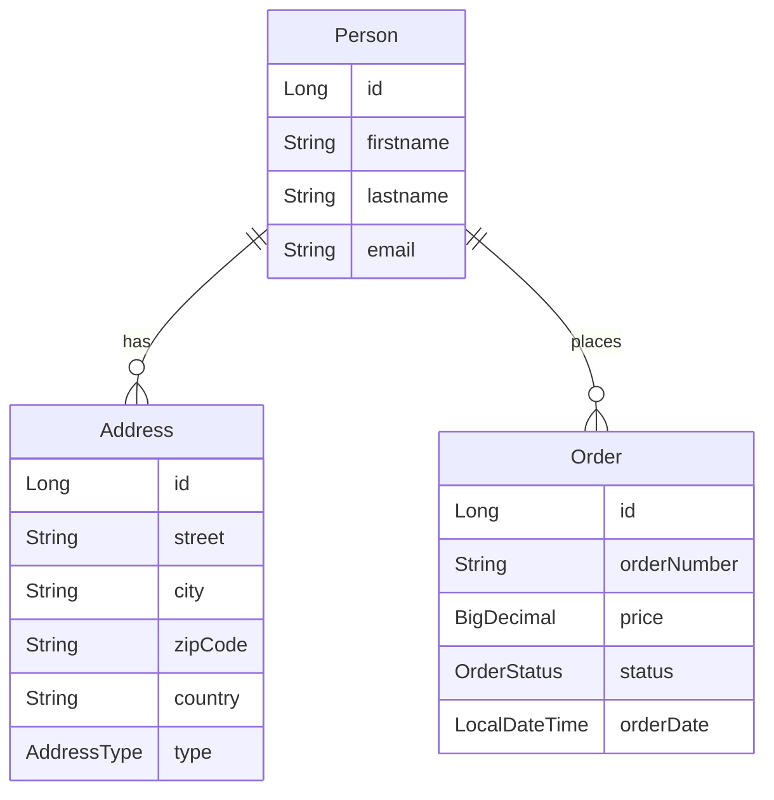

# Tag 3: JPA Relationships – Maven-Projekt

## Ausgangslage

- Workspace [`03-jpa-relations`](c:\Users\Trainer\Documents\NetBeansProjects\Spring Boot AK\03-jpa-relations) ist **leer**.
- Vorlage: [`02-jpa-basics`](c:\Users\Trainer\Documents\NetBeansProjects\Spring Boot AK\02-jpa-basics) (Spring Boot **3.3.0**, Java **21**, H2 + MariaDB-Profile).
- Inhalt laut [Tutorial](https://www.java-developer.online/tag-3-jpa-relationships-and-queries/): Person ↔ Address / Order, Query Methods, `@Query` + JOIN FETCH.

## Entscheidungen

| Thema | Wahl |
|-------|------|
| Umfang | **Grundlagen + Professional** (Schritte 1–6) vollständig; Bonus (Schritt 7) als schlanke Ergänzung (Pagination-Endpoint, eine Specification, EntityGraph, Projection) |
| Package | `com.fleetdata.personmanagement` (wie Tutorial) |
| Lombok | Ja (wie Tutorial: `@Data`, `@ToString.Exclude`, `@RequiredArgsConstructor`) |
| DB-Default | **H2** (`spring.profiles.active=h2`), MariaDB-Profil analog Tag 2 — sofort startbar ohne DB-Setup |
| JSON-Zyklen | `@JsonManagedReference` / `@JsonBackReference` auf Relationships (Tutorial-Code allein würde bei GET StackOverflow/Infinite JSON erzeugen) |

## Architektur



## Dateistruktur

```
03-jpa-relations/
  pom.xml
  src/main/java/com/fleetdata/personmanagement/
    PersonManagementApplication.java
    entity/AddressType.java, Address.java, OrderStatus.java, Order.java, Person.java
    repository/PersonRepository.java, OrderRepository.java
    controller/PersonController.java, OrderController.java
    specification/PersonSpecifications.java   (Bonus)
    projection/PersonSummary.java             (Bonus)
  src/main/resources/
    application.properties
    application-h2.properties
    application-mysql.properties
  src/test/java/.../PersonManagementApplicationTests.java
  curl-tests.md   (cURL-Beispiele aus dem Tutorial)
```

## Umsetzungsschritte

### 1. Maven-Grundgerüst

[`pom.xml`](c:\Users\Trainer\Documents\NetBeansProjects\Spring Boot AK\03-jpa-relations\pom.xml) analog Tag 2 plus:

- `lombok` (`optional`/`provided`)
- gleiche Starter: `web`, `data-jpa`, `validation`, `h2`, `mariadb-java-client`, `test`
- artifactId z. B. `jpa-relations` / name passend zum Kurs

Profiles in Resources wie Tag 2:

- `application.properties`: `spring.profiles.active=h2`, Port 8080
- `application-h2.properties`: In-Memory H2 + Console + `ddl-auto=create-drop`
- `application-mysql.properties`: MariaDB `persondb`, `ddl-auto=update`

### 2. Entities (Kern)

- **AddressType**, **OrderStatus** – Enums wie Tutorial
- **Address** – `@ManyToOne(LAZY)` + `@JoinColumn(person_id)` + `@Enumerated(STRING)` + `@JsonBackReference`
- **Order** – ManyToOne zu Person, `@PrePersist` für `orderDate`/`status`
- **Person** – zwei `@OneToMany(mappedBy="person", cascade=ALL, orphanRemoval=true, LAZY)` für `addresses` und `orders`; Helper `addAddress`/`removeAddress`/`addOrder`/`removeOrder`; `@JsonManagedReference` auf Collections

### 3. Repositories

- **PersonRepository**: Query Methods (`findByEmail`, `findByLastname`, `findByFirstnameContainingIgnoreCase`, `findByAddresses_City`, …) + `@Query` Fetch Joins (`findAllWithAddresses`, `findByIdWithAll`) + `JpaSpecificationExecutor` + EntityGraph-Methode + Projection-Methode
- **OrderRepository**: Status-/Preis-/Person-Queries + `findByStatusWithPerson`

### 4. Controller (lauffähige API)

- **PersonController**: CRUD-ähnlich Tag 2 + `POST /{id}/addresses`, Search-Endpoints, Fetch-Join-Endpoints; bei `POST` nested Addresses über Helper synchronisieren (sonst bleibt `person` auf Address null)
- **OrderController**: Orders anlegen (`POST /api/persons/{id}/orders`) und nach Status/Person abfragen

### 5. Bonus (schlank)

- Pagination: `GET /api/persons?page=&size=&sortField=&sortDir=`
- `PersonSpecifications` + Endpoint z. B. `GET /api/persons/search/dynamic`
- `PersonSummary` Projection + Endpoint

### 6. NetBeans / Start

- Projekt als normales Maven-Projekt öffnen (Ordner `03-jpa-relations`)
- Run: Main-Klasse `PersonManagementApplication` oder `mvn spring-boot:run`
- Verifikation: `GET http://localhost:8080/api/persons`, cURL-Beispiele in `curl-tests.md`

## Bekannte Tutorial-Fixes (damit es wirklich läuft)

1. Fehlende Imports (`List`, `AddressType`, `@Param`) im Tutorial-Snippet ergänzen
2. Bidirektionale JSON-Serialisierung absichern
3. Beim Anlegen von Person mit nested `addresses` beide Seiten setzen
4. `Order`-Entity-Name ist in JPQL ok; Tabelle heißt `orders` (kein SQL-Keyword-Konflikt mit Hibernate)

## Nicht im Scope

- Flyway/Security (Tag 4+)
- Umbenennen/Anpassen von Tag-2-Code
- Push/Commit (nur auf Wunsch)
