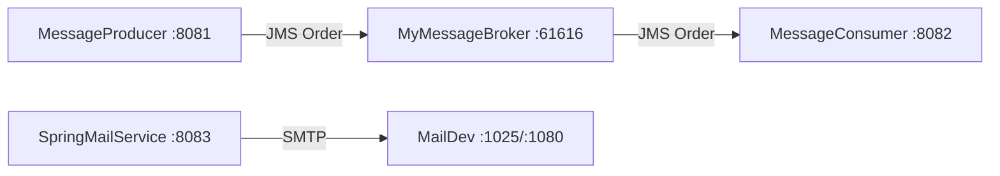

# Tag 7: Messaging & Email – Maven-Projekt

## Struktur (Entscheidung)

Ein **Parent-Multi-Modul-Projekt** im Workspace-Root (wie [01-customconfig-autostarter](c:\Users\Trainer\Documents\NetBeansProjects\Spring Boot AK\01-customconfig-autostarter)), mit vier unabhängig startbaren Spring-Boot-Apps – analog zu den Tutorial-Downloads, aber in NetBeans als ein Projekt öffnenbar:

```
06-messaging-email/
├── pom.xml                          # packaging=pom, Module auflisten
├── MyMessageBroker/                 # Port 8080, ActiveMQ 61616
├── MessageProducer/                 # Port 8081
├── MessageConsumer/                 # Port 8082
└── SpringMailService/               # Port 8083
```

- **Spring Boot 3.3.0**, **Java 21**, `groupId`: `de.fleetdata.messaging` (wie Tutorial)
- Jedes Modul: eigenes `pom.xml` mit `spring-boot-starter-parent` bzw. Parent-BOM + `spring-boot-maven-plugin`



## Modul 1: MyMessageBroker

Aus dem Tutorial 1:1:

- [`BrokerConfig.java`](MyMessageBroker/src/main/java/de/fleetdata/messaging/config/BrokerConfig.java) – embedded `BrokerService`, Persistenz, `tcp://localhost:61616`
- [`MessageBrokerApplication.java`](MyMessageBroker/src/main/java/de/fleetdata/messaging/MessageBrokerApplication.java)
- `application.properties` (Port 8080, Broker-URL, KahaDB)
- Dependencies: `spring-boot-starter-web`, `spring-boot-starter-activemq`, `activemq-broker`, `activemq-kahadb-store`

## Modul 2: MessageProducer

Tutorial-Code + fehlende Gerüste:

- Model [`Order.java`](MessageProducer/src/main/java/de/fleetdata/messaging/model/Order.java) (`Serializable`, Lombok)
- [`OrderProducer`](MessageProducer/src/main/java/de/fleetdata/messaging/service/OrderProducer.java) + [`OrderController`](MessageProducer/src/main/java/de/fleetdata/messaging/controller/OrderController.java) (`GET /api/orders/send`)
- `MessageProducerApplication`, `application.properties` (Port 8081, Queue `order-queue`)
- Dependencies: `web`, `activemq`, `lombok`

## Modul 3: MessageConsumer

- Identisches `Order`-Model (gleiches Package + `serialVersionUID`)
- [`OrderConsumer`](MessageConsumer/src/main/java/de/fleetdata/messaging/service/OrderConsumer.java) mit `@JmsListener`
- Main mit `@EnableJms`
- Optional kleiner REST-Endpoint `GET /api/orders/processed` (sinnvoll zum Prüfen, aus Consumer-Service ableitbar)
- Port 8082, gleiche ActiveMQ-/Queue-Properties

## Modul 4: SpringMailService

Tutorial-Lücken ergänzen (im Artikel nur skizziert):

- `pom.xml`: `web`, `mail`, `thymeleaf`, `lombok`
- [`EmailService`](SpringMailService/src/main/java/de/fleetdata/messaging/service/EmailService.java) – simple / HTML / `@Async`
- [`EmailController`](SpringMailService/src/main/java/de/fleetdata/messaging/controller/EmailController.java) für die Tutorial-curl-URLs:
  - `GET /api/email/send?to=...`
  - `GET /api/email/html?to=...&name=...`
  - `GET /api/email/async?to=...&name=...`
- [`AsyncConfig`](SpringMailService/src/main/java/de/fleetdata/messaging/config/AsyncConfig.java) – ThreadPool wie im Professionals-Teil
- Thymeleaf-Template `templates/email/welcome.html`
- Main mit `@EnableAsync`, Port 8083, MailDev SMTP (`localhost:1025`)

**Nicht** die Mini-Challenge (Consumer + Email kombiniert) – Fokus auf die vier lauffähigen Kernprojekte.

## NetBeans / Startreihenfolge

1. Parent-Projekt in NetBeans öffnen
2. Module einzeln starten: **Broker → Producer → Consumer** (und optional Mail + Docker MailDev)
3. Test: `curl "http://localhost:8081/api/orders/send?product=Laptop&customer=Max&quantity=2"`
4. Mail: `docker run -p 1080:1080 -p 1025:1025 maildev/maildev`, dann curl gegen `:8083`

Kurze `README.md` im Root mit Startreihenfolge und curl-Beispielen (für NetBeans/Kursnutzung).

## Hinweis ActiveMQ

`spring.activemq.packages.trust-all=true` wie im Tutorial setzen, damit die `Order`-Deserialisierung funktioniert. Broker zuerst starten, sonst schlagen Producer/Consumer fehl.