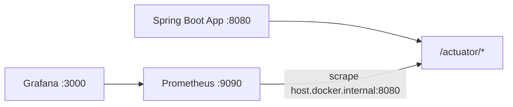

# Tag 9: Spring Boot Actuator – Maven-Projekt

## Ausgangslage

- Workspace [`07-actuator`](c:\Users\Trainer\Documents\NetBeansProjects\Spring Boot AK\07-actuator) ist **leer**.
- Konventionen aus Nachbarprojekten: **Spring Boot 3.4.3**, **Java 17**, Package **`com.example`**, Standard-Maven-Layout (NetBeans öffnet die `pom.xml` direkt).

## Architektur



App läuft in NetBeans/`mvn spring-boot:run`; Monitoring-Stack optional per Docker.

## Maven / Dependencies

Neue [`pom.xml`](c:\Users\Trainer\Documents\NetBeansProjects\Spring Boot AK\07-actuator\pom.xml):

- Parent: `spring-boot-starter-parent` **3.4.3**
- Artifact: `actuator-monitoring` / `com.example`
- Starter: `web`, `data-jpa`, `security`, `actuator`, `aop`, `mail`, `validation`
- Runtime: `h2`, `micrometer-registry-prometheus`
- Optional: `lombok` (wie in Tag-4/7-Projekten)
- Plugin: `spring-boot-maven-plugin`

## Paketstruktur

```
com.example
  ActuatorMonitoringApplication
  config/     ActuatorSecurityConfig, ActuatorUserConfig, AppSecurityConfig, RestTemplateConfig
  model/      User
  repository/ UserRepository
  service/    UserService          (Counter + Timer via MeterRegistry)
  controller/ UserController, PingController
  health/     EmailServiceHealthIndicator, ExternalApiHealthIndicator
  monitoring/ DatabaseQueryTracker, RepositoryMonitoringAspect,
              DatabaseQueriesEndpoint, DatabaseQueryMetricsExporter
```

## Laufzeit-Anpassungen (damit es ohne Extra-Setup startet)

| Tutorial | Praktische Lösung für NetBeans |
|----------|--------------------------------|
| H2 in Health-Response | H2 in-memory (`jdbc:h2:mem:actuatordb`) |
| Externes SMTP | `health.email.check-connection=false` (Default): Indicator meldet UP wenn Mail-Bean/Config da ist; mit `true` echter `testConnection()` wie im Blog |
| External API | Prüft `http://localhost:${server.port}/api/ping` (kein externes Netz nötig) |
| Prometheus `targets: ['app:8080']` | `host.docker.internal:8080` (App in NetBeans, Stack in Docker auf Windows) |
| API-Security | Zweite `SecurityFilterChain` für `/api/**` → `permitAll` (Metriken per POST erzeugbar ohne Login) |

Actuator-Security bleibt wie im Blog: `health`/`info`/`prometheus` public, Rest braucht Rolle `ACTUATOR` (User `actuator` / `actuator-secret-password`).

## Konfiguration

[`src/main/resources/application.properties`](c:\Users\Trainer\Documents\NetBeansProjects\Spring Boot AK\07-actuator\src\main\resources\application.properties):

- Exposure: `health,info,metrics,prometheus,loggers,database-queries`
- `management.endpoint.health.show-details=always`
- `info.app.*` wie im Tutorial
- Prometheus-Export + HTTP-Histogramme
- H2, JPA `ddl-auto=update`, einfache Mail-Platzhalter-Properties

## Kern-Features (aus dem Blog)

1. **Actuator-Endpoints** – konfiguriert und absicherbar  
2. **Custom Health Indicators** – Email + External API  
3. **Micrometer** – `users.registered` (Counter), `users.registration.duration` (Timer) in `UserService`  
4. **REST** – `POST /api/users`, `GET /api/users`, `GET /api/ping`  
5. **Custom Endpoint** – `/actuator/database-queries` (+ Selector, DELETE reset) inkl. AOP um `com.example.repository..*`  
6. **Metrics-Exporter** – `@Scheduled` Gauges für Query-Stats (Scheduling aktivieren)  
7. **Security** – Actuator-Chain + In-Memory-User `ACTUATOR`

Kleine Korrektur gegenüber Blog-Snippet: `@Selector` nur am Parameter; `@EnableAspectJAutoProxy`/`@EnableScheduling` an der Application-Klasse.

## Docker / Monitoring (optional)

Im Projektroot:

- [`docker-compose.yml`](c:\Users\Trainer\Documents\NetBeansProjects\Spring Boot AK\07-actuator\docker-compose.yml) – Prometheus, Grafana, Alertmanager (ohne App-Container)
- [`prometheus.yml`](c:\Users\Trainer\Documents\NetBeansProjects\Spring Boot AK\07-actuator\prometheus.yml) – scrape `/actuator/prometheus` auf `host.docker.internal:8080`
- [`prometheus-rules.yml`](c:\Users\Trainer\Documents\NetBeansProjects\Spring Boot AK\07-actuator\prometheus-rules.yml) – Memory/Error/App-Down Alerts
- [`alertmanager.yml`](c:\Users\Trainer\Documents\NetBeansProjects\Spring Boot AK\07-actuator\alertmanager.yml) – Stub-Receiver (kein echtes SMTP nötig)
- Einfaches Grafana-Datasource-Provisioning unter `monitoring/grafana/`

## Doku

Kurze [`README.md`](c:\Users\Trainer\Documents\NetBeansProjects\Spring Boot AK\07-actuator\README.md): NetBeans öffnen → Run, Curl-Beispiele für Health/Metrics/Users/Database-Queries, Docker-Stack starten.

## Verifikation

Nach dem Anlegen:

1. `mvn -q -DskipTests package` (bzw. `spring-boot:run`)
2. Smoke-Checks: `/actuator/health`, `/actuator/info`, `/actuator/prometheus`, `POST /api/users`, `/actuator/database-queries` (mit Basic-Auth wo nötig)
