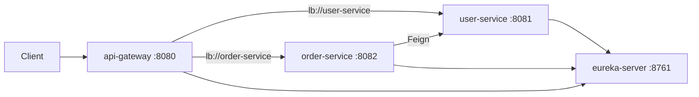

# Tag 10: Lauffähiges Maven-Projekt (NetBeans)

## Ausgangslage

- Workspace [`08-template-engines-microservices`](c:\Users\Trainer\Documents\NetBeansProjects\Spring Boot AK\08-template-engines-microservices) ist **leer**.
- Pattern wie Tag 7 ([`06-messaging-email`](c:\Users\Trainer\Documents\NetBeansProjects\Spring Boot AK\06-messaging-email)): Parent-POM + Module + README mit Startreihenfolge.
- **Frontend-SPAs (React/Vue/Angular) werden weggelassen** – kein reines NetBeans-Maven-Setup; bei Bedarf später nachziehbar.

## Zielstruktur

```
08-template-engines-microservices/
  README.md                          # NetBeans-Start, Ports, Test-URLs
  template-engines/                  # Parent POM, packaging=pom
    pom.xml
    thymeleaf-demo/   (8080)
    freemarker-demo/  (8081)
    jte-demo/         (8082)
    groovy-demo/      (8083)
    pebble-demo/      (8084)
    mustache-demo/    (8085)
    jsp-demo/         (8086)
  microservices/                     # Parent POM, packaging=pom
    pom.xml
    eureka-server/    (8761)
    user-service/     (8081)
    order-service/    (8082)
    api-gateway/      (8080)
    docker-compose.yml
```

Zwei getrennte Parent-Projekte (wie die Kurs-Repos), damit Ports und Abhängigkeiten nicht kollidieren und NetBeans jedes Parent separat öffnen kann.

## Umsetzung

1. **Repos herunterladen** (ZIP oder `git clone`) und Inhalt nach `template-engines/` bzw. `microservices/` legen – ohne `.git`, damit der Workspace lokal bleibt.
2. **Root-[`README.md`](c:\Users\Trainer\Documents\NetBeansProjects\Spring Boot AK\08-template-engines-microservices\README.md)** analog Tag 7:
   - NetBeans: Parent öffnen → Modul **Run**
   - Template-Engines: je ein Demo starten, URL `http://localhost:<port>/`
   - Microservices-Startreihenfolge: Eureka → User → Order → Gateway
   - Test-URLs: Eureka-Dashboard, `/api/users`, `/api/orders/1/with-user` über Gateway
3. **Build verifizieren**: `mvn clean package -DskipTests` in beiden Parent-Ordnern.
4. **Nur bei Build-Fehlern anpassen** (Versionen/Deprecation); Microservices-Repo ist bereits NetBeans-tauglich (`nbactions.xml`), Spring Boot **3.4.2** / Cloud **2024.0.1**, Java **21**.

## Architektur Microservices



## Hinweis NetBeans

- **File → Open Project** auf `template-engines` oder `microservices` (Parent mit Subprojekten).
- Microservices: Eureka zuerst starten, sonst schlagen Feign/Gateway fehl.
- Template-Engines und Microservices **nicht parallel** mit denselben Ports (8080–8082) laufen lassen.
