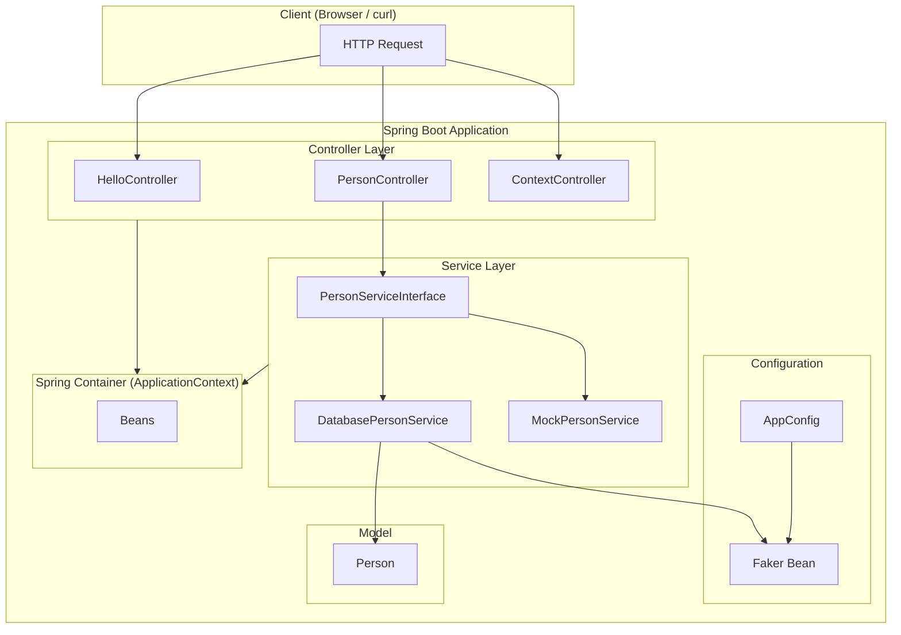
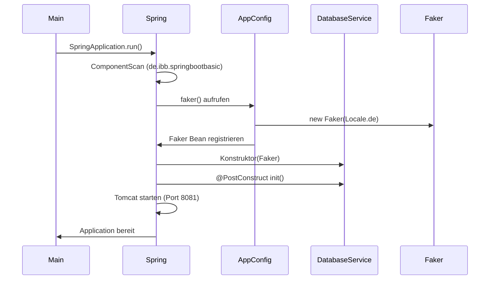
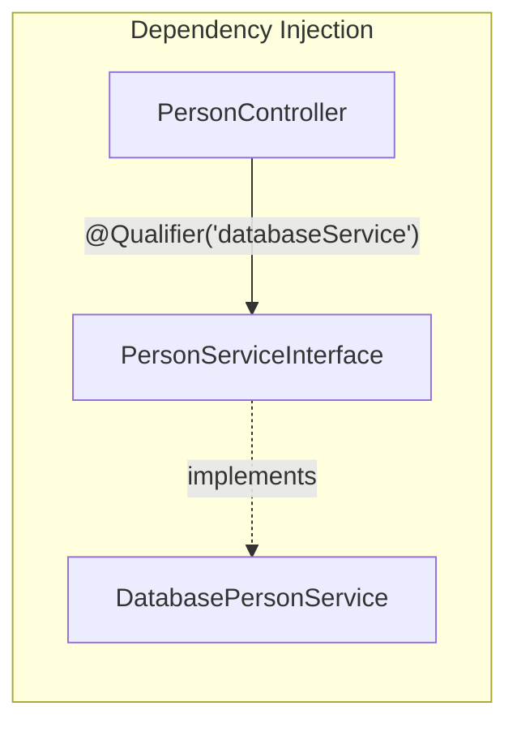
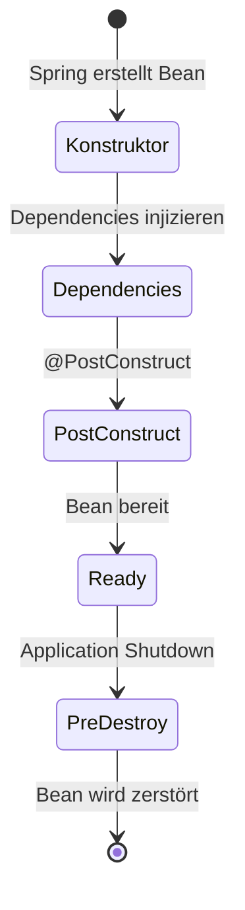

Die Aufgabe dieses Moduls steht in der [README des Elternordners](../README.md).

# Spring Boot Basic – Tag 2

**Der Spring Container & Dependency Injection**

Lernprojekt von Java Fleet Systems Consulting zur Demonstration von Spring Boot, dem IoC-Container und Dependency Injection.

---

## Überblick

Dieses Projekt zeigt, wie Spring Boot den ApplicationContext nutzt, Beans verwaltet und Abhängigkeiten per Constructor Injection bereitstellt. Die Anwendung bietet eine REST-API zur Person-Verwaltung sowie Debug-Endpoints zur Inspektion des Spring Containers.

**Technologie-Stack:**

- Java 21
- Spring Boot 3.5.9
- Lombok, DataFaker
- eingebetteter Tomcat (Port 8081)

---

## Architektur



---

## Projektstruktur

```
src/main/java/de/ibb/springbootbasic/
├── SpringBootBasicTag2Application.java   # Main Entry Point
├── config/
│   └── AppConfig.java                    # @Bean für Faker
├── controller/
│   ├── HelloController.java              # GET / und /api/hello
│   ├── PersonController.java             # REST API für Personen
│   └── ContextController.java            # Debug: Spring Container
├── model/
│   └── Person.java                       # Datenmodell
└── service/
    ├── PersonServiceInterface.java       # Interface
    ├── DatabasePersonService.java        # @Primary – 100 Faker-Personen
    └── MockPersonService.java            # Alternative für Tests
```

---

## Spring Container & Dependency Injection

### Ablauf beim Start



### Dependency Injection

Der `PersonController` bekommt den Service über **Constructor Injection**:



- **Interface:** `PersonServiceInterface` – Programmierung gegen Verträge
- **@Primary:** `DatabasePersonService` wird standardmäßig injiziert
- **@Qualifier("databaseService"):** explizite Auswahl, wenn mehrere Implementierungen existieren
- **MockService:** für Tests nutzbar mit `@Qualifier("mockService")`

### Bean Lifecycle



| Phase        | Annotation    | Beispiel                                          |
|-------------|---------------|---------------------------------------------------|
| Erstellung  | Konstruktor   | `DatabasePersonService(Faker faker)`              |
| Initialisierung | `@PostConstruct` | 100 Testpersonen mit DataFaker generieren   |
| Shutdown    | `@PreDestroy` | Aufräumen, Ressourcen freigeben                   |

---

## API Endpoints

| Methode | Pfad                      | Beschreibung                        |
|---------|---------------------------|-------------------------------------|
| GET     | `/`                       | Willkommen und Übersicht            |
| GET     | `/api/hello`              | Hello-Endpoint                      |
| GET     | `/api/persons`            | Alle Personen                       |
| GET     | `/api/persons/{id}`       | Person anhand ID                    |
| GET     | `/api/persons/count`      | Anzahl Personen                     |
| POST    | `/api/persons`            | Neue Person erstellen               |
| GET     | `/api/context/beans`      | Alle Beans im Container             |
| GET     | `/api/context/my-beans`   | Nur eigene Beans                    |
| GET     | `/api/context/bean-count` | Anzahl Beans                        |
| GET     | `/api/context/bean-info/{name}` | Details zu einer Bean        |
| GET     | `/api/context/service-implementations` | Implementierungen von PersonServiceInterface |

---

## Starten

```bash
mvn spring-boot:run
```

Die Anwendung läuft unter **http://localhost:8081/**

**Beispielaufrufe:**

```bash
curl http://localhost:8081/
curl http://localhost:8081/api/persons
curl http://localhost:8081/api/context/bean-count
```

---

## Service wechseln

Standardmäßig wird `DatabasePersonService` (100 Faker-Personen) genutzt. Für Tests oder ohne DataFaker kann auf `MockPersonService` umgestellt werden:

- **Option A:** `@Primary` von `DatabasePersonService` entfernen und bei `MockPersonService` setzen
- **Option B:** Im `PersonController` `@Qualifier("mockService")` statt `@Qualifier("databaseService")` verwenden

---

## Lizenz & Autor

- **Autor:** Elyndra Valen  
- **Unternehmen:** Java Fleet Systems Consulting
