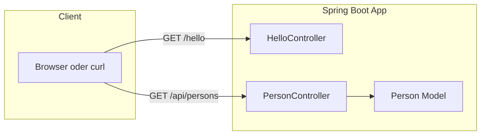
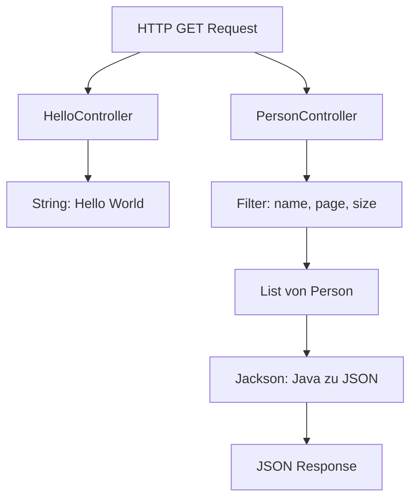
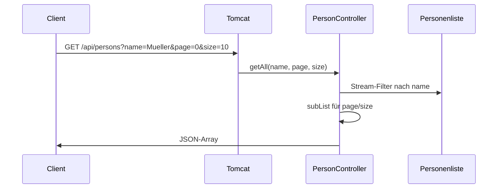

# REST API – Tag 1 Spring Boot

Spring-Boot-REST-Anwendung mit Hello-World-Endpoint und einer Person-API. Basiert auf der Anleitung [Tag 1: Deine erste Spring Boot REST API](https://www.java-developer.online/tag-1-deine-erste-spring-boot-rest-app/).

## Übersicht

Die Anwendung liefert JSON über HTTP und nutzt keinen persistenten Speicher: 100 Personen werden beim Start mit **Datafaker** (deutsche Namen) erzeugt und im Speicher gehalten.



## Voraussetzungen

- **Java 21**
- **Maven 3.6+**
- Optional: NetBeans IDE (oder IntelliJ, Eclipse, VS Code)

## Projektstruktur

```
01-rest-api/
├── pom.xml
└── src/main/
    ├── java/com/example/restapi/
    │   ├── RestApiApplication.java    # Einstiegspunkt
    │   ├── controller/
    │   │   ├── HelloController.java   # GET /hello
    │   │   └── PersonController.java # GET /api/persons
    │   └── model/
    │       └── Person.java            # Datenmodell
    └── resources/
        └── application.properties    # server.port=9091
```

## Architektur



- **RestApiApplication:** Startet die Anwendung und den eingebetteten Tomcat (Port 9091).
- **HelloController:** Reagiert auf `/hello` und gibt einen String zurück.
- **PersonController:** Stellt unter `/api/persons` alle Personen bereit, optional mit Suche und Paginierung; unter `/api/persons/{id}` eine Person nach ID.
- **Person:** Java-Bean (id, firstname, lastname, email) für die JSON-Serialisierung.

## API-Endpoints

| Methode | Pfad | Parameter | Beschreibung |
|--------|------|-----------|--------------|
| GET | `/hello` | – | Liefert `"Hello World"`. |
| GET | `/api/persons` | – | Alle 100 Personen als JSON. |
| GET | `/api/persons` | `name` | Filtert nach Vorname oder Nachname (case-insensitive). |
| GET | `/api/persons` | `page`, `size` | Paginierung (z. B. `page=0`, `size=10`). |
| GET | `/api/persons/{id}` | – | Eine Person anhand der ID (oder `null`). |

Suche und Paginierung können kombiniert werden: zuerst Filter nach `name`, dann Aufteilung in Seiten.

## Ablauf einer Anfrage



## Bauen und Starten

**Kommandozeile:**

```bash
# Abhängigkeiten und Kompilat
mvn clean compile

# Ausführbares JAR bauen
mvn package -DskipTests

# Anwendung starten
mvn spring-boot:run
```

**NetBeans:**

- Projekt öffnen (File → Open Project → Ordner `01-rest-api`).
- Nach dem Maven-Import: Rechtsklick auf Projekt → **Run**.

Die Anwendung läuft standardmäßig unter **http://localhost:9091**.

## Beispiele zum Testen

| Aktion | Aufruf |
|--------|--------|
| Hello World | `http://localhost:9091/hello` |
| Alle Personen | `http://localhost:9091/api/persons` |
| Person mit ID 1 | `http://localhost:9091/api/persons/1` |
| Erste 10 Personen | `http://localhost:9091/api/persons?page=0&size=10` |
| Suche nach Namen | `http://localhost:9091/api/persons?name=Mueller` |

Mit curl:

```bash
curl http://localhost:9091/hello
curl http://localhost:9091/api/persons
curl "http://localhost:9091/api/persons?page=0&size=5"
```

## Technologien

| Komponente | Verwendung |
|------------|------------|
| Spring Boot 3.2 | Framework, eingebetteter Tomcat |
| Spring Web | REST, MVC, Jackson (JSON) |
| Datafaker 2.1 | 100 Testpersonen mit `Locale.GERMANY` |
| Spring Boot DevTools | Optional: Neustart bei Codeänderungen |

Die Mermaid-Diagramme nutzen das Standard-Theme (keine eigenen Farben) für gute Lesbarkeit und Kontrast.
