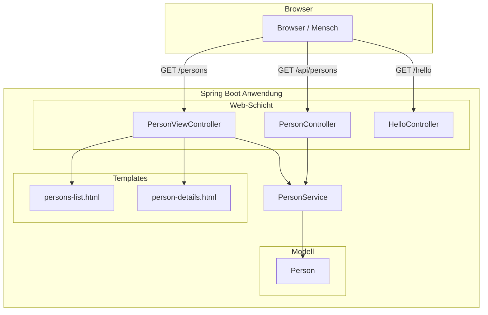
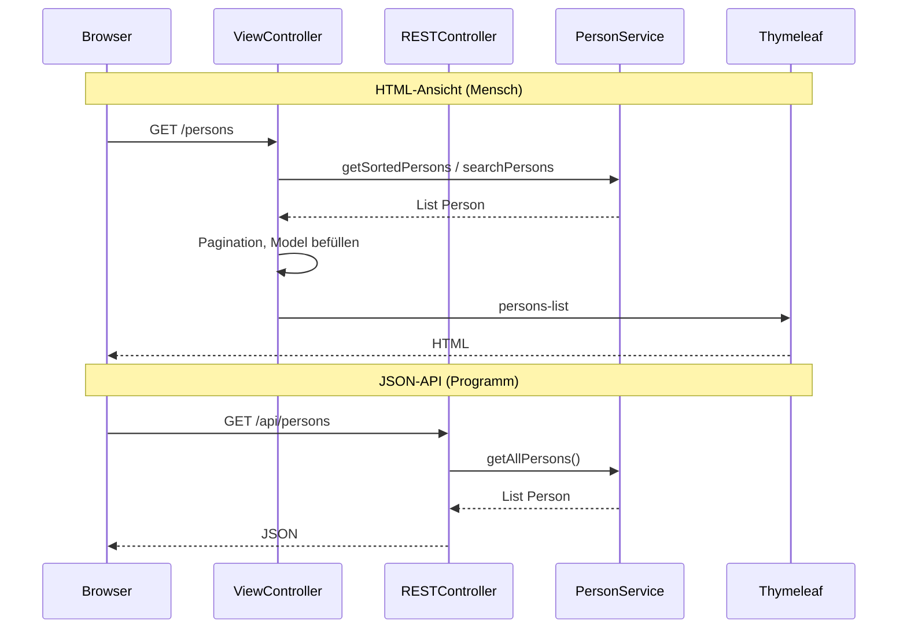
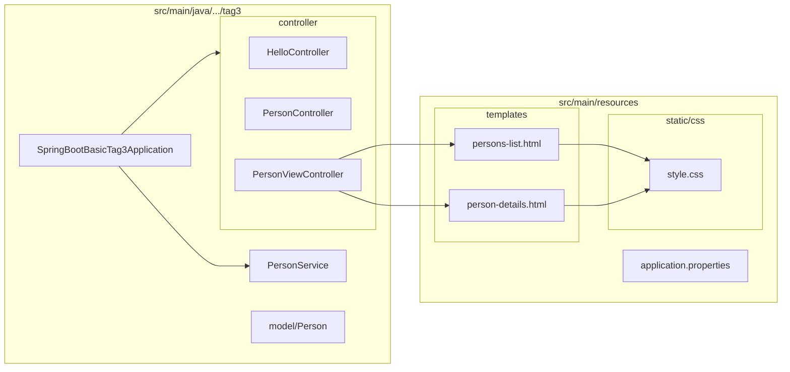

# Spring Boot Basic – Tag 3: Thymeleaf & MVC Views

Von JSON zu HTML: Dieselbe Anwendung liefert einmal **JSON** (für APIs) und einmal **HTML** (für den Browser) – über getrennte Controller, aber denselben Service.

---

## Was dieses Projekt macht

- **REST-API** (Tag 1/2): `GET /api/persons` liefert Personen als JSON.
- **Web-UI** (Tag 3): `GET /persons` liefert eine HTML-Tabelle, erzeugt mit Thymeleaf.
- Beide Wege nutzen denselben **PersonService** (100 Test-Personen im Speicher, CRUD, Suche, Sortierung).

Unterschied: **@RestController** gibt Objekte zurück (→ JSON), **@Controller** gibt View-Namen zurück (→ Thymeleaf rendert HTML).

---

## Architektur-Überblick

- **PersonViewController** (@Controller): HTML-Views, nutzt Thymeleaf-Templates.
- **PersonController** (@RestController): JSON-API für Programme.
- **PersonService**: gemeinsame Logik für beide; **Person** ist das Datenmodell.

---

## Ablauf: Request → HTML vs. JSON

- **/persons**: View-Controller → Service → Model → Thymeleaf → HTML.
- **/api/persons**: REST-Controller → Service → JSON (kein Template).

---

## Projektstruktur

| Pfad | Beschreibung |
|------|--------------|
| `SpringBootBasicTag3Application.java` | Einstiegspunkt, startet die Anwendung |
| `controller/HelloController` | GET /hello (Text) |
| `controller/PersonController` | REST: GET/POST/PUT/DELETE /api/persons (JSON) |
| `controller/PersonViewController` | HTML: /, /persons, /persons/{id} (Thymeleaf) |
| `service/PersonService` | In-Memory-Daten, 100 Personen, CRUD, Suche, Sortierung |
| `model/Person` | Datenmodell (id, firstname, lastname, email) |
| `templates/persons-list.html` | Tabelle mit Pagination, Suche, Sortierung |
| `templates/person-details.html` | Detailseite einer Person |
| `static/css/style.css` | Layout und Styling der Web-UI |

---

## Endpoints

| URL | Typ | Beschreibung |
|-----|-----|--------------|
| `/` | HTML | Redirect auf /persons |
| `/persons` | HTML | Personen-Liste (Tabelle, Pagination, Suche, Sortierung) |
| `/persons/{id}` | HTML | Detailseite einer Person |
| `/persons?search=…&sort=…&order=…&page=…&size=…` | HTML | Liste mit Filtern |
| `/api/persons` | JSON | Alle Personen (REST) |
| `/api/persons/{id}` | JSON | Eine Person (REST) |
| `/hello` | Text | Einfacher Test-Endpoint |

---

## Schnellstart

1. **In NetBeans:** File → Open Project → Ordner `03-controller-thymeleaf` wählen.
2. **Starten:** Rechtsklick auf Projekt → Run (oder im Projektordner: `mvn spring-boot:run`).
3. **Im Browser (Port 8081):**
   - http://localhost:8081/ → Redirect zu /persons  
   - http://localhost:8081/persons → Personen-Liste  
   - http://localhost:8081/persons/1 → Person-Details  
   - http://localhost:8081/api/persons → JSON-API  
   - http://localhost:8081/hello → Test  

---

## Technologie-Stack

- **Spring Boot 3.3.5**, Java 21  
- **Spring Web** (MVC, REST)  
- **Thymeleaf** (HTML-Templates)  
- **Spring Boot DevTools** (Hot Reload)  
- **Maven** (Build, Abhängigkeiten)  

---

## Konzepte in Kürze

- **@Controller** liefert View-Namen → Thymeleaf rendert HTML aus `templates/`.
- **@RestController** liefert Objekte → Spring serialisiert zu JSON.
- **Model**: Controller füllt das Model, Thymeleaf liest es in den Templates (z. B. `th:text`, `th:each`, `th:href`).
- **Ein Service für zwei Wege**: Web-UI und REST-API teilen sich den PersonService, keine doppelte Logik.
