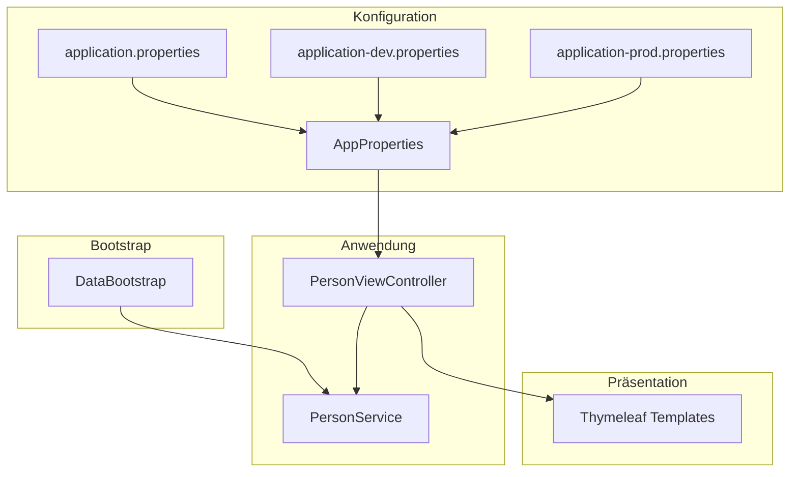
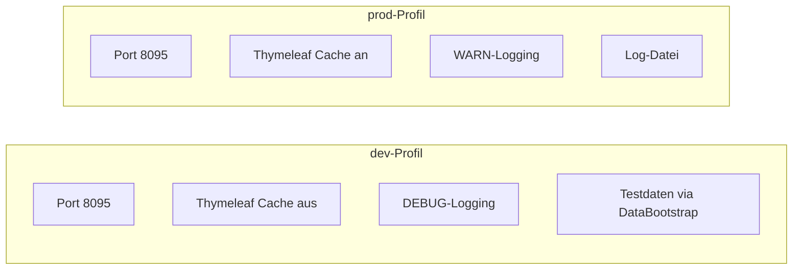
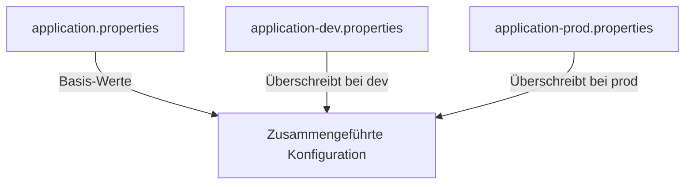
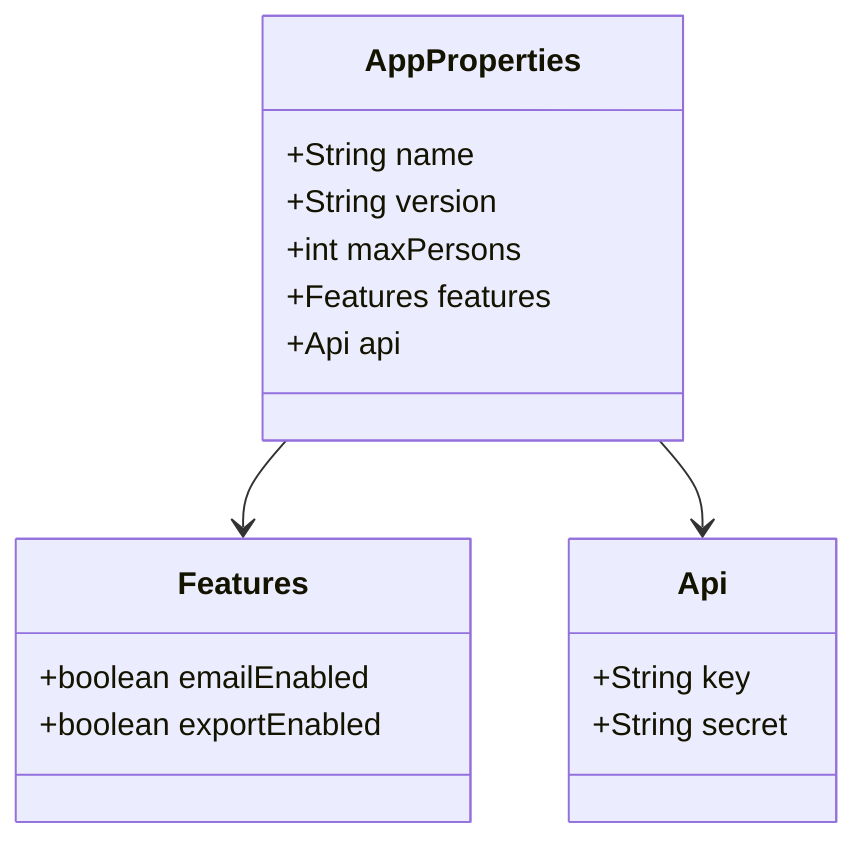
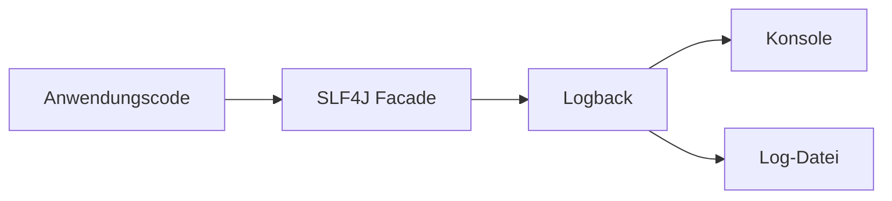
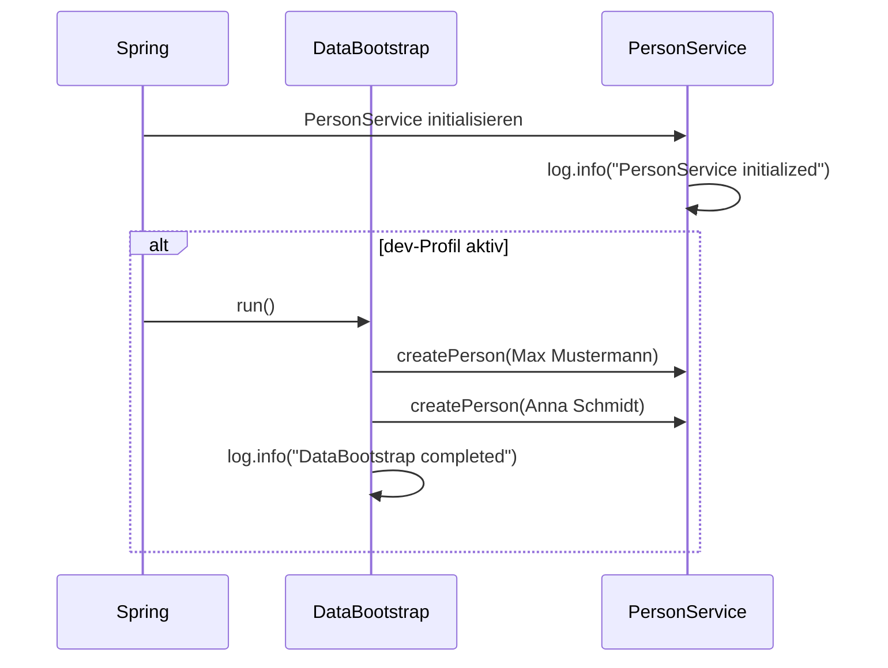

# Spring Boot Basic – Tag 5: Konfiguration & Logging

Eine Spring-Boot-Webanwendung zur Verwaltung von Personen. Das Projekt demonstriert professionelle Konfiguration, Profile, typsichere Properties und strukturiertes Logging.

---

## Projektübersicht

| Eigenschaft | Wert |
|-------------|------|
| Framework | Spring Boot 3.2 |
| Java | 21 |
| Build | Maven |
| Port | 8095 |

---

## Architektur



---

## Konfigurationssystem

### Profile

Die Anwendung nutzt Spring-Profile für unterschiedliche Umgebungen:



| Profil | Verwendung | Besonderheiten |
|--------|------------|----------------|
| **dev** | Entwicklung | Thymeleaf-Cache deaktiviert, DEBUG-Logs, DataBootstrap lädt Testdaten |
| **prod** | Produktion | Cache aktiv, reduzierte Logs, Logging in Datei |

### Properties-Hierarchie



- **application.properties**: Gemeinsame Basis (App-Name, Log-Pattern, eigene Properties)
- **application-dev.properties**: Entwicklungsspezifisch
- **application-prod.properties**: Produktionsspezifisch

---

## @ConfigurationProperties

Die Klasse `AppProperties` bindet typsicher Properties mit dem Präfix `app`:



| Property | Beschreibung |
|----------|--------------|
| `app.name` | Anzeigename der Anwendung |
| `app.version` | Versionsnummer |
| `app.max-persons` | Maximale Personenanzahl |
| `app.features.email-enabled` | Feature-Flag E-Mail |
| `app.features.export-enabled` | Feature-Flag Export |
| `app.api.key` / `app.api.secret` | API-Zugangsdaten (via Umgebungsvariablen) |

---

## Logging

Logging erfolgt über SLF4J mit Logback als Implementierung:



| Komponente | Log-Level (dev) | Log-Level (prod) |
|------------|-----------------|------------------|
| Root | INFO | WARN |
| com.example.helloworldapi | DEBUG | INFO |
| org.springframework.web | DEBUG | – |

---

## Datenfluss beim Start



---

## Projektstruktur

```
05-configuration-logging/
├── src/main/java/com/example/helloworldapi/
│   ├── HelloWorldApiApplication.java
│   ├── bootstrap/
│   │   └── DataBootstrap.java          # Testdaten (nur dev)
│   ├── config/
│   │   └── AppProperties.java          # @ConfigurationProperties
│   ├── controller/
│   │   ├── PersonViewController.java
│   │   └── CustomErrorController.java
│   ├── model/
│   │   └── Person.java
│   ├── service/
│   │   └── PersonService.java
│   └── validation/
│       ├── ValidGermanPhone.java
│       └── GermanPhoneValidator.java
├── src/main/resources/
│   ├── application.properties
│   ├── application-dev.properties
│   ├── application-prod.properties
│   ├── logback-spring.xml
│   ├── static/css/style.css
│   └── templates/
│       ├── persons-list.html
│       ├── person-details.html
│       ├── person-form.html
│       ├── person-edit-form.html
│       └── error/
└── pom.xml
```

---

## Schnellstart

### Voraussetzungen

- JDK 21
- Maven 3.6+

### Anwendung starten

```bash
# Development (mit Testdaten, DEBUG-Logs)
mvn spring-boot:run "-Dspring-boot.run.profiles=dev"

# Production (weniger Logs, Log-Datei)
mvn spring-boot:run "-Dspring-boot.run.profiles=prod"
```

### Zugriff

- Personen-Liste: http://localhost:8095/persons
- Neue Person: http://localhost:8095/persons/new

---

## Umgebungsvariablen (optional)

Für API-Zugangsdaten in Produktion:

| Variable | Beschreibung |
|----------|--------------|
| `API_KEY` | API-Schlüssel |
| `API_SECRET` | API-Geheimnis |

Im dev-Profil werden bei fehlenden Variablen Dummy-Werte verwendet.

---

## Log-Datei

Im prod-Profil werden Logs zusätzlich in `logs/persons-app.log` geschrieben (Rolling, max. 30 Tage).
