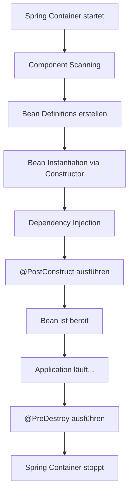
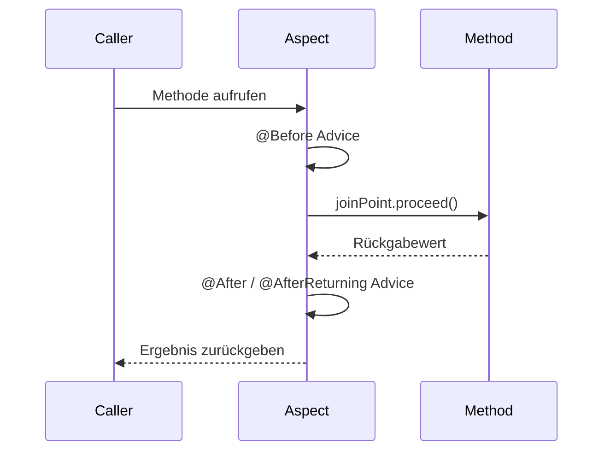
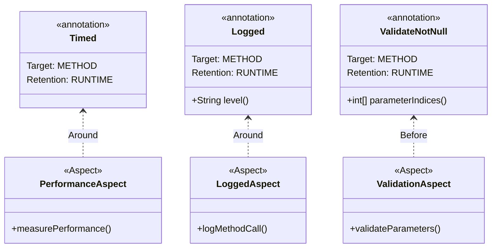
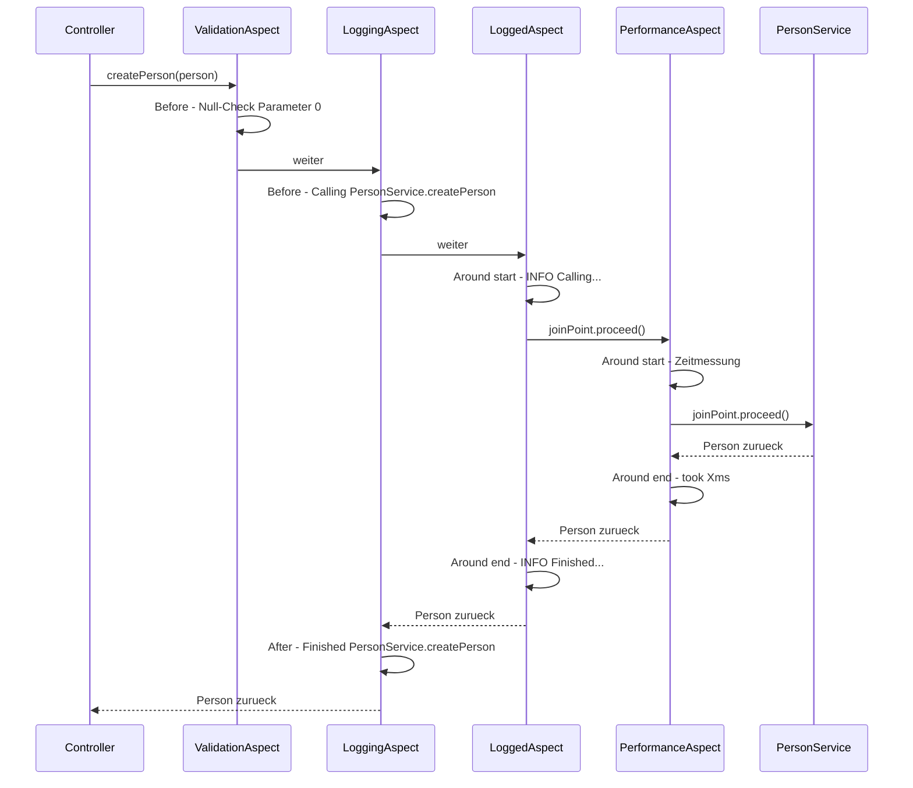

# Spring Boot Basic – Tag 6: DI & AOP im Detail

**Kurs:** Spring Boot Basic (Tag 6 von 10)  
**Thema:** Dependency Injection in der Tiefe & Aspektorientierte Programmierung  
**Stack:** Java 21 · Spring Boot 3.2 · Thymeleaf · Lombok · Maven  
**Port:** `http://localhost:8096/persons`

---

## Was dieses Projekt zeigt

Dieses Projekt baut auf Tag 5 (Konfiguration & Logging) auf und vertieft zwei zentrale Spring-Konzepte:

1. **Dependency Injection** – wie Spring Beans verwaltet und injiziert, `@PostConstruct`/`@PreDestroy`, `@Primary`
2. **Aspektorientierte Programmierung (AOP)** – Cross-Cutting Concerns wie Logging, Performance-Messung und Validierung sauber von der Business-Logik trennen

---

## Projektstruktur

```
src/main/java/com/example/helloworldapi/
├── HelloWorldApiApplication.java
├── annotation/
│   ├── Timed.java
│   ├── Logged.java
│   └── ValidateNotNull.java
├── aspect/
│   ├── LoggingAspect.java
│   ├── PerformanceAspect.java
│   ├── LoggedAspect.java
│   └── ValidationAspect.java
├── bootstrap/
│   └── DataBootstrap.java
├── config/
│   └── AppProperties.java
├── controller/
│   ├── PersonViewController.java
│   └── CustomErrorController.java
├── model/
│   └── Person.java
├── service/
│   └── PersonService.java
└── validation/
    ├── ValidGermanPhone.java
    └── GermanPhoneValidator.java

src/main/resources/
├── application.properties
├── application-dev.properties
├── application-prod.properties
├── logback-spring.xml
├── static/css/style.css
└── templates/
    ├── persons-list.html
    ├── person-details.html
    ├── person-form.html
    ├── person-edit-form.html
    └── error/
        ├── 404.html
        ├── 500.html
        └── generic.html
```

---

## Starten

```bash
mvn spring-boot:run -Dspring-boot.run.profiles=dev
```

Dann im Browser öffnen: [http://localhost:8096/persons](http://localhost:8096/persons)

---

## Dependency Injection

### Die 3 Arten im Vergleich

| Art | Annotation | `final` möglich | Testbar | Empfehlung |
|---|---|---|---|---|
| Constructor Injection | `@RequiredArgsConstructor` | ja | ja | **Best Practice** |
| Field Injection | `@Autowired` auf Feld | nein | nein | nicht empfohlen |
| Setter Injection | `@Autowired` auf Setter | nein | bedingt | nur für optionale Dependencies |

Dieses Projekt nutzt durchgehend **Constructor Injection** via Lombok `@RequiredArgsConstructor`.

### Wie Spring Beans injiziert



### @PostConstruct und @PreDestroy in PersonService

```java
@PostConstruct
public void init() {
    log.info("PersonService @PostConstruct - Initialization");
}

@PreDestroy
public void cleanup() {
    log.info("PersonService @PreDestroy - Cleanup");
}
```

`@PostConstruct` wird nach der Dependency Injection aufgerufen – ideal für Setup-Logik (Cache laden, Verbindungen aufbauen).  
`@PreDestroy` wird vor dem Shutdown aufgerufen – ideal für Cleanup (Verbindungen schließen, Daten speichern).

---

## Aspektorientierte Programmierung (AOP)

### Das Problem ohne AOP

Ohne AOP wiederholt sich Logging- und Mess-Code in jeder Methode:

```java
// Jede Methode enthält denselben Boilerplate
public Person createPerson(Person person) {
    log.info("Method createPerson called");
    long start = System.currentTimeMillis();
    try {
        // Business-Logik...
        log.info("createPerson finished in {}ms", System.currentTimeMillis() - start);
        return person;
    } catch (Exception e) {
        log.error("Error in createPerson", e);
        throw e;
    }
}
```

Das ist eine DRY-Verletzung (Don't Repeat Yourself).

### Die Lösung: Aspects

```java
// Nur noch Business-Logik
@Timed
@Logged
public Person createPerson(Person person) {
    person.setId(idCounter.getAndIncrement());
    persons.add(person);
    return person;
}
```

### AOP-Konzepte

| Begriff | Bedeutung | Beispiel im Projekt |
|---|---|---|
| **Aspect** | Klasse, die einen Cross-Cutting Concern kapselt | `LoggingAspect`, `PerformanceAspect` |
| **Join Point** | Punkt im Code, an dem ein Aspect eingreifen kann | Methoden-Aufruf |
| **Advice** | Code, der am Join Point ausgeführt wird | `@Before`, `@After`, `@Around` |
| **Pointcut** | Ausdruck, der definiert, wo ein Advice greift | `execution(* ...service.*.*(..))` |

### Advice-Typen im Überblick



Bei `@Around` übernimmt der Aspect die vollständige Kontrolle – er ruft `joinPoint.proceed()` selbst auf und kann den Rückgabewert verändern oder die Methode überspringen.

---

## Die 4 Aspects im Detail

### 1. LoggingAspect

Loggt automatisch jeden Eintritt und Austritt aller Service-Methoden.

```java
@Before("execution(* com.example.helloworldapi.service.*.*(..))")
public void logBefore(JoinPoint joinPoint) {
    log.info("→ Calling {}.{}", className, methodName);
}

@After("execution(* com.example.helloworldapi.service.*.*(..))")
public void logAfter(JoinPoint joinPoint) {
    log.info("← Finished {}.{}", className, methodName);
}
```

**Pointcut-Expression erklärt:**

```
execution(  *    com.example.helloworldapi.service  .  *  .  *  (  ..  )  )
            ↑                    ↑                     ↑     ↑      ↑
        Rückgabe              Package               Klasse  Methode Parameter
        (beliebig)                                 (alle)  (alle)  (beliebig)
```

### 2. PerformanceAspect

Misst die Ausführungszeit von Methoden, die mit `@Timed` annotiert sind.

```java
@Around("@annotation(com.example.helloworldapi.annotation.Timed)")
public Object measurePerformance(ProceedingJoinPoint joinPoint) throws Throwable {
    long start = System.currentTimeMillis();
    Object result = joinPoint.proceed();
    log.info("⏱️ {}.{} took {}ms", className, methodName,
             System.currentTimeMillis() - start);
    return result;
}
```

### 3. LoggedAspect

Loggt Methoden, die mit `@Logged` annotiert sind. Der Log-Level ist konfigurierbar.

```java
@Around("@annotation(logged)")
public Object logMethodCall(ProceedingJoinPoint joinPoint, Logged logged) throws Throwable {
    log.info("[{}] → Calling {}.{}", logged.level(), className, methodName);
    Object result = joinPoint.proceed();
    log.info("[{}] ← Finished {}.{}", logged.level(), className, methodName);
    return result;
}
```

### 4. ValidationAspect

Prüft vor dem Methodenaufruf, ob bestimmte Parameter nicht `null` sind.

```java
@Before("@annotation(validateNotNull)")
public void validateParameters(JoinPoint joinPoint, ValidateNotNull validateNotNull) {
    for (int index : validateNotNull.parameterIndices()) {
        if (args[index] == null) {
            throw new IllegalArgumentException(methodName + ": Parameter " + index + " must not be null!");
        }
    }
}
```

---

## Custom Annotations

### Warum Custom Annotations?

Ein breiter Pointcut wie `execution(* ...service.*.*(..))` greift auf **alle** Service-Methoden. Custom Annotations erlauben **selektive** Anwendung:

```java
// Nur diese Methode wird gemessen und geloggt
@Timed
@Logged
public Person createPerson(Person person) { ... }

// Diese Methode bleibt unberührt
public List<Person> getAllPersons() { ... }
```

### Aufbau einer Custom Annotation

```java
@Target(ElementType.METHOD)       // Nur auf Methoden anwendbar
@Retention(RetentionPolicy.RUNTIME) // Zur Laufzeit verfügbar (Pflicht für AOP!)
public @interface Timed {
}
```

| Element | Bedeutung |
|---|---|
| `@Target(METHOD)` | Annotation darf nur auf Methoden gesetzt werden |
| `@Target(TYPE)` | Annotation darf nur auf Klassen gesetzt werden |
| `@Retention(RUNTIME)` | Annotation ist zur Laufzeit via Reflection sichtbar – notwendig für AOP |
| `@Retention(SOURCE)` | Annotation existiert nur im Quellcode (z.B. `@Override`) |

### Die 3 Custom Annotations im Projekt



---

## Zusammenspiel aller Aspects bei einem Methodenaufruf

Wenn `createPerson()` aufgerufen wird (annotiert mit `@Timed`, `@Logged`, `@ValidateNotNull`):



---

## Konfiguration

### Profile

| Profil | Port | Thymeleaf Cache | Log-Level App | Log-Level Root |
|---|---|---|---|---|
| `dev` | 8096 | aus | DEBUG | INFO |
| `prod` | 8096 | ein | INFO | WARN |

### application.properties (Basis)

```properties
spring.application.name=persons-app
spring.profiles.active=dev

app.name=Persons Management System
app.version=1.0.0
app.max-persons=100
app.features.email-enabled=true
app.features.export-enabled=false
```

### AppProperties (typsichere Konfiguration)

```java
@Component
@ConfigurationProperties(prefix = "app")
@Data
public class AppProperties {
    private String name;
    private String version;
    private int maxPersons;
    private Features features = new Features();
    private Api api = new Api();
    // ...
}
```

---

## Bean Lifecycle – Konsolenausgabe beim Start

```
10:30:45.123  INFO PersonService   : PersonService Constructor called
10:30:45.124  INFO PersonService   : PersonService @PostConstruct - Initialization
10:30:45.125  INFO DataBootstrap   : Starting DataBootstrap...
10:30:45.126  INFO LoggingAspect   : → Calling PersonService.createPerson
10:30:45.127  INFO LoggedAspect    : [INFO] → Calling PersonService.createPerson
10:30:45.128  INFO PersonService   : Creating new person: Max Mustermann
10:30:45.129  INFO PersonService   : Person created successfully with ID: 1
10:30:45.130  INFO PerformanceAspect: ⏱️ PersonService.createPerson took 2ms
10:30:45.131  INFO LoggedAspect    : [INFO] ← Finished PersonService.createPerson
10:30:45.132  INFO LoggingAspect   : ← Finished PersonService.createPerson
```

Beim Shutdown:

```
10:35:00.001  INFO PersonService   : PersonService @PreDestroy - Cleanup
```

---

## Häufige Fehler

| Fehler | Ursache | Lösung |
|---|---|---|
| Aspect wird nicht ausgeführt | `spring-boot-starter-aop` fehlt oder `@Component` vergessen | Dependency prüfen, `@Component` zu `@Aspect`-Klasse hinzufügen |
| `No qualifying bean` | Mehrere Implementierungen eines Interfaces | `@Primary` auf die Standard-Implementierung oder `@Qualifier` am Injection-Point |
| Custom Annotation greift nicht | `@Retention(RUNTIME)` fehlt | `@Retention(RetentionPolicy.RUNTIME)` zur Annotation hinzufügen |
| `proceed()` nicht verfügbar | Falscher JoinPoint-Typ in `@Around` | `ProceedingJoinPoint` statt `JoinPoint` verwenden |
| Circular Dependency | Bean A injiziert Bean B, Bean B injiziert Bean A | Design überdenken; Notlösung: `@Lazy` |

---

## Lernziele dieses Projekts

- Dependency Injection vollständig verstehen (Constructor vs. Field vs. Setter)
- `@Qualifier` und `@Primary` bei mehreren Bean-Implementierungen einsetzen
- Bean Lifecycle mit `@PostConstruct` und `@PreDestroy` steuern
- Eigene Aspects mit `@Before`, `@After` und `@Around` erstellen
- Pointcut-Expressions lesen und schreiben
- Custom Annotations entwickeln und mit Aspects verknüpfen
- Cross-Cutting Concerns sauber von der Business-Logik trennen
