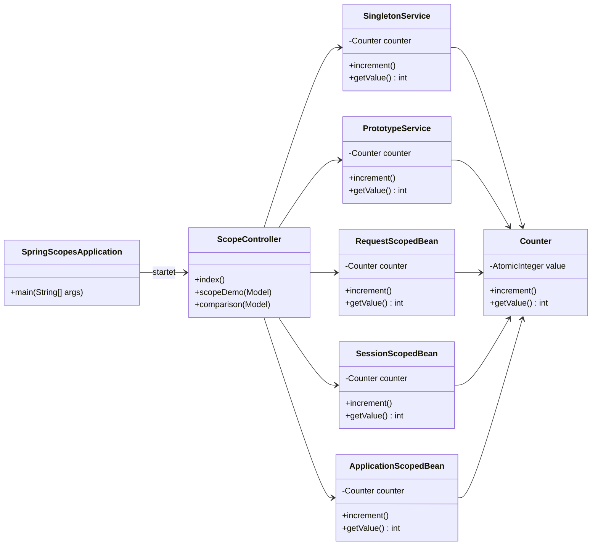
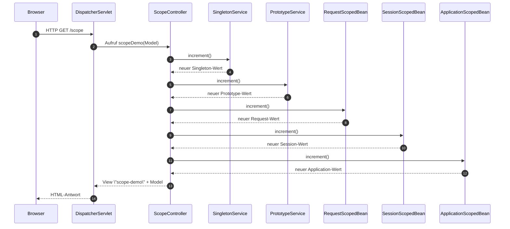

Die Aufgabe dieses Moduls steht in der [README des Elternordners](../README.md).

# Spring Boot Basic – Tag 7: Scopes in Spring

Dieses Projekt zeigt die wichtigsten Bean-Scopes in Spring Boot anhand von einfachen Zählern.

- **Singleton** – eine Instanz für die gesamte Anwendung (Default)
- **Prototype** – neue Instanz bei jedem `getBean()` / Injection
- **Request** – eine Instanz pro HTTP-Request
- **Session** – eine Instanz pro HTTP-Session (pro User)
- **Application** – eine Instanz pro Web-Anwendung (`ServletContext`)

---

## Projektaufbau & Klassen

- `de.ibb.scopes.SpringScopesApplication`  
  Startklasse mit `@SpringBootApplication`.

- `de.ibb.scopes.model.Counter`  
  Kleiner Zähler mit `increment()` und `getValue()`, der in allen Scopes verwendet wird.

- `de.ibb.scopes.service.*`  
  - `SingletonService` – `@Service` (Default-Scope: Singleton)  
  - `PrototypeService` – `@Service @Scope("prototype")`  
  - `RequestScopedBean` – `@Component @Scope(WebApplicationContext.SCOPE_REQUEST, proxyMode = TARGET_CLASS)`  
  - `SessionScopedBean` – `@Component @Scope(WebApplicationContext.SCOPE_SESSION, proxyMode = TARGET_CLASS)`  
  - `ApplicationScopedBean` – `@Component @Scope(WebApplicationContext.SCOPE_APPLICATION, proxyMode = TARGET_CLASS)`

- `de.ibb.scopes.controller.ScopeController`  
  MVC-Controller, der alle fünf Beans injiziert und die Thymeleaf-Views bedient.

### Klassen- und Beziehungsübersicht (Mermaid Klassendiagramm)



---

## Request-Fluss & Scopes (Mermaid Sequenzdiagramm)

Der folgende Ablauf zeigt einen Aufruf von `/scope` in einem Browser-Tab:



**Wichtig:**

- **SingletonService** und **ApplicationScopedBean** überleben über viele Requests und Sessions hinweg.  
- **SessionScopedBean** lebt pro User-Session (neuer Browser / Inkognito = neue Instanz).  
- **RequestScopedBean** wird für *jeden* Request neu erzeugt und danach verworfen.  
- **PrototypeService** wird als Prototype-Bean erstellt, aber im Controller als Abhängigkeit nur einmal injiziert (hier dient er als Demonstration des Scopes, typischerweise würde man einen Provider o. Ä. nutzen, um bei jedem Bedarf eine neue Instanz zu erhalten).

---

## Views & UI-Fluss (Mermaid Flowchart)

```mermaid
flowchart LR
    start[Browser] --> indexRoute[/GET "/" /]
    indexRoute --> indexView[index.html]

    indexView --> scopeLink[/GET "/scope"/]
    indexView --> comparisonLink[/GET "/comparison"/]

    scopeLink --> scopeRoute[ScopeController.scopeDemo]
    scopeRoute --> scopeView[scope-demo.html]

    comparisonLink --> comparisonRoute[ScopeController.comparison]
    comparisonRoute --> comparisonView[comparison.html]
```

---

## Build & Start

- Voraussetzungen:
  - **Java 21**
  - **Maven 3.9+**

```bash
mvn clean install
mvn spring-boot:run
```

Danach ist die Anwendung erreichbar unter:

- Übersicht: `http://localhost:9097/`
- Scope-Demo: `http://localhost:9097/scope`
- Vergleich: `http://localhost:9097/comparison`

---

## Experimente zum Verständnis der Scopes

- **Gleicher Tab:**  
  `/scope` mehrfach neu laden → Singleton, Session, Application steigen; Request beginnt jedes Mal bei 1.

- **Neuer Tab im gleichen Browser (gleiche Session):**  
  Singleton, Session und Application werden weiter erhöht; Request bleibt request-lokal.

- **Inkognito-Fenster / anderer Browser (neue Session):**  
  Session-Werte starten wieder bei 1, Application und Singleton laufen weiter.

So lassen sich die Unterschiede von Singleton, Prototype, Request, Session und Application Scope praktisch nachvollziehen.

