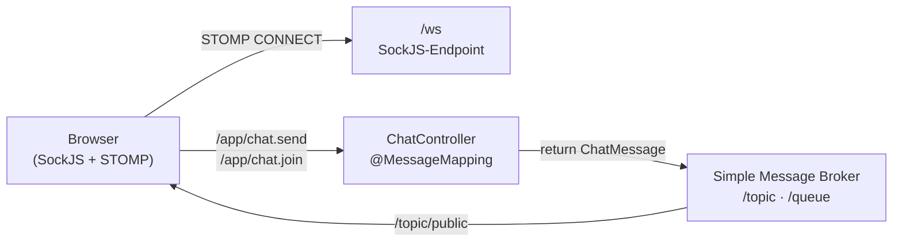
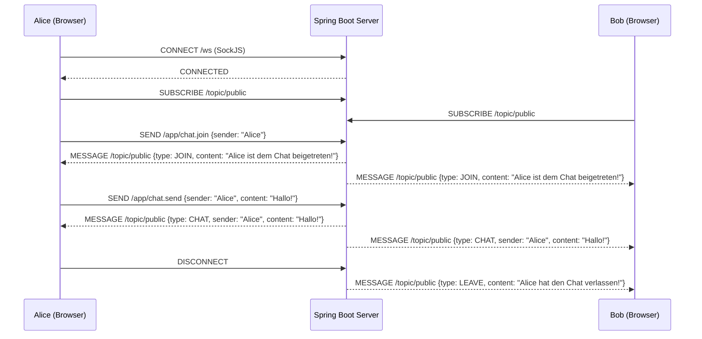
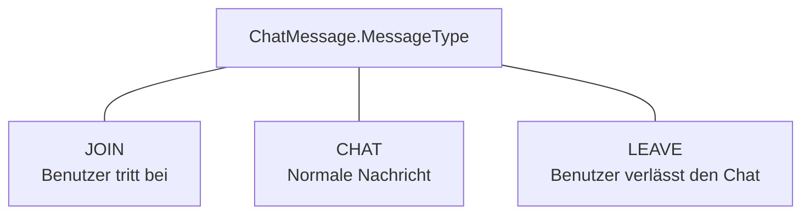

Die Aufgabe dieses Moduls steht in der [README des Elternordners](../README.md).

# WebSockets Chat

Eine Echtzeit-Chat-Anwendung mit **Spring Boot**, **WebSocket (STOMP)** und **SockJS**.
Mehrere Benutzer können sich über den Browser verbinden und in einem gemeinsamen Chatraum
Nachrichten austauschen. Beitritte und Abgänge werden allen Teilnehmern live angezeigt.

---

## Architektur



Der Client verbindet sich per **SockJS** zum Endpoint `/ws` und kommuniziert
über das **STOMP-Protokoll**. Eingehende Nachrichten werden vom `ChatController`
verarbeitet und über den integrierten Message Broker an alle Abonnenten
von `/topic/public` verteilt.

---

## Nachrichtenfluss



---

## Nachrichtentypen



| Typ     | Auslöser                        | Inhalt                                     |
|---------|---------------------------------|--------------------------------------------|
| `JOIN`  | Client sendet an `/app/chat.join`  | `"Alice ist dem Chat beigetreten!"`        |
| `CHAT`  | Client sendet an `/app/chat.send`  | Freitext-Nachricht des Benutzers           |
| `LEAVE` | WebSocket-Verbindung wird getrennt | `"Alice hat den Chat verlassen!"`          |

---

## Projektstruktur

```
src/main/java/com/example/websockets/
├── WebsocketsChatApplication.java      ← Spring Boot Entry Point
├── config/
│   └── WebSocketConfig.java            ← STOMP-Endpoint & Broker-Konfiguration
├── controller/
│   ├── ChatController.java             ← Verarbeitung von Chat-Nachrichten
│   └── ChatViewController.java         ← Thymeleaf-View für /chat
├── dto/
│   └── ChatMessage.java                ← Datenmodell (content, sender, type, timestamp)
└── listener/
    └── WebSocketEventListener.java     ← Connect-/Disconnect-Events

src/main/resources/
├── application.properties              ← Server-Port (9088)
└── templates/
    └── chat.html                       ← Thymeleaf-Template (UI + JavaScript)
```

---

## Komponenten im Detail

### WebSocketConfig

Konfiguriert den STOMP Message Broker und den SockJS-Endpoint.

| Einstellung                          | Wert              | Bedeutung                                          |
|--------------------------------------|--------------------|---------------------------------------------------|
| `enableSimpleBroker`                 | `/topic`, `/queue` | Präfixe, auf die Clients subscriben können         |
| `setApplicationDestinationPrefixes`  | `/app`             | Präfix für Nachrichten, die an `@MessageMapping` gehen |
| `addEndpoint`                        | `/ws`              | WebSocket-Handshake-URL (mit SockJS-Fallback)      |

### ChatController

| Methode       | Mapping            | Ziel            | Beschreibung                                        |
|---------------|--------------------|-----------------|-----------------------------------------------------|
| `sendMessage` | `/app/chat.send`   | `/topic/public` | Empfängt eine Nachricht und broadcastet sie          |
| `addUser`     | `/app/chat.join`   | `/topic/public` | Speichert den Benutzernamen in der Session und broadcastet den Beitritt |

### WebSocketEventListener

Reagiert auf Spring-interne WebSocket-Events:

- **`SessionConnectedEvent`** — Loggt neue Verbindungen.
- **`SessionDisconnectEvent`** — Liest den Benutzernamen aus der Session und sendet
  eine `LEAVE`-Nachricht an `/topic/public`.

### ChatMessage (DTO)

```
┌────────────────────────────┐
│ ChatMessage                │
├────────────────────────────┤
│ - content   : String       │
│ - sender    : String       │
│ - type      : MessageType  │
│ - timestamp : LocalDateTime│
└────────────────────────────┘
```

---

## Frontend

Das Frontend ist ein einzelnes Thymeleaf-Template (`chat.html`), das zwei Ansichten enthält:

1. **Login-Seite** — Eingabe des Benutzernamens.
2. **Chat-Seite** — Nachrichtenverlauf mit Eingabefeld und Disconnect-Button.

Bibliotheken werden als **WebJars** eingebunden:

| Bibliothek       | Version | Zweck                          |
|------------------|---------|--------------------------------|
| Bootstrap        | 5.3.0   | UI-Styling                     |
| SockJS Client    | 1.5.1   | WebSocket-Fallback für Browser |
| STOMP WebSocket  | 2.3.4   | STOMP-Protokoll über SockJS    |

---

## Starten

```bash
# Aus dem Projektverzeichnis:
mvn spring-boot:run
```

Die Anwendung ist dann erreichbar unter:

```
http://localhost:9088/chat
```

Der Port lässt sich in `application.properties` anpassen:

```properties
server.port=9088
```

---

## Technologien

| Technologie              | Version |
|--------------------------|---------|
| Java                     | 21      |
| Spring Boot              | 3.3.2   |
| Spring WebSocket (STOMP) | —       |
| Thymeleaf                | —       |
| SockJS + STOMP.js        | —       |
| Bootstrap                | 5.3.0   |
| Maven                    | —       |
