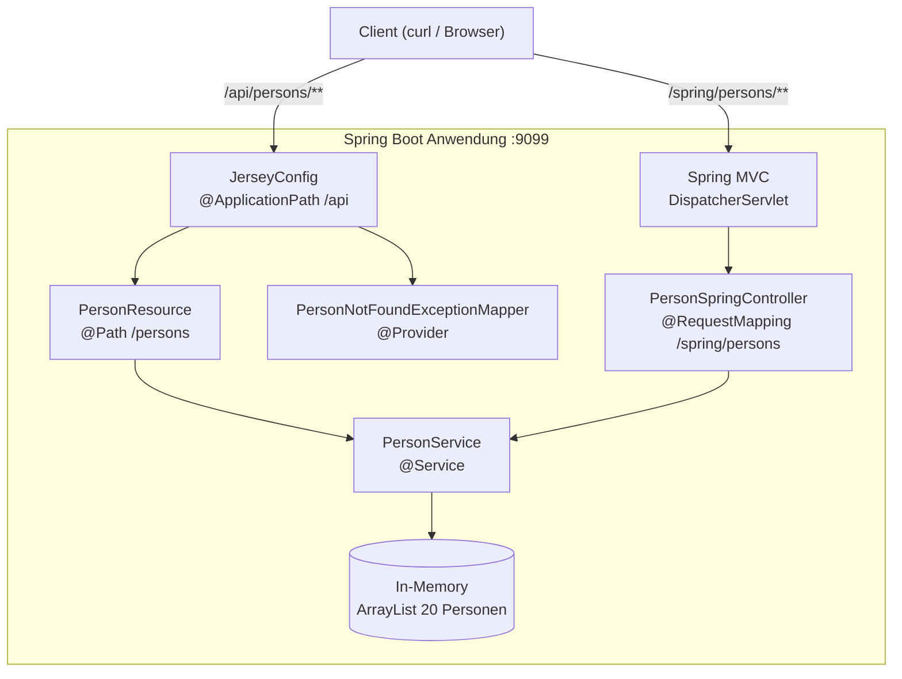
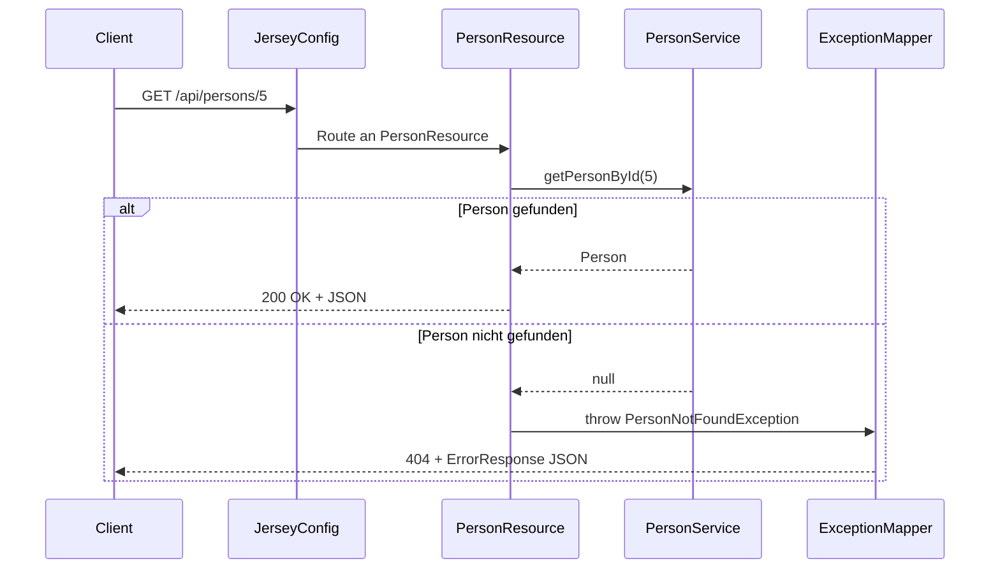

Die Aufgabe dieses Moduls steht in der [README des Elternordners](../README.md).

# Tag 9 -- JAX-RS in Spring Boot

REST APIs mit dem Java-Standard **JAX-RS** (Jakarta RESTful Web Services), umgesetzt mit **Jersey** als Implementierung innerhalb von Spring Boot.

Dieses Projekt zeigt, wie JAX-RS-Endpoints und Spring-MVC-Endpoints parallel in derselben Anwendung laufen koennen.

---

## Ueberblick

| Eigenschaft       | Wert                          |
|--------------------|-------------------------------|
| Spring Boot        | 3.3.2                         |
| Java               | 21                            |
| JAX-RS-Impl.       | Jersey (via `spring-boot-starter-jersey`) |
| Testdaten          | 20 Personen (Datafaker)       |
| Port               | 9099                          |

---

## Architektur



Beide Wege -- JAX-RS ueber Jersey und Spring MVC -- greifen auf denselben `PersonService` zu. So lassen sich die beiden Ansaetze direkt vergleichen.

---

## Projektstruktur

```
src/main/java/com/example/jaxrs/
 |-- JaxRsApplication.java              Startklasse
 |-- config/
 |    +-- JerseyConfig.java             Jersey-Konfiguration, registriert Resources
 |-- model/
 |    +-- Person.java                   POJO (id, firstname, lastname, email)
 |-- service/
 |    +-- PersonService.java            In-Memory CRUD-Service mit Datafaker
 |-- resource/
 |    +-- PersonResource.java           JAX-RS Endpoints (CRUD)
 |-- controller/
 |    +-- PersonSpringController.java   Spring MVC Endpoints (GET) zum Vergleich
 |-- dto/
 |    +-- ErrorResponse.java            JSON-Fehlerstruktur
 +-- exception/
      |-- PersonNotFoundException.java           Custom RuntimeException
      +-- PersonNotFoundExceptionMapper.java     @Provider fuer 404-Antworten
```

---

## Endpoints

### JAX-RS (Jersey) -- Basis-Pfad `/api`

| Methode  | Pfad                  | Beschreibung                         |
|----------|-----------------------|--------------------------------------|
| `GET`    | `/api/persons`        | Alle Personen (Filter + Paging)      |
| `GET`    | `/api/persons/{id}`   | Eine Person nach ID                  |
| `POST`   | `/api/persons`        | Neue Person anlegen                  |
| `PUT`    | `/api/persons/{id}`   | Person aktualisieren                 |
| `DELETE` | `/api/persons/{id}`   | Person loeschen                      |

**Query-Parameter fuer `GET /api/persons`:**

| Parameter   | Default | Beschreibung                     |
|-------------|---------|----------------------------------|
| `firstname` | --      | Filtert nach Vorname (contains)  |
| `page`      | `0`     | Seite (0-basiert)                |
| `size`      | `0`     | Seitengroesse (0 = alle)         |

### Spring MVC -- Basis-Pfad `/spring`

| Methode | Pfad                     | Beschreibung           |
|---------|--------------------------|------------------------|
| `GET`   | `/spring/persons`        | Alle Personen          |
| `GET`   | `/spring/persons/{id}`   | Eine Person nach ID    |

---

## Request-Ablauf (JAX-RS)



---

## Spring MVC vs. JAX-RS -- Annotations-Vergleich

| Konzept            | Spring MVC                         | JAX-RS                            |
|--------------------|-------------------------------------|-----------------------------------|
| Klassen-Annotation | `@RestController`                  | `@Path("/persons")` + `@Component`|
| Basis-Pfad         | `@RequestMapping("/spring/persons")` | `@Path("/persons")` via `@ApplicationPath("/api")` |
| GET                | `@GetMapping`                      | `@GET`                            |
| POST               | `@PostMapping`                     | `@POST`                           |
| PUT                | `@PutMapping`                      | `@PUT`                            |
| DELETE             | `@DeleteMapping`                   | `@DELETE`                         |
| Pfad-Variable      | `@PathVariable Long id`           | `@PathParam("id") Long id`       |
| Request-Body       | `@RequestBody Person p`           | `Person p` (automatisch)         |
| Query-Parameter    | `@RequestParam`                    | `@QueryParam` + `@DefaultValue`  |
| Content-Type       | `produces` in Mapping              | `@Produces` / `@Consumes`        |
| Response           | `ResponseEntity<T>`               | `Response`                        |
| Error-Handling     | `@ExceptionHandler`               | `ExceptionMapper` + `@Provider`  |

---

## Starten und Testen

### Anwendung starten

```bash
mvn spring-boot:run
```

### Beispiel-Requests (curl)

```bash
# Alle Personen (JAX-RS)
curl http://localhost:9099/api/persons

# Person nach ID (JAX-RS)
curl http://localhost:9099/api/persons/1

# Filtern nach Vorname
curl "http://localhost:9099/api/persons?firstname=Max"

# Paging (Seite 0, 5 Eintraege)
curl "http://localhost:9099/api/persons?page=0&size=5"

# Neue Person anlegen
curl -X POST http://localhost:9099/api/persons ^
  -H "Content-Type: application/json" ^
  -d "{\"firstname\":\"Tom\",\"lastname\":\"Mueller\",\"email\":\"tom@example.de\"}"

# Person aktualisieren
curl -X PUT http://localhost:9099/api/persons/1 ^
  -H "Content-Type: application/json" ^
  -d "{\"firstname\":\"Thomas\",\"lastname\":\"Mueller\",\"email\":\"thomas@example.de\"}"

# Person loeschen
curl -X DELETE http://localhost:9099/api/persons/1

# Nicht vorhandene Person (404 mit ErrorResponse)
curl http://localhost:9099/api/persons/999

# Alle Personen (Spring MVC -- zum Vergleich)
curl http://localhost:9099/spring/persons
```

### Fehlerantwort (404)

```json
{
  "status": 404,
  "message": "Person not found with id: 999",
  "timestamp": 1697543210567
}
```

---

## Voraussetzungen

- Java 21
- Maven 3.9+
- NetBeans (oder beliebige IDE)
