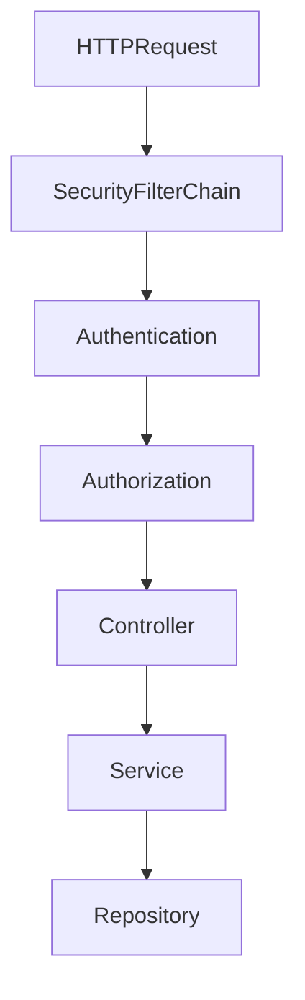

# BookShop

Lernprojekt für **Spring Boot 3.4** und **Spring Framework 6**: CRUD-REST-API mit Bean Validation, JPA + MySQL, Flyway, Actuator und **Spring Security** mit HTTP Basic und Rollen.

**Lern-Dokumentation:**

* [docs/01-spring-boot-grundlagen.md](docs/01-spring-boot-grundlagen.md) — Fundament bis Qualität am BookShop-Code  
* [docs/02-erste-rest-anwendung.md](docs/02-erste-rest-anwendung.md) — erste REST-Einheit: `@SpringBootApplication`, `@RestController`, DI, Controller/Service  
* [docs/03-crud-api.md](docs/03-crud-api.md) — CRUD: `@RequestBody`, `ResponseEntity`, POST/PUT/DELETE, Statuscodes  
* [docs/04-bean-validation-fehlerbehandlung.md](docs/04-bean-validation-fehlerbehandlung.md) — Bean Validation, `@RestControllerAdvice`, `ProblemDetail`  
* [docs/05-jpa-h2-persistenz.md](docs/05-jpa-h2-persistenz.md) — H2, `@Entity`, `JpaRepository`, `@Transactional`, Dirty Checking  
* [docs/06-author-book-manytoone.md](docs/06-author-book-manytoone.md) — 1:n Autor–Buch, `@ManyToOne`, `authorId`, nested DTOs  
* [docs/07-automatisierte-tests.md](docs/07-automatisierte-tests.md) — `@WebMvcTest`, Mockito, `@DataJpaTest` + Testcontainers  
* [docs/08-flyway-schema-versionierung.md](docs/08-flyway-schema-versionierung.md) — Flyway, `ddl-auto=validate`, Migrationsregeln  
* [docs/09-logging-health-monitoring.md](docs/09-logging-health-monitoring.md) — Actuator, Health, MDC-Logging, Micrometer-Metriken  
* [docs/10-spring-security-rollen.md](docs/10-spring-security-rollen.md) — HTTP Basic, Rollen, Actuator-Schutz, Security-Tests

---

## Inhaltsverzeichnis

1. [Ziel und Lernfokus](#1-ziel-und-lernfokus)
2. [Technik-Stack](#2-technik-stack)
3. [Voraussetzungen](#3-voraussetzungen)
4. [Projekt starten](#4-projekt-starten)
5. [Paket- und Ordnerstruktur](#5-paket--und-ordnerstruktur)
6. [Architektur-Überblick](#6-architektur-überblick)
7. [Entwicklungsschritte 1–8 (Kurz)](#7-entwicklungsschritte-18-kurz)
8. [Entwicklungsschritt 9 – Spring Security mit Rollen](#8-entwicklungsschritt-9--spring-security-mit-rollen)
9. [API-Referenz](#9-api-referenz)
10. [Tests](#10-tests)
11. [Nächste sinnvolle Schritte](#11-nächste-sinnvolle-schritte)
12. [Weitere Dokumentation](#12-weitere-dokumentation)

---

## 1. Ziel und Lernfokus

| Frage | Antwort |
|-------|---------|
| Authentifizierung? | **Wer** stellt die Anfrage? (HTTP Basic) |
| Autorisierung? | **Was** darf dieser Benutzer? (Rollen) |
| Welche Rollen? | `READER` (lesen), `ADMIN` (lesen + schreiben + Actuator) |
| `401` vs. `403`? | nicht angemeldet vs. angemeldet, aber nicht berechtigt |
| Warum stateless? | REST-API ohne Server-Session; Credentials pro Request |

**Noch nicht enthalten:** Benutzer in MySQL, JWT, Formular-Login, Prometheus, Testcontainers.

---

## 2. Technik-Stack

| Komponente | Wahl |
|------------|------|
| Spring Boot | 3.4.1 |
| Java | 17 |
| Persistenz | Spring Data JPA + **MySQL** |
| Schema | **Flyway** (`db/migration`) |
| Beobachtbarkeit | **Actuator** + Micrometer + SLF4J/MDC |
| Sicherheit | **Spring Security** (HTTP Basic, In-Memory-User) |
| Runtime-DB | `jdbc:mysql://localhost:3306/bookshop` |
| Test-DB | H2 (Profil `test`, gleiche Migrationen) |

---

## 3. Voraussetzungen

- JDK 17+, lokale MySQL, Datenbank `bookshop`

---

## 4. Projekt starten

```bash
.\mvnw.cmd test
.\mvnw.cmd spring-boot:run
```

```bash
curl -i http://localhost:8080/books
curl -i -u reader:reader-pass http://localhost:8080/books
curl -i http://localhost:8080/actuator/health
curl -i -u admin:admin-pass http://localhost:8080/security/me
```

---

## 5. Paket- und Ordnerstruktur

```text
com.example.bookshop/
├── author/ ...
├── book/ ...
├── error/
│   └── GlobalExceptionHandler.java
├── logging/
│   └── CorrelationIdFilter.java
├── monitoring/
│   ├── BookCatalogHealthIndicator.java
│   └── BookMetrics.java
└── security/
    ├── SecurityConfig.java
    └── CurrentUserController.java

src/main/resources/
├── application.properties
├── application-dev.properties
└── db/migration/
```

---

## 6. Architektur-Überblick



---

## 7. Entwicklungsschritte 1–8 (Kurz)

1. Fundament (Hello/Greet, DI)  
2. Books lesen  
3. CRUD In-Memory  
4. Validation + ProblemDetail + ISBN  
5. JPA + MySQL  
6. Author–Book ManyToOne  
7. Flyway (`validate` statt `ddl-auto=update`)  
8. Actuator, Logging, MDC, Metriken  

---

## 8. Entwicklungsschritt 9 – Spring Security mit Rollen

### Benutzer (In-Memory)

| Benutzer | Passwort | Rollen |
|----------|----------|--------|
| `reader` | `reader-pass` | `READER` |
| `admin` | `admin-pass` | `READER`, `ADMIN` |

### Zugriffsregeln

| Bereich | Regel |
|---------|-------|
| `GET /actuator/health`, `/actuator/info` | öffentlich |
| andere Actuator-Endpunkte | `ADMIN` |
| `GET /books/**`, `GET /authors/**` | `READER` oder `ADMIN` |
| `POST`/`PUT`/`DELETE` auf `/books/**`, `/authors/**` | `ADMIN` |
| `/security/me` | angemeldet |

### HTTP Basic testen

```bash
# ohne Anmeldung → 401
curl -i http://localhost:8080/books

# Reader lesen → 200
curl -i -u reader:reader-pass http://localhost:8080/books

# Reader schreiben → 403
curl -i -u reader:reader-pass -X POST -H "Content-Type: application/json" \
  -d '{"title":"Effective Java","authorId":1,"isbn":"978-0-13-468599-1"}' \
  http://localhost:8080/books

# Admin schreiben → 201
curl -i -u admin:admin-pass -X POST -H "Content-Type: application/json" \
  -d '{"title":"Effective Java","authorId":1,"isbn":"978-0-13-468599-1"}' \
  http://localhost:8080/books

# Metriken nur Admin
curl -i -u reader:reader-pass http://localhost:8080/actuator/metrics
curl -i -u admin:admin-pass http://localhost:8080/actuator/metrics

# aktueller Benutzer
curl -u admin:admin-pass http://localhost:8080/security/me
```

### Konfigurationshinweise

- `SessionCreationPolicy.STATELESS` – keine Server-Session
- CSRF deaktiviert für stateless REST-Clients (`curl`, Postman)
- `PasswordEncoder` mit delegating Hash (`{bcrypt}...`)
- HTTP Basic nur lokal/über HTTPS in Produktion

---

## 9. API-Referenz

| Methode | Pfad | Rolle | Status |
|---------|------|-------|--------|
| GET | `/authors` | READER, ADMIN | 200 / 401 |
| POST | `/authors` | ADMIN | 201 / 400 / 401 / 403 |
| GET | `/books` | READER, ADMIN | 200 / 401 |
| GET | `/books?authorId=` | READER, ADMIN | 200 / 404 / 401 |
| GET | `/books/{id}` | READER, ADMIN | 200 / 404 / 401 |
| POST | `/books` | ADMIN | 201 / 400 / 404 / 409 / 401 / 403 |
| PUT | `/books/{id}` | ADMIN | 200 / 400 / 404 / 409 / 401 / 403 |
| DELETE | `/books/{id}` | ADMIN | 204 / 404 / 401 / 403 |
| GET | `/security/me` | authentifiziert | 200 / 401 |
| GET | `/actuator/health` | öffentlich | 200 |
| GET | `/actuator/info` | öffentlich | 200 |
| GET | `/actuator/metrics` | ADMIN | 200 / 401 / 403 |

---

## 10. Tests

- `BookControllerTest` / `AuthorControllerTest`: Security mit `httpBasic(...)`  
- `BookShopApplicationTests`: Profil `test` (H2 + Flyway)  
- `BookCatalogHealthIndicatorTest`: Status `UP` + Detail `bookCount`  

---

## 11. Nächste sinnvolle Schritte

1. Benutzer und Rollen in MySQL  
2. Prometheus / JSON-Logging  
3. `@DataJpaTest` / Testcontainers  
4. Author Update/Delete mit Regeln  

---

## 12. Weitere Dokumentation

| Dokument | Inhalt |
|----------|--------|
| [docs/01-spring-boot-grundlagen.md](docs/01-spring-boot-grundlagen.md) | Einstieg: mentales Modell, Beans, DI, Web, Schichten, JPA/`@Transactional`, Autokonfiguration, Qualität — am BookShop-Code |
| [docs/02-erste-rest-anwendung.md](docs/02-erste-rest-anwendung.md) | Erste REST-Anwendung: Startklasse, Record, `@Service`/`@RestController`, Constructor Injection, curl, 404, `@RequestParam`-Übung |
| [docs/03-crud-api.md](docs/03-crud-api.md) | CRUD-API: `BookRequest`, In-Memory-Service, POST/PUT/DELETE, `ResponseEntity`, Statuscodes, Lernkontrolle |
| [docs/04-bean-validation-fehlerbehandlung.md](docs/04-bean-validation-fehlerbehandlung.md) | Bean Validation, fachliche Exceptions, `@RestControllerAdvice`, `ProblemDetail`, 400 vs. 404 |
| [docs/05-jpa-h2-persistenz.md](docs/05-jpa-h2-persistenz.md) | H2/JPA: Entity, Repository, Response-DTO, `@Transactional`, Dirty Checking, Derived Queries |
| [docs/06-author-book-manytoone.md](docs/06-author-book-manytoone.md) | 1:n Autor–Buch: `@ManyToOne`, Lazy Loading, `/authors`, `GET /books?authorId=` |
| [docs/07-automatisierte-tests.md](docs/07-automatisierte-tests.md) | Test-Slices: `@WebMvcTest`, Mockito-Service, `@DataJpaTest` + MySQL-Testcontainers |
| [docs/08-flyway-schema-versionierung.md](docs/08-flyway-schema-versionierung.md) | Flyway: Migrationen, `validate`, Baseline vs. Neuaufbau, Prüfsummen |
| [docs/09-logging-health-monitoring.md](docs/09-logging-health-monitoring.md) | Actuator, eigener Health Indicator, MDC, Metriken (`book.catalog.created`) |
| [docs/10-spring-security-rollen.md](docs/10-spring-security-rollen.md) | HTTP Basic, READER/ADMIN, `401`/`403`, Security-Tests mit `httpBasic` |

---

## Kurzfazit

**HTTP Basic + Rollen** schützen REST-API und Actuator: Reader lesen, Admin schreibt und verwaltet Metriken – mit klarer Trennung von Authentifizierung (`401`) und Autorisierung (`403`).
