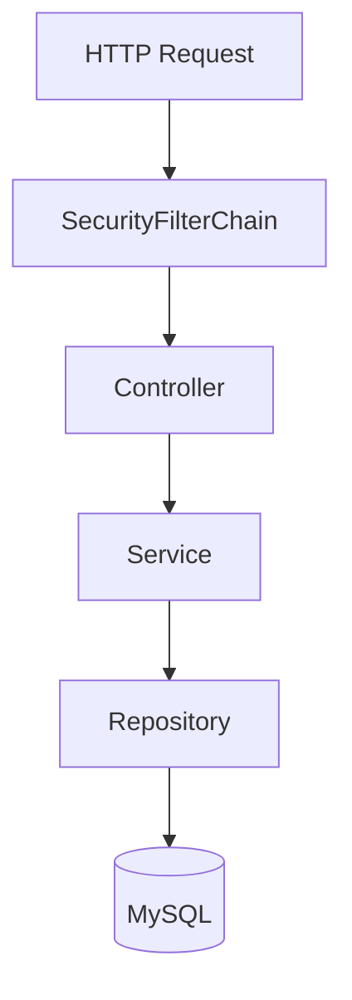

# Spring Boot Grundlagen (BookShop)

Lernnotiz zum **bisherigen Stand** des BookShop-Projekts: mentales Modell, Beans, Dependency Injection, Schichten, Web, Persistenz und Qualität — jeweils mit Verweis auf den echten Code.

Begleitend: Projektübersicht, API und Security in der [README](../README.md).  
Nächste Lerneinheit (didaktisches Mini-REST): [02-erste-rest-anwendung.md](02-erste-rest-anwendung.md).

---

## Inhaltsverzeichnis

1. [Was Spring Boot ist](#1-was-spring-boot-ist)
2. [Das Grundbild im Kopf](#2-das-grundbild-im-kopf)
3. [Drei Kernbegriffe](#3-drei-kernbegriffe)
4. [Einstiegspunkt der Anwendung](#4-einstiegspunkt-der-anwendung)
5. [Web: vom Hello zum Greeting](#5-web-vom-hello-zum-greeting)
6. [Schichtenarchitektur](#6-schichtenarchitektur)
7. [REST am Beispiel Bücher](#7-rest-am-beispiel-bücher)
8. [Daten: Entity, Repository, Service, Transaktion](#8-daten-entity-repository-service-transaktion)
9. [Autokonfiguration und Konfiguration](#9-autokonfiguration-und-konfiguration)
10. [Qualität: Fehler, Logging, Tests](#10-qualität-fehler-logging-tests)
11. [Häufige Missverständnisse](#11-häufige-missverständnisse)
12. [Lernroute und wo du stehst](#12-lernroute-und-wo-du-stehst)
13. [Merksatz](#13-merksatz)

---

## 1. Was Spring Boot ist

Spring Boot ist nicht „Spring neu“, sondern der **übliche Weg**, Spring-Anwendungen zu bauen:

| Begriff | Rolle |
|---------|--------|
| **Spring Framework** | Kernfähigkeiten (IoC-Container, DI, Transaktionen, …) |
| **Spring Boot** | Standardkonfiguration + Autokonfiguration + komfortabler Start |

In diesem Projekt: **Spring Boot 3.4.1**, Java **17**, Einstieg über Maven (`mvnw`) und `main(...)`.

Du brauchst keinen separaten App-Server manuell zu deployen: Boot startet einen **eingebetteten** Webserver (Tomcat), sobald `spring-boot-starter-web` auf dem Classpath liegt.

---

## 2. Das Grundbild im Kopf

```text
Anwendung starten
  → Spring-Container erzeugt Beans
  → Abhängigkeiten werden injiziert
  → eingebetteter Webserver startet
  → Controller / Services / Repositories arbeiten zusammen
```

Im BookShop konkret:

```text
BookShopApplication.main
  → Context startet (Scan ab com.example.bookshop)
  → GreetingService, BookService, BookController, …
  → SecurityFilterChain, DataSource, Flyway, …
  → Tomcat lauscht (typisch :8080)
  → GET /hello, GET /books, …
```

---

## 3. Drei Kernbegriffe

### Bean

Eine **Bean** ist ein Objekt, das der Spring-Container verwaltet. Typische Marker:

| Annotation | Typische Schicht | Beispiel im Projekt |
|------------|------------------|---------------------|
| `@RestController` | Web | `HelloController`, `BookController` |
| `@Service` | Fachlogik | `GreetingService`, `BookService` |
| `@Repository` / Spring Data | Persistenz | `BookRepository` (Interface → Proxy) |
| `@Configuration` + `@Bean` | Infrastruktur | `SecurityConfig` |

### Dependency Injection (DI / IoC)

Wichtige Objekte erzeugst du **nicht** mit `new`, sondern Spring **gibt** sie dir — meist über den **Konstruktor**.

Frage aus der Mini-Übung:

> Warum wird `GreetingService` im Controller-Konstruktor übergeben statt `new GreetingService()`?

**Antwort:** Weil Spring den Objektgraphen aufbauen und Abhängigkeiten verdrahten soll. Das ist Inversion of Control.

### Autokonfiguration

Boot schaut auf **Classpath** und **Properties** und verdrahtet Standardbausteine, z. B.:

- Web-Starter → eingebetteter Tomcat, DispatcherServlet
- Data-JPA + JDBC-URL → DataSource, EntityManager
- Flyway auf dem Classpath → Migrationen beim Start

---

## 4. Einstiegspunkt der Anwendung

Datei: `src/main/java/com/example/bookshop/BookShopApplication.java`

```java
@SpringBootApplication
public class BookShopApplication {
    public static void main(String[] args) {
        SpringApplication.run(BookShopApplication.class, args);
    }
}
```

`@SpringBootApplication` bündelt im Wesentlichen:

1. **Autokonfiguration**
2. **Component Scan** (ab dem Package der Klasse: `com.example.bookshop`)
3. Möglichkeit zur **Konfiguration** (eigene `@Configuration`-Klassen)

Start:

```bash
.\mvnw.cmd spring-boot:run
```

---

## 5. Web: vom Hello zum Greeting

### Minimaler Endpunkt

Datei: `web/controller/HelloController.java`

- `@RestController` — Web-Bean; Rückgabe wird HTTP-Body
- `@GetMapping("/hello")` — GET `/hello` → `"Hallo Spring Boot"`

### Dependency Injection in Aktion

| Klasse | Annotation | Aufgabe |
|--------|------------|---------|
| `GreetingService` | `@Service` | `greet(name)` → `"Hallo " + name` |
| `GreetingController` | `@RestController` | injiziert Service, mappt GET `/greet` |

```java
public GreetingController(GreetingService greetingService) {
    this.greetingService = greetingService;
}
```

Dasselbe Muster später bei `BookController(BookService)` und  
`BookService(BookRepository, AuthorRepository, BookMetrics)`.

---

## 6. Schichtenarchitektur

Empfohlene Trennung (und warum nicht alles in den Controller):

```text
HTTP
  ↓
Controller   — Request/Response, Mapping, Validation am Rand
  ↓
Service      — Fachregeln, Transaktionen, Orchestrierung
  ↓
Repository   — Persistenz
  ↓
Entity       — Tabellenzeile / Domänenpersistenz
```

API-Daten getrennt halten:

| Typ | Richtung | Beispiel |
|-----|----------|----------|
| Request-DTO | rein | `BookRequest`, `AuthorRequest` |
| Response-DTO | raus | `BookResponse`, `AuthorResponse` |
| Entity | nur innen | `BookEntity`, `AuthorEntity` |

Paketstruktur (vereinfacht):

```text
com.example.bookshop/
├── BookShopApplication.java
├── web/controller/     # Hello, Greeting (Einstieg)
├── service/            # GreetingService
├── book/               # Controller, Service, Repo, Entity, DTOs
├── author/             # analog
├── error/              # GlobalExceptionHandler
├── logging/            # CorrelationIdFilter
├── monitoring/         # Health, Metrics
└── security/           # SecurityConfig, /security/me
```

Request-Durchlauf (inkl. Security, ab Schritt 9):



---

## 7. REST am Beispiel Bücher

Datei: `book/BookController.java` — Basispfad `@RequestMapping("/books")`.

| Annotation / Typ | Bedeutung | Beispiel |
|------------------|-----------|----------|
| `@GetMapping` | Lesen | `GET /books`, `GET /books/{id}` |
| `@PostMapping` | Anlegen | `POST /books` → oft `201` + `Location` |
| `@PutMapping` | Aktualisieren | `PUT /books/{id}` |
| `@DeleteMapping` | Löschen | `DELETE /books/{id}` → `204` |
| `@PathVariable` | Pfadteil | `{id}` |
| `@RequestParam` | Query | `?authorId=` |
| `@RequestBody` | JSON → Objekt | `BookRequest` |
| `@Valid` | Bean Validation | Constraints auf dem Request-Record |
| `ResponseEntity` | Status + Header + Body | `.created(location).body(...)` |

Der Controller enthält **keine** Fachregeln (ISBN-Eindeutigkeit, Autor existiert, …) — das macht `BookService`.

---

## 8. Daten: Entity, Repository, Service, Transaktion

### Entity

`BookEntity` mit `@Entity`, `@Table(name = "books")`, `@Id`, `@ManyToOne` zum Autor.  
Geschützter No-Args-Konstruktor für JPA; fachliches Anlegen/Ändern über Konstruktor bzw. `update(...)`.

### Repository

```java
public interface BookRepository extends JpaRepository<BookEntity, Long> {
    List<BookEntity> findByAuthorId(Long authorId);
    boolean existsByIsbn(String isbn);
}
```

Spring Data JPA stellt die Implementierung zur Laufzeit bereit; Methodennamen wie `findByAuthorId` werden abgeleitet.

### Service und `@Transactional`

`BookService`:

- Klassen-Level: `@Transactional(readOnly = true)` für Lesen
- Schreibmethoden (`create`, `update`, `delete`): `@Transactional` (schreibbar)

Spring öffnet eine Transaktion um die Methode: bei Erfolg Commit, bei unchecked Exception typischerweise Rollback.

Fachlogik-Beispiele:

- Autor muss existieren → sonst `AuthorNotFoundException`
- ISBN eindeutig → sonst `DuplicateIsbnException`
- Mapping Entity ↔ `BookResponse` im Service (nicht im Controller)

Schema-Verwaltung: **Flyway** (`db/migration`), Hibernate `ddl-auto=validate` (kein automatisches Schema-Update in Produktion).

---

## 9. Autokonfiguration und Konfiguration

### Starter in `pom.xml` (Auswahl)

| Starter / Dependency | Wirkung |
|----------------------|---------|
| `spring-boot-starter-web` | REST + eingebetteter Tomcat |
| `spring-boot-starter-data-jpa` | JPA + Repository-Support |
| `spring-boot-starter-validation` | `@Valid`, Constraints |
| `spring-boot-starter-security` | Authn/Authz (HTTP Basic) |
| `spring-boot-starter-actuator` | Health, Info, Metrics |
| `mysql-connector-j` | MySQL zur Laufzeit |
| `h2` (Test) | In-Memory-DB für Tests |
| Flyway | Migrationen |

### Properties

`src/main/resources/application.properties` — u. a.:

- DataSource (MySQL-URL, User)
- JPA (`show-sql`, `ddl-auto=validate`)
- Flyway
- Actuator-Exposure
- Logging-Pattern (inkl. Correlation-Id aus MDC)

Profile: `application-dev.properties`, Test: `src/test/resources/application-test.properties` (H2).

---

## 10. Qualität: Fehler, Logging, Tests

| Thema | Im Projekt |
|-------|------------|
| Zentrale Fehlerbehandlung | `GlobalExceptionHandler` (`@RestControllerAdvice`) → u. a. `ProblemDetail`, 404/409/400 |
| Logging | SLF4J in Services; `CorrelationIdFilter` für Request-Korrelation |
| Monitoring | Actuator, `BookCatalogHealthIndicator`, `BookMetrics` |
| Tests | WebMvc-Tests mit Security (`httpBasic`), Application-Test mit Profil `test` |

Details zu Rollen, curl-Beispielen und API-Tabelle: [README](../README.md).

---

## 11. Häufige Missverständnisse

1. **„Spring Boot nimmt mir alles ab.“**  
   Nein — Konfiguration ja; Fachlogik, Domänenmodell, API-Design und Struktur bleiben deine Aufgabe.

2. **„Ich muss erst alles über Spring wissen.“**  
   Nein — kleines Projekt, Kernideen zuerst: Einstieg, Beans, DI, Controller, Properties, Datenzugriff.

3. **„Spring Boot = nur Web.“**  
   Nein — im BookShop schon sichtbar: Security, Actuator, Logging, Persistenz, Tests; Boot kann noch deutlich breiter sein.

---

## 12. Lernroute und wo du stehst

| Phase | Inhalt | BookShop-Bezug |
|-------|--------|----------------|
| **1 – Fundament** | Boot, Bean, DI, `@SpringBootApplication` | `BookShopApplication`, Hello/Greet |
| **2 – Web** | REST-Annotationen, `ResponseEntity` | `BookController`, `AuthorController` |
| **3 – Daten** | Entity, Repository, Service, `@Transactional` | `book/`, `author/`, Flyway, MySQL |
| **4 – Qualität** | Properties, Tests, Logging, Fehler | Exception Handler, Actuator, Tests |
| **5 – Security** | HTTP Basic, Rollen | `SecurityConfig` (siehe README Schritt 9) |

**Bis hierhin (diese Doku):** Phasen 1–4 erklärt und am Code verankert; Phase 5 ist im Projekt umgesetzt und in der README dokumentiert.

Sinnvolle Vertiefungen als Nächstes:

- Request-Durchlauf `POST /books` Zeile für Zeile
- Warum `update` oft ohne explizites `save` funktioniert (JPA Persistence Context)
- Wie Spring Data Methodennamen ableitet
- Security: `401` vs. `403`, stateless Basic Auth

---

## 13. Merksatz

**Spring Boot** bedeutet für dich vor allem:

**schneller Start + Autokonfiguration + sauber verwaltete Beans + klare Schichten für Web, Logik und Datenzugriff.**

Im BookShop siehst du das als:

`BookShopApplication` → Controllers → Services → Repositories/Entities → Properties/Flyway → (optional) Security & Actuator.
