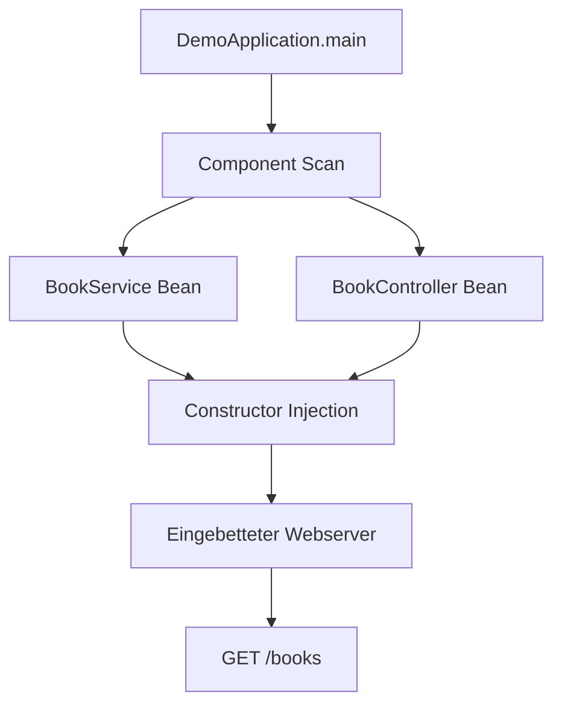

# Erste kleine Spring-Boot-REST-Anwendung

Lern-Einheit zum Fundament von Spring Web: `@SpringBootApplication`, `@RestController`, Dependency Injection und das Zusammenspiel von Controller und Service.

Vorher: [01-spring-boot-grundlagen.md](01-spring-boot-grundlagen.md)  
Nächste Einheit: [03-crud-api.md](03-crud-api.md)  
Projektübersicht: [README](../README.md)

Im BookShop entspricht diese Einheit dem **Entwicklungsschritt 1–2** (Hello/Greet und Books lesen) — hier als didaktisch reduziertes Mini-Beispiel.

---

## Lernziele

Nach dieser Einheit solltest du sauber verstehen:

* was `@SpringBootApplication` macht
* was ein `@RestController` ist
* wie **Dependency Injection** funktioniert
* wie Controller und Service zusammenspielen
* wie du das Ganze per HTTP testest

Das passt zu den Grundlagen aus dem Spring-Boot-Handbuch: Einstieg, Container/Beans, Injection und Spring Web.

---

## Inhaltsverzeichnis

1. [Was wir bauen](#1-was-wir-bauen)
2. [Projektstruktur](#2-projektstruktur)
3. [Einstiegsklasse](#3-einstiegsklasse)
4. [Datenobjekt](#4-datenobjekt)
5. [Service-Schicht](#5-service-schicht)
6. [Controller-Schicht](#6-controller-schicht)
7. [Zeile für Zeile erklärt](#7-zeile-für-zeile-erklärt)
8. [Was Spring beim Start macht](#8-was-spring-beim-start-macht)
9. [Testen mit curl](#9-testen-mit-curl)
10. [Warum automatisch JSON?](#10-warum-automatisch-json)
11. [Architekturprinzip](#11-architekturprinzip)
12. [Typische Anfängerfehler](#12-typische-anfängerfehler)
13. [Erweiterung: 404 bei unbekannter ID](#13-erweiterung-404-bei-unbekannter-id)
14. [Mini-Übung: Suche mit RequestParam](#14-mini-übung-suche-mit-requestparam)
15. [Mitnehmen](#15-mitnehmen)
16. [Hausregel](#16-hausregel)
17. [Nächster Schritt](#17-nächster-schritt)
18. [Bezug zum BookShop](#18-bezug-zum-bookshop)

---

## 1. Was wir bauen

Ein kleiner HTTP-Service für Bücher. Am Ende sollen funktionieren:

| Methode | URL | Ergebnis |
|---------|-----|----------|
| `GET` | `/books` | Liste aller Bücher (JSON) |
| `GET` | `/books/1` | Ein Buch (JSON) |

---

## 2. Projektstruktur

Didaktisches Mini-Layout:

```text
src/main/java/com.example.demo
 ├── DemoApplication.java
 └── book
      ├── Book.java
      ├── BookService.java
      └── BookController.java
```

Klein, aber schon sauber getrennt: Einstieg, Modell, Service, Controller.

Im BookShop liegt die Startklasse bei `com.example.bookshop.BookShopApplication`; Bücher unter `com.example.bookshop.book`.

---

## 3. Einstiegsklasse

```java
package com.example.demo;

import org.springframework.boot.SpringApplication;
import org.springframework.boot.autoconfigure.SpringBootApplication;

@SpringBootApplication
public class DemoApplication {

    public static void main(String[] args) {
        SpringApplication.run(DemoApplication.class, args);
    }
}
```

### `@SpringBootApplication`

Standard-Startannotation in Spring Boot. Sie bündelt im Kern drei Dinge:

| Bestandteil | Kurz |
|-------------|------|
| Konfiguration | die Klasse ist eine Konfigurationsquelle |
| Component Scanning | Suche nach Beans unterhalb des Pakets der Startklasse |
| Auto Configuration | sinnvolle Vorkonfiguration anhand Classpath |

Merksatz:

**Spring sucht damit automatisch nach deinen Komponenten unterhalb des Pakets der Startklasse und konfiguriert vieles sinnvoll vor.**

### `SpringApplication.run(...)`

Startet:

* den Spring-Container
* die Bean-Verwaltung
* bei Webprojekten den eingebetteten Webserver

---

## 4. Datenobjekt

Ein Java-`record` als einfacher Datenträger (DTO):

```java
package com.example.demo.book;

public record Book(Long id, String title, String author) {
}
```

Beispiel:

```java
new Book(1L, "Spring Start", "Max Mustermann");
```

Ein `record` liefert automatisch:

* Konstruktor
* Zugriffsmethoden `id()`, `title()`, `author()`
* `toString()`, `equals()`, `hashCode()`

Für einfache DTOs sehr praktisch. Im späteren BookShop siehst du dasselbe Muster bei `BookRequest` / `BookResponse`.

---

## 5. Service-Schicht

```java
package com.example.demo.book;

import org.springframework.stereotype.Service;

import java.util.List;

@Service
public class BookService {

    public List<Book> findAll() {
        return List.of(
                new Book(1L, "Spring Start", "Max Mustermann"),
                new Book(2L, "Java Basics", "Erika Musterfrau")
        );
    }

    public Book findById(Long id) {
        return findAll().stream()
                .filter(book -> book.id().equals(id))
                .findFirst()
                .orElse(null);
    }
}
```

### `@Service`

Damit sagst du Spring:

**Diese Klasse ist eine Bean und soll vom Container verwaltet werden.**

Folgen:

* Spring erzeugt das Objekt
* Spring kann es anderen Klassen injizieren
* du schreibst kein `new BookService()` im Controller

`@Service` ist eine spezialisierte `@Component`-Variante (neben `@Repository`, `@Controller`).

---

## 6. Controller-Schicht

```java
package com.example.demo.book;

import org.springframework.web.bind.annotation.GetMapping;
import org.springframework.web.bind.annotation.PathVariable;
import org.springframework.web.bind.annotation.RequestMapping;
import org.springframework.web.bind.annotation.RestController;

import java.util.List;

@RestController
@RequestMapping("/books")
public class BookController {

    private final BookService bookService;

    public BookController(BookService bookService) {
        this.bookService = bookService;
    }

    @GetMapping
    public List<Book> getAllBooks() {
        return bookService.findAll();
    }

    @GetMapping("/{id}")
    public Book getBookById(@PathVariable Long id) {
        return bookService.findById(id);
    }
}
```

---

## 7. Zeile für Zeile erklärt

### `@RestController`

Web-Komponente. Merksatz:

**Ein `@RestController` nimmt HTTP-Anfragen entgegen und liefert die Antwort direkt als Daten zurück, meist JSON.**

Also API-Antworten, keine klassischen HTML-Views.

### `@RequestMapping("/books")`

Gemeinsames URL-Präfix für alle Methoden:

| Methode | URL |
|---------|-----|
| `getAllBooks()` | `/books` |
| `getBookById(...)` | `/books/{id}` |

### Konstruktor-Injection

```java
public BookController(BookService bookService) {
    this.bookService = bookService;
}
```

Spring sieht: Controller braucht `BookService` → passende Bean existiert → Übergabe automatisch.

Das ist **Constructor Injection** (saubere Form von Dependency Injection / IoC).

| Mit `new BookService()` | Mit Injection |
|-------------------------|---------------|
| Controller erzeugt die Abhängigkeit selbst | Spring verwaltet den Objektgraphen |
| fester gekoppelt | lockerer gekoppelt |
| schwerer zu testen | besser mockbar |

### `@GetMapping`

```java
@GetMapping
public List<Book> getAllBooks()
```

→ HTTP **GET** `/books`.

### `@GetMapping("/{id}")` und `@PathVariable`

```java
@GetMapping("/{id}")
public Book getBookById(@PathVariable Long id)
```

→ HTTP **GET** `/books/1`.  
URL `/books/2` → `id` wird `2`.

---

## 8. Was Spring beim Start macht

Vereinfachte Startkette:

1. Spring Boot startet (`SpringApplication.run`)
2. Pakete werden gescannt (unterhalb der Startklasse)
3. `BookService` wird gefunden (`@Service`)
4. `BookController` wird gefunden (`@RestController`)
5. beide Beans werden erzeugt
6. `BookService` wird in `BookController` injiziert
7. der Webserver startet
8. `/books` ist erreichbar



---

## 9. Testen mit curl

Anwendung starten (im BookShop z. B. `.\mvnw.cmd spring-boot:run`), dann:

### Alle Bücher

```bash
curl http://localhost:8080/books
```

Erwartete Antwort (Beispiel):

```json
[
  {
    "id": 1,
    "title": "Spring Start",
    "author": "Max Mustermann"
  },
  {
    "id": 2,
    "title": "Java Basics",
    "author": "Erika Musterfrau"
  }
]
```

### Ein Buch

```bash
curl http://localhost:8080/books/1
```

```json
{
  "id": 1,
  "title": "Spring Start",
  "author": "Max Mustermann"
}
```

> **Hinweis BookShop:** Mit Security (Schritt 9) brauchst du Credentials, z. B.  
> `curl -u reader:reader-pass http://localhost:8080/books`

---

## 10. Warum automatisch JSON?

Spring Web bringt `HttpMessageConverter` mit. Du gibst Java-Objekte zurück; Spring serialisiert sie zu JSON in der HTTP-Response.

Für diesen einfachen Fall baust du JSON nicht manuell.

---

## 11. Architekturprinzip

Trennung von Anfang an:

| Schicht | Verantwortung |
|---------|----------------|
| **Controller** | spricht HTTP |
| **Service** | enthält Fachlogik |
| **Model/DTO** | transportiert Daten |

Später zusätzlich:

| Schicht | Verantwortung |
|---------|----------------|
| **Repository** | spricht mit der Datenbank |

Anfänger packen oft alles in den Controller. Kurzfristig ok, langfristig schlecht skalierbar.

---

## 12. Typische Anfängerfehler

### Fehler 1: `new` im Controller

```java
// falsch
private BookService bookService = new BookService();
```

Spring verwaltet die Abhängigkeit nicht → schwerer testbar, unnötig fest gekoppelt.

### Fehler 2: komplette Fachlogik im Controller

```java
// didaktisch unsauber
@GetMapping
public List<Book> getAllBooks() {
    return List.of(
        new Book(1L, "A", "B"),
        new Book(2L, "C", "D")
    );
}
```

Für ein Einzeiler-Demo verständlich — besser in den Service auslagern.

### Fehler 3: Startklasse im falschen Paket

Liegt `DemoApplication` zu tief oder im falschen Ast, findet der Component Scan deine Klassen möglicherweise nicht.

Faustregel:

**Die Startklasse gehört möglichst weit oben in die Paketstruktur.**

---

## 13. Erweiterung: 404 bei unbekannter ID

`orElse(null)` liefert bei `/books/99` oft eine leere oder unklare Antwort. Besser ein HTTP-404:

```java
package com.example.demo.book;

import org.springframework.http.HttpStatus;
import org.springframework.stereotype.Service;
import org.springframework.web.server.ResponseStatusException;

import java.util.List;

@Service
public class BookService {

    public List<Book> findAll() {
        return List.of(
                new Book(1L, "Spring Start", "Max Mustermann"),
                new Book(2L, "Java Basics", "Erika Musterfrau")
        );
    }

    public Book findById(Long id) {
        return findAll().stream()
                .filter(book -> book.id().equals(id))
                .findFirst()
                .orElseThrow(() -> new ResponseStatusException(
                        HttpStatus.NOT_FOUND,
                        "Buch mit ID " + id + " nicht gefunden"
                ));
    }
}
```

Im BookShop läuft das über eigene Exceptions (`BookNotFoundException`) und den `GlobalExceptionHandler` mit `ProblemDetail` — dieselbe Idee, nur zentraler.

---

## 14. Mini-Übung: Suche mit RequestParam

Controller erweitern:

```java
@GetMapping("/search")
public List<Book> searchBooks(@RequestParam String author) {
    return bookService.findAll().stream()
            .filter(book -> book.author().equalsIgnoreCase(author))
            .toList();
}
```

Aufruf:

```bash
curl "http://localhost:8080/books/search?author=Max%20Mustermann"
```

Unterschied üben:

| Annotation | Quelle | Beispiel |
|------------|--------|----------|
| `@PathVariable` | Pfad | `/books/1` → `id=1` |
| `@RequestParam` | Query-String | `/books/search?author=…` |

> Mapping-Reihenfolge beachten: `/search` muss als eigener `@GetMapping` greifen und darf nicht von `/{id}` „verschluckt“ werden (bei String-`id` riskant). Mit `Long id` wie oben ist `/books/search` unkritisch, solange `/search` als eigene Methode existiert.

Im BookShop siehst du `@RequestParam` z. B. bei `GET /books?authorId=`.

---

## 15. Mitnehmen

### Fachlich

Kernkette:

1. Spring Boot startet die Anwendung  
2. Spring verwaltet Beans  
3. Beans werden injiziert  
4. Controller reagieren auf HTTP  
5. Service enthält Logik  
6. Rückgaben werden automatisch als JSON serialisiert  

### Didaktisch

Noch kein vollständiges Enterprise-Projekt — genau das richtige erste Fundament.

---

## 16. Hausregel

Bei jeder Klasse vier Fragen:

1. **Welche Rolle?** Controller, Service, Repository, Config?  
2. **Wer erzeugt das Objekt?** Ich oder Spring?  
3. **Von wem hängt sie ab?** Welche Beans braucht sie?  
4. **Welche Verantwortung genau?** HTTP, Fachlogik, Persistenz oder Konfiguration?  

---

## 17. Nächster Schritt

Daraus eine **echte CRUD-API** machen:

* `POST /books`
* `PUT /books/{id}`
* `DELETE /books/{id}`
* `@RequestBody`
* `ResponseEntity`
* saubere HTTP-Statuscodes
* optional danach H2/MySQL + Spring Data JPA

Im BookShop ist das bereits in den Entwicklungsschritten 3–5 umgesetzt — siehe [03-crud-api.md](03-crud-api.md), [README](../README.md) und [01-spring-boot-grundlagen.md](01-spring-boot-grundlagen.md).

---

## 18. Bezug zum BookShop

| Thema dieser Einheit | Im BookShop |
|----------------------|-------------|
| Startklasse | `BookShopApplication` |
| Einfacher GET-Controller | `HelloController`, früher Books lesen |
| DI Controller → Service | `GreetingController` / `BookController` |
| In-Memory-Liste | historisch Schritt 2–3; heute JPA + MySQL |
| 404 bei fehlender ID | `BookNotFoundException` + `GlobalExceptionHandler` |
| `@RequestParam` | `GET /books?authorId=` |

Diese Datei hält die **Lehrversion** fest; der laufende Code ist die fortgeschrittene Variante derselben Ideen.
