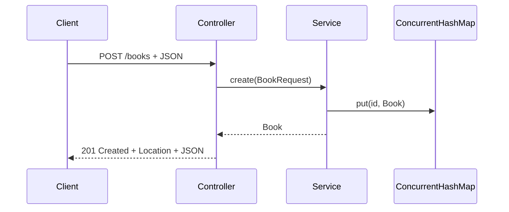

# CRUD-API: Create, Read, Update, Delete

Lern-Einheit: aus dem bisherigen Lesezugriff eine vollständige REST-CRUD-API bauen — mit `@RequestBody`, `@PostMapping`, `@PutMapping`, `@DeleteMapping`, `ResponseEntity` und passenden HTTP-Statuscodes.

Vorher: [02-erste-rest-anwendung.md](02-erste-rest-anwendung.md)  
Nächste Einheit: [04-bean-validation-fehlerbehandlung.md](04-bean-validation-fehlerbehandlung.md)  
Danach (im BookShop): JPA / Persistenz  
Projektübersicht: [README](../README.md)

Im BookShop entspricht diese Einheit dem **Entwicklungsschritt 3** (CRUD In-Memory). Hier als didaktisches Mini-Beispiel ohne Datenbank.

---

## Lernziele

* Create / Read / Update / Delete über HTTP
* `@RequestBody` und Jackson-Deserialisierung
* `ResponseEntity` für Status, Header und Body
* typische Statuscodes (`200`, `201`, `204`, `404`)
* Trennung von Domänenobjekt und Request-DTO
* In-Memory-Speicher mit `ConcurrentHashMap` / `AtomicLong` als Lernlösung

Diese Bausteine gehören im Handbuch zu Spring Web: Request-Auswertung, DTOs, `ResponseEntity` und Fehlerbehandlung.

---

## Inhaltsverzeichnis

1. [Ziel der API](#1-ziel-der-api)
2. [Domänenobjekt](#2-domänenobjekt)
3. [DTO für eingehende Daten](#3-dto-für-eingehende-daten)
4. [In-Memory-Service](#4-in-memory-service)
5. [Was neu ist](#5-was-neu-ist)
6. [Vollständiger Controller](#6-vollständiger-controller)
7. [`@RequestBody`](#7-requestbody)
8. [`ResponseEntity`](#8-responseentity)
9. [Buch anlegen (POST)](#9-buch-anlegen-post)
10. [Buch aktualisieren (PUT)](#10-buch-aktualisieren-put)
11. [Buch löschen (DELETE)](#11-buch-löschen-delete)
12. [HTTP-Statuscodes](#12-http-statuscodes)
13. [Datenfluss beim POST](#13-datenfluss-beim-post)
14. [Aufgabenverteilung](#14-aufgabenverteilung)
15. [Kritikpunkt: Validierung fehlt](#15-kritikpunkt-validierung-fehlt)
16. [Lernkontrolle](#16-lernkontrolle)
17. [Praxisaufgabe: Autorensuche](#17-praxisaufgabe-autorensuche)
18. [Bezug zum BookShop](#18-bezug-zum-bookshop)

---

## 1. Ziel der API

| HTTP-Methode | URL | Bedeutung |
| ------------ | --- | --------- |
| `GET` | `/books` | alle Bücher abrufen |
| `GET` | `/books/{id}` | ein Buch abrufen |
| `POST` | `/books` | neues Buch anlegen |
| `PUT` | `/books/{id}` | Buch vollständig ändern |
| `DELETE` | `/books/{id}` | Buch löschen |

Zunächst weiterhin **keine Datenbank**. Die Daten liegen vorübergehend im Arbeitsspeicher.

---

## 2. Domänenobjekt

```java
package com.example.demo.book;

public record Book(
        Long id,
        String title,
        String author
) {
}
```

Die ID soll **nicht** vom Client vergeben werden. Deshalb gibt es für eingehende Requests ein separates DTO.

---

## 3. DTO für eingehende Daten

```java
package com.example.demo.book;

public record BookRequest(
        String title,
        String author
) {
}
```

Der Client sendet nur:

```json
{
  "title": "Spring Boot lernen",
  "author": "Anna Beispiel"
}
```

Die ID erzeugt die Anwendung.

### Warum ein separates DTO?

| Vorteil | Erklärung |
|---------|-----------|
| Keine Client-ID | Der Client darf keine ID festlegen |
| Getrennte Modelle | Internes Modell ≠ API-Modell |
| Validierung | Constraints später am Request-DTO |
| Evolution | DB-Änderungen müssen die API nicht automatisch ändern |

DTO = **Data Transfer Object**.

---

## 4. In-Memory-Service

```java
package com.example.demo.book;

import org.springframework.http.HttpStatus;
import org.springframework.stereotype.Service;
import org.springframework.web.server.ResponseStatusException;

import java.util.ArrayList;
import java.util.List;
import java.util.Map;
import java.util.concurrent.ConcurrentHashMap;
import java.util.concurrent.atomic.AtomicLong;

@Service
public class BookService {

    private final Map<Long, Book> books = new ConcurrentHashMap<>();
    private final AtomicLong nextId = new AtomicLong();

    public BookService() {
        create(new BookRequest(
                "Spring Boot lernen",
                "Anna Beispiel"
        ));

        create(new BookRequest(
                "Modernes Java",
                "Max Mustermann"
        ));
    }

    public List<Book> findAll() {
        return new ArrayList<>(books.values());
    }

    public Book findById(Long id) {
        Book book = books.get(id);

        if (book == null) {
            throw new ResponseStatusException(
                    HttpStatus.NOT_FOUND,
                    "Buch mit ID " + id + " wurde nicht gefunden"
            );
        }

        return book;
    }

    public Book create(BookRequest request) {
        Long id = nextId.incrementAndGet();

        Book book = new Book(
                id,
                request.title(),
                request.author()
        );

        books.put(id, book);
        return book;
    }

    public Book update(Long id, BookRequest request) {
        findById(id);

        Book updatedBook = new Book(
                id,
                request.title(),
                request.author()
        );

        books.put(id, updatedBook);
        return updatedBook;
    }

    public void delete(Long id) {
        Book removedBook = books.remove(id);

        if (removedBook == null) {
            throw new ResponseStatusException(
                    HttpStatus.NOT_FOUND,
                    "Buch mit ID " + id + " wurde nicht gefunden"
            );
        }
    }
}
```

---

## 5. Was neu ist

### `ConcurrentHashMap`

```java
private final Map<Long, Book> books = new ConcurrentHashMap<>();
```

Die Map simuliert die Datenbank:

* Schlüssel: Buch-ID
* Wert: Buch

```text
1 -> Book(1, "Spring Boot lernen", "Anna Beispiel")
2 -> Book(2, "Modernes Java", "Max Mustermann")
```

`ConcurrentHashMap` ist threadsicherer als eine normale `HashMap` — wichtig, weil mehrere Requests parallel eintreffen können.

### `AtomicLong`

```java
private final AtomicLong nextId = new AtomicLong();
Long id = nextId.incrementAndGet(); // 1, 2, 3, ...
```

Auch hier: sichere IDs bei parallelen Zugriffen.

### Wichtig

Das ist eine **Lernlösung**. Beim Neustart sind die Daten weg. Später ersetzt Spring Data JPA die Map durch eine echte Datenbank.

---

## 6. Vollständiger Controller

```java
package com.example.demo.book;

import org.springframework.http.ResponseEntity;
import org.springframework.web.bind.annotation.DeleteMapping;
import org.springframework.web.bind.annotation.GetMapping;
import org.springframework.web.bind.annotation.PathVariable;
import org.springframework.web.bind.annotation.PostMapping;
import org.springframework.web.bind.annotation.PutMapping;
import org.springframework.web.bind.annotation.RequestBody;
import org.springframework.web.bind.annotation.RequestMapping;
import org.springframework.web.bind.annotation.RestController;

import java.net.URI;
import java.util.List;

@RestController
@RequestMapping("/books")
public class BookController {

    private final BookService bookService;

    public BookController(BookService bookService) {
        this.bookService = bookService;
    }

    @GetMapping
    public List<Book> getAllBooks() {
        return bookService.findAll();
    }

    @GetMapping("/{id}")
    public Book getBookById(@PathVariable Long id) {
        return bookService.findById(id);
    }

    @PostMapping
    public ResponseEntity<Book> createBook(
            @RequestBody BookRequest request
    ) {
        Book createdBook = bookService.create(request);

        URI location = URI.create("/books/" + createdBook.id());

        return ResponseEntity
                .created(location)
                .body(createdBook);
    }

    @PutMapping("/{id}")
    public ResponseEntity<Book> updateBook(
            @PathVariable Long id,
            @RequestBody BookRequest request
    ) {
        Book updatedBook = bookService.update(id, request);

        return ResponseEntity.ok(updatedBook);
    }

    @DeleteMapping("/{id}")
    public ResponseEntity<Void> deleteBook(
            @PathVariable Long id
    ) {
        bookService.delete(id);

        return ResponseEntity.noContent().build();
    }
}
```

---

## 7. `@RequestBody`

```java
@PostMapping
public ResponseEntity<Book> createBook(
        @RequestBody BookRequest request
)
```

Bedeutung:

> Lies den HTTP-Request-Body und konvertiere das JSON in ein Java-Objekt.

Client sendet:

```json
{
  "title": "Clean Code",
  "author": "Robert C. Martin"
}
```

Jackson erzeugt:

```java
new BookRequest("Clean Code", "Robert C. Martin");
```

JSON musst du nicht manuell parsen.

---

## 8. `ResponseEntity`

Direktes Zurückgeben eines Objekts:

```java
public Book getBookById(...)
```

Mit `ResponseEntity` steuerst du die **gesamte** HTTP-Response:

* Statuscode
* Header
* Body

```java
return ResponseEntity.ok(updatedBook);
```

→ `200 OK` + Body mit dem aktualisierten Buch.

---

## 9. Buch anlegen (POST)

### Request

```http
POST /books
Content-Type: application/json
```

```json
{
  "title": "Clean Code",
  "author": "Robert C. Martin"
}
```

### curl

```bash
curl -i \
  -X POST \
  -H "Content-Type: application/json" \
  -d '{"title":"Clean Code","author":"Robert C. Martin"}' \
  http://localhost:8080/books
```

PowerShell:

```powershell
Invoke-RestMethod `
  -Method Post `
  -Uri "http://localhost:8080/books" `
  -ContentType "application/json" `
  -Body '{"title":"Clean Code","author":"Robert C. Martin"}'
```

### Antwort

```text
HTTP/1.1 201 Created
Location: /books/3
```

```json
{
  "id": 3,
  "title": "Clean Code",
  "author": "Robert C. Martin"
}
```

### Warum `201 Created`?

Ein neues Objekt wurde erzeugt. Der `Location`-Header zeigt, wo die Ressource erreichbar ist:

```java
URI location = URI.create("/books/" + createdBook.id());

return ResponseEntity
        .created(location)
        .body(createdBook);
```

> **BookShop:** Schreiben erfordert Admin, z. B.  
> `curl -i -u admin:admin-pass -X POST -H "Content-Type: application/json" ...`

---

## 10. Buch aktualisieren (PUT)

### Request

```http
PUT /books/3
Content-Type: application/json
```

```json
{
  "title": "Clean Code – Deutsche Ausgabe",
  "author": "Robert C. Martin"
}
```

### curl

```bash
curl -i \
  -X PUT \
  -H "Content-Type: application/json" \
  -d '{"title":"Clean Code – Deutsche Ausgabe","author":"Robert C. Martin"}' \
  http://localhost:8080/books/3
```

### Antwort

```text
HTTP/1.1 200 OK
```

```json
{
  "id": 3,
  "title": "Clean Code – Deutsche Ausgabe",
  "author": "Robert C. Martin"
}
```

* ID aus dem Pfad: `@PathVariable Long id`
* neue Daten aus dem Body: `@RequestBody BookRequest request`

---

## 11. Buch löschen (DELETE)

### Request

```http
DELETE /books/3
```

### curl

```bash
curl -i -X DELETE http://localhost:8080/books/3
```

### Antwort

```text
HTTP/1.1 204 No Content
```

Bedeutung:

* Operation erfolgreich
* kein Response-Body

```java
return ResponseEntity.noContent().build();
```

Rückgabetyp `ResponseEntity<Void>` — `Void` = kein Body.

---

## 12. HTTP-Statuscodes

| Situation | Statuscode |
| --------- | ---------: |
| Ressource erfolgreich gelesen | `200 OK` |
| Ressource erfolgreich aktualisiert | `200 OK` |
| Ressource erfolgreich erzeugt | `201 Created` |
| Ressource erfolgreich gelöscht | `204 No Content` |
| Ressource existiert nicht | `404 Not Found` |
| Request-Daten ungültig | `400 Bad Request` |
| Interner Programmfehler | `500 Internal Server Error` |

Der Statuscode ist Teil des API-Vertrags. Der Client soll Erfolg/Fehler nicht am Antworttext erraten müssen.

---

## 13. Datenfluss beim POST

```text
JSON
  ↓
BookController
  ↓
BookRequest
  ↓
BookService
  ↓
Book
  ↓
ResponseEntity
  ↓
JSON
```

Schritte:

1. Client sendet JSON  
2. Jackson → `BookRequest`  
3. Controller ruft Service auf  
4. Service erzeugt ID  
5. Service erzeugt `Book`  
6. Controller baut `ResponseEntity`  
7. Jackson → JSON-Antwort  



---

## 14. Aufgabenverteilung

### Controller — HTTP

```java
@PostMapping
@RequestBody
@PathVariable
ResponseEntity
```

### Service — Anwendungslogik

```java
create(...)
update(...)
delete(...)
findById(...)
```

Der Controller sollte **nicht** selbst:

* IDs erzeugen
* Daten speichern
* Geschäftsregeln prüfen
* komplexe Suchlogik enthalten

---

## 15. Kritikpunkt: Validierung fehlt

Aktuell wäre auch das akzeptiert:

```json
{
  "title": "",
  "author": null
}
```

Nächster Qualitätsbaustein: **Bean Validation** — ausführlich in [04-bean-validation-fehlerbehandlung.md](04-bean-validation-fehlerbehandlung.md).

```java
public record BookRequest(
        @NotBlank String title,
        @NotBlank String author
) {
}
```

```java
public ResponseEntity<Book> createBook(
        @Valid @RequestBody BookRequest request
)
```

Dafür braucht das Projekt den Validation-Starter. Im BookShop: Schritt 4 (`@Valid`, Constraints, `GlobalExceptionHandler`).

---

## 16. Lernkontrolle

### Frage 1

Worin unterscheiden sich `@PathVariable` und `@RequestBody`?

**Lösung:** `@PathVariable` liest aus der URL; `@RequestBody` liest aus dem HTTP-Body.

### Frage 2

Warum gibt `POST /books` den Status `201` statt `200` zurück?

**Lösung:** Weil eine neue Ressource erzeugt wurde.

### Frage 3

Warum gibt `DELETE /books/3` keinen gelöschten Datensatz zurück?

**Lösung:** Die Löschung ist abgeschlossen; `204 No Content` signalisiert Erfolg ohne Body.

### Frage 4

Warum `BookRequest` statt direkt `Book`?

**Lösung:** Der Client soll nur erlaubte Eingabefelder liefern und die ID nicht selbst bestimmen.

---

## 17. Praxisaufgabe: Autorensuche

Service:

```java
public List<Book> findByAuthor(String author) {
    return books.values().stream()
            .filter(book ->
                    book.author().equalsIgnoreCase(author)
            )
            .toList();
}
```

Controller:

```java
@GetMapping("/search")
public List<Book> searchByAuthor(
        @RequestParam String author
) {
    return bookService.findByAuthor(author);
}
```

Aufruf:

```bash
curl "http://localhost:8080/books/search?author=Anna%20Beispiel"
```

Damit hast du alle drei Arten von Request-Daten gesehen:

| Annotation | Quelle |
|------------|--------|
| `@PathVariable` | URL-Pfad |
| `@RequestParam` | Query-String |
| `@RequestBody` | JSON-Body |

### Nächste Schritte in der Lernroute

1. Bean Validation + globale Fehlerbehandlung (`@RestControllerAdvice`) — siehe [04-bean-validation-fehlerbehandlung.md](04-bean-validation-fehlerbehandlung.md)  
2. In-Memory-Map ersetzen durch H2/MySQL + Spring Data JPA — siehe [05-jpa-h2-persistenz.md](05-jpa-h2-persistenz.md)  

Im BookShop sind beide Schritte bereits erledigt — siehe [01-spring-boot-grundlagen.md](01-spring-boot-grundlagen.md) und [README](../README.md).

---

## 18. Bezug zum BookShop

| Thema dieser Einheit | Im BookShop |
|----------------------|-------------|
| CRUD-Endpunkte | `BookController` (`GET`/`POST`/`PUT`/`DELETE`) |
| Request-DTO | `BookRequest` (plus Validation + `authorId`/`isbn`) |
| Response-Modell | `BookResponse` (nicht Entity nach außen) |
| `201` + `Location` | `ResponseEntity.created(...)` |
| `204` bei Delete | `ResponseEntity.noContent()` |
| 404 | `BookNotFoundException` + `GlobalExceptionHandler` |
| In-Memory-Map | historisch Schritt 3; heute JPA + MySQL + Flyway |
| Autorensuche | `GET /books?authorId=` (über Autor-ID, nicht Name) |

Diese Datei hält die **Lehrversion (In-Memory-CRUD)** fest; der laufende Code ist die fortgeschrittene Variante.
