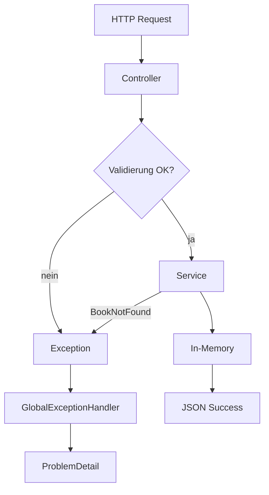

# Bean Validation und zentrale Fehlerbehandlung

Lern-Einheit: aus der funktionierenden CRUD-API eine belastbare HTTP-Schnittstelle machen — mit Jakarta Bean Validation, fachlichen Exceptions, `@RestControllerAdvice` und `ProblemDetail`.

Vorher: [03-crud-api.md](03-crud-api.md)  
Nächste Einheit: [05-jpa-h2-persistenz.md](05-jpa-h2-persistenz.md)  
Danach: automatisierte Tests  
Projektübersicht: [README](../README.md)

Im BookShop entspricht diese Einheit dem **Entwicklungsschritt 4** (Validation + ProblemDetail + ISBN).

Spring Web behandelt diese Themen über Jakarta Bean Validation, `@ExceptionHandler`, Problem Details und globales Controller Advice.

---

## Lernziele

* ungültige Requests automatisch ablehnen (`400`)
* strukturierte Fehlerantworten mit `ProblemDetail`
* `@Valid` am Controller aktivieren
* fachliche `BookNotFoundException` statt HTTP im Service
* zentrale Behandlung mit `@RestControllerAdvice`
* unterscheiden: ungültiges JSON vs. ungültige Felder vs. fehlende Ressource

---

## Inhaltsverzeichnis

1. [Ziel](#1-ziel)
2. [Validation-Starter](#2-validation-starter)
3. [Request-DTO validieren](#3-request-dto-validieren)
4. [Validierung im Controller](#4-validierung-im-controller)
5. [Eigene Not-found-Exception](#5-eigene-not-found-exception)
6. [Globale Fehlerbehandlung](#6-globale-fehlerbehandlung)
7. [`@RestControllerAdvice`](#7-restcontrolleradvice)
8. [`@ExceptionHandler`](#8-exceptionhandler)
9. [Problem Details](#9-problem-details)
10. [Validierungsfehler testen](#10-validierungsfehler-testen)
11. [Nicht vorhandenes Buch testen](#11-nicht-vorhandenes-buch-testen)
12. [Fehlerhaftes JSON](#12-fehlerhaftes-json)
13. [Drei Fehlerarten](#13-drei-fehlerarten)
14. [Optional: ID validieren](#14-optional-id-validieren)
15. [Vollständiger Controller](#15-vollständiger-controller)
16. [Architektur nach diesem Schritt](#16-architektur-nach-diesem-schritt)
17. [Lernkontrolle](#17-lernkontrolle)
18. [Praxisaufgabe: ISBN](#18-praxisaufgabe-isbn)
19. [Bezug zum BookShop](#19-bezug-zum-bookshop)

---

## 1. Ziel

Ungültige Requests automatisch ablehnen:

```json
{
  "title": "",
  "author": null
}
```

Statt eines Buchs mit unbrauchbaren Daten eine strukturierte Antwort:

```json
{
  "type": "about:blank",
  "title": "Validierungsfehler",
  "status": 400,
  "detail": "Die übermittelten Buchdaten sind ungültig.",
  "errors": {
    "title": "Der Titel darf nicht leer sein.",
    "author": "Der Autor darf nicht leer sein."
  }
}
```

Für nicht vorhandene Bücher: `404 Not Found`.

---

## 2. Validation-Starter

In der `pom.xml`:

```xml
<dependency>
    <groupId>org.springframework.boot</groupId>
    <artifactId>spring-boot-starter-validation</artifactId>
</dependency>
```

Maven lädt damit die Jakarta-Validation-API und die Implementierung.

Bei Spring Boot 3:

```java
jakarta.validation   // richtig
javax.validation     // veraltet / falsch
```

---

## 3. Request-DTO validieren

```java
package com.example.demo.book;

import jakarta.validation.constraints.NotBlank;
import jakarta.validation.constraints.Size;

public record BookRequest(

        @NotBlank(message = "Der Titel darf nicht leer sein.")
        @Size(
                max = 200,
                message = "Der Titel darf höchstens 200 Zeichen enthalten."
        )
        String title,

        @NotBlank(message = "Der Autor darf nicht leer sein.")
        @Size(
                max = 100,
                message = "Der Autor darf höchstens 100 Zeichen enthalten."
        )
        String author
) {
}
```

### `@NotBlank`

Lehnt ab: `null`, `""`, `"   "`.  
Für Texte meist besser geeignet als nur `@NotNull`.

### `@Size`

Begrenzt die Textlänge.

Wichtig: Die Annotationen **beschreiben** Regeln — die Prüfung muss am Controller mit `@Valid` aktiviert werden.

---

## 4. Validierung im Controller

```java
import jakarta.validation.Valid;
```

```java
@PostMapping
public ResponseEntity<Book> createBook(
        @Valid @RequestBody BookRequest request
) {
    Book createdBook = bookService.create(request);

    URI location = URI.create("/books/" + createdBook.id());

    return ResponseEntity
            .created(location)
            .body(createdBook);
}
```

Ebenso beim Update:

```java
@PutMapping("/{id}")
public ResponseEntity<Book> updateBook(
        @PathVariable Long id,
        @Valid @RequestBody BookRequest request
) {
    Book updatedBook = bookService.update(id, request);
    return ResponseEntity.ok(updatedBook);
}
```

### Ablauf

```text
JSON
  ↓
BookRequest erzeugen
  ↓
Validierungsregeln prüfen
  ↓
gültig?   → Controller-Methode ausführen
ungültig? → MethodArgumentNotValidException
```

Bei ungültigen Daten wird die Controller-Methode **nicht** ausgeführt.

---

## 5. Eigene Not-found-Exception

`ResponseStatusException` im Service geht für kleine Apps — eine fachliche Exception trennt Service und HTTP besser:

```java
package com.example.demo.book;

public class BookNotFoundException extends RuntimeException {

    private final Long bookId;

    public BookNotFoundException(Long bookId) {
        super("Buch mit ID " + bookId + " wurde nicht gefunden.");
        this.bookId = bookId;
    }

    public Long getBookId() {
        return bookId;
    }
}
```

Im Service:

```java
public Book findById(Long id) {
    Book book = books.get(id);

    if (book == null) {
        throw new BookNotFoundException(id);
    }

    return book;
}

public void delete(Long id) {
    Book removedBook = books.remove(id);

    if (removedBook == null) {
        throw new BookNotFoundException(id);
    }
}
```

Der Service kennt keine `HttpStatus` / `ResponseStatusException` mehr:

```text
Service:            fachlicher Fehler
Exception Handler:  fachlichen Fehler → HTTP
```

---

## 6. Globale Fehlerbehandlung

Datei z. B. `src/main/java/com/example/demo/error/GlobalExceptionHandler.java`:

```java
package com.example.demo.error;

import com.example.demo.book.BookNotFoundException;
import org.springframework.http.HttpStatus;
import org.springframework.http.ProblemDetail;
import org.springframework.http.converter.HttpMessageNotReadableException;
import org.springframework.web.bind.MethodArgumentNotValidException;
import org.springframework.web.bind.annotation.ExceptionHandler;
import org.springframework.web.bind.annotation.RestControllerAdvice;

import java.util.LinkedHashMap;
import java.util.Map;

@RestControllerAdvice
public class GlobalExceptionHandler {

    @ExceptionHandler(BookNotFoundException.class)
    public ProblemDetail handleBookNotFound(
            BookNotFoundException exception
    ) {
        ProblemDetail problem = ProblemDetail.forStatusAndDetail(
                HttpStatus.NOT_FOUND,
                exception.getMessage()
        );

        problem.setTitle("Buch nicht gefunden");
        problem.setProperty("bookId", exception.getBookId());

        return problem;
    }

    @ExceptionHandler(MethodArgumentNotValidException.class)
    public ProblemDetail handleValidation(
            MethodArgumentNotValidException exception
    ) {
        Map<String, String> errors = new LinkedHashMap<>();

        exception.getBindingResult()
                .getFieldErrors()
                .forEach(error ->
                        errors.putIfAbsent(
                                error.getField(),
                                error.getDefaultMessage()
                        )
                );

        ProblemDetail problem = ProblemDetail.forStatusAndDetail(
                HttpStatus.BAD_REQUEST,
                "Die übermittelten Buchdaten sind ungültig."
        );

        problem.setTitle("Validierungsfehler");
        problem.setProperty("errors", errors);

        return problem;
    }

    @ExceptionHandler(HttpMessageNotReadableException.class)
    public ProblemDetail handleUnreadableJson(
            HttpMessageNotReadableException exception
    ) {
        ProblemDetail problem = ProblemDetail.forStatusAndDetail(
                HttpStatus.BAD_REQUEST,
                "Der Request-Body enthält kein gültiges JSON."
        );

        problem.setTitle("Ungültiges JSON");

        return problem;
    }
}
```

(Der Handler für ungültiges JSON ist in Abschnitt 12 erklärt; hier schon im vollständigen Beispiel enthalten.)

---

## 7. `@RestControllerAdvice`

Kennzeichnet eine zentrale Komponente für Fehler aus **allen** REST-Controllern.

Ohne Advice müsste jeder Controller eigene `try/catch`-Blöcke haben — redundant, schwer wartbar, inkonsistent, schlecht testbar.

Mit `@RestControllerAdvice` liegt die Fehlerbehandlung an **einer** Stelle.

---

## 8. `@ExceptionHandler`

```java
@ExceptionHandler(BookNotFoundException.class)
```

Bedeutung:

> Wenn diese Exception während eines Controller-Aufrufs auftritt, erzeugt diese Methode die HTTP-Antwort.

```java
throw new BookNotFoundException(99L);
```

→ HTTP `404` (über den Handler).

---

## 9. Problem Details

`ProblemDetail` ist Springs Modell für standardisierte HTTP-Fehlerantworten (RFC 7807):

```java
ProblemDetail problem = ProblemDetail.forStatusAndDetail(
        HttpStatus.NOT_FOUND,
        exception.getMessage()
);
```

Grundfelder:

```json
{
  "type": "about:blank",
  "title": "Buch nicht gefunden",
  "status": 404,
  "detail": "Buch mit ID 99 wurde nicht gefunden."
}
```

Zusatzfelder:

```java
problem.setProperty("bookId", exception.getBookId());
```

---

## 10. Validierungsfehler testen

```bash
curl -i \
  -X POST \
  -H "Content-Type: application/json" \
  -d '{"title":" ","author":""}' \
  http://localhost:8080/books
```

Erwartet:

```text
HTTP/1.1 400 Bad Request
```

```json
{
  "type": "about:blank",
  "title": "Validierungsfehler",
  "status": 400,
  "detail": "Die übermittelten Buchdaten sind ungültig.",
  "errors": {
    "title": "Der Titel darf nicht leer sein.",
    "author": "Der Autor darf nicht leer sein."
  }
}
```

PowerShell:

```powershell
$body = @{
    title  = " "
    author = ""
} | ConvertTo-Json

Invoke-RestMethod `
    -Method Post `
    -Uri "http://localhost:8080/books" `
    -ContentType "application/json" `
    -Body $body
```

> **BookShop:** Schreiben mit Admin, z. B. `-u admin:admin-pass`.

---

## 11. Nicht vorhandenes Buch testen

```bash
curl -i http://localhost:8080/books/99
```

```text
HTTP/1.1 404 Not Found
```

```json
{
  "type": "about:blank",
  "title": "Buch nicht gefunden",
  "status": 404,
  "detail": "Buch mit ID 99 wurde nicht gefunden.",
  "bookId": 99
}
```

---

## 12. Fehlerhaftes JSON

Syntaktisch ungültig:

```json
{
  "title": "Spring Boot",
  "author":
}
```

Hier entsteht **keine** Validierungs-Exception — Spring kann kein `BookRequest` erzeugen → `HttpMessageNotReadableException` (siehe Handler in Abschnitt 6).

Damit unterscheidet die API:

| Fall | Ursache |
|------|---------|
| ungültiges JSON | Syntax / nicht lesbar |
| ungültige Felder | JSON ok, Constraints verletzt |
| Ressource fehlt | Request ok, Daten nicht vorhanden |

---

## 13. Drei Fehlerarten

```text
Ungültiges JSON
  → 400 Bad Request

Ungültige Felder (Titel/Autor fehlen)
  → 400 Bad Request

Ressource fehlt
  → 404 Not Found
```

Für API-Clients ist diese Unterscheidung zentral.

---

## 14. Optional: ID validieren

Auch Pfadvariablen können validiert werden:

```java
import jakarta.validation.constraints.Positive;
import org.springframework.validation.annotation.Validated;

@Validated
@RestController
@RequestMapping("/books")
public class BookController {
```

```java
@GetMapping("/{id}")
public Book getBookById(
        @PathVariable
        @Positive(message = "Die ID muss größer als 0 sein.")
        Long id
) {
    return bookService.findById(id);
}
```

Dabei können Constraint-Exceptions entstehen, die separat behandelt werden müssen. Für den Einstieg reicht die **DTO-Validierung**.

---

## 15. Vollständiger Controller

```java
package com.example.demo.book;

import jakarta.validation.Valid;
import org.springframework.http.ResponseEntity;
import org.springframework.web.bind.annotation.DeleteMapping;
import org.springframework.web.bind.annotation.GetMapping;
import org.springframework.web.bind.annotation.PathVariable;
import org.springframework.web.bind.annotation.PostMapping;
import org.springframework.web.bind.annotation.PutMapping;
import org.springframework.web.bind.annotation.RequestBody;
import org.springframework.web.bind.annotation.RequestMapping;
import org.springframework.web.bind.annotation.RestController;

import java.net.URI;
import java.util.List;

@RestController
@RequestMapping("/books")
public class BookController {

    private final BookService bookService;

    public BookController(BookService bookService) {
        this.bookService = bookService;
    }

    @GetMapping
    public List<Book> getAllBooks() {
        return bookService.findAll();
    }

    @GetMapping("/{id}")
    public Book getBookById(@PathVariable Long id) {
        return bookService.findById(id);
    }

    @PostMapping
    public ResponseEntity<Book> createBook(
            @Valid @RequestBody BookRequest request
    ) {
        Book createdBook = bookService.create(request);

        URI location = URI.create("/books/" + createdBook.id());

        return ResponseEntity
                .created(location)
                .body(createdBook);
    }

    @PutMapping("/{id}")
    public ResponseEntity<Book> updateBook(
            @PathVariable Long id,
            @Valid @RequestBody BookRequest request
    ) {
        Book updatedBook = bookService.update(id, request);
        return ResponseEntity.ok(updatedBook);
    }

    @DeleteMapping("/{id}")
    public ResponseEntity<Void> deleteBook(@PathVariable Long id) {
        bookService.delete(id);
        return ResponseEntity.noContent().build();
    }
}
```

---

## 16. Architektur nach diesem Schritt

```text
book/
  Book.java
  BookRequest.java
  BookController.java
  BookService.java
  BookNotFoundException.java

error/
  GlobalExceptionHandler.java
```

Erfolgspfad:

```text
HTTP Request
  → Controller
  → Validierung
  → Service
  → In-Memory-Speicher
```

Fehlerpfad:

```text
Exception
  → GlobalExceptionHandler
  → ProblemDetail
  → HTTP-Fehlerantwort
```



---

## 17. Lernkontrolle

| Frage | Kurzantwort |
|-------|-------------|
| Warum `@Valid` am Controller-Parameter? | Sonst werden die Constraints im DTO für diesen Request nicht ausgewertet. |
| Warum eigene Exception im Service? | Damit der Service keine HTTP-Details kennen muss. |
| Was macht `@RestControllerAdvice`? | Behandelt Exceptions zentral für REST-Controller. |
| Unterschied `400` vs. `404`? | `400` = Request ungültig; `404` = Request ok, Ressource fehlt. |
| Warum `ProblemDetail`? | Einheitliche, maschinenlesbare, standardnahe Fehlerantworten. |

---

## 18. Praxisaufgabe: ISBN

`BookRequest` um ISBN erweitern:

```java
@NotBlank(message = "Die ISBN darf nicht leer sein.")
@Pattern(
    regexp = "^[0-9-]{10,17}$",
    message = "Die ISBN hat kein gültiges Format."
)
String isbn
```

Entsprechend Domänenobjekt, Service und Responses anpassen.

### Nächster Schritt in der Lernroute

`ConcurrentHashMap` ersetzen durch **H2 (oder MySQL) + Spring Data JPA** — siehe [05-jpa-h2-persistenz.md](05-jpa-h2-persistenz.md):

* `@Entity`
* `JpaRepository`
* Datenbankkonfiguration
* persistente CRUD-Operationen

Im BookShop: Entwicklungsschritt 5 — siehe [01-spring-boot-grundlagen.md](01-spring-boot-grundlagen.md) und [README](../README.md).

---

## 19. Bezug zum BookShop

| Thema dieser Einheit | Im BookShop |
|----------------------|-------------|
| Validation-Starter | `spring-boot-starter-validation` in `pom.xml` |
| `@Valid` + Constraints | `BookRequest`, `AuthorRequest` |
| ISBN | `@NotBlank` + `@Pattern` auf `isbn` |
| Fachliche Exceptions | `BookNotFoundException`, `AuthorNotFoundException`, `DuplicateIsbnException` |
| Zentraler Handler | `error/GlobalExceptionHandler.java` |
| `ProblemDetail` | 400 / 404 / 409 mit `errors`, `bookId`, … |
| Ungültiges JSON | `HttpMessageNotReadableException`-Handler |

Diese Datei hält die **Lehrversion** fest; der laufende Code ist die fortgeschrittene Variante (inkl. Autoren, ISBN-Konflikt `409`, Security).
